# Guía de encuentros del acto I (v4, sustituida)

> Esta guía describe las poblaciones de la v4. La sustituye el catálogo v2 (`catalogo-salas.html`); las capturas de la ROM de la v2 están en `assets/guia_v2/`.

Cada encuentro combina una **planta** (la sala: piezas, coberturas y obstáculos) con una **población** (los enemigos) de tres dificultades: **ligera** en los encuentros 1-4, **media** en el 5-8 y **dura** en el 9-12. Cada partida elige 12 de las 18 combinaciones: ninguna planta dos veces seguidas, como mucho 2 veces por acto, y a veces en espejo.

Capturas de la ROM real (variante `encuentros`, sin espejo):
- **A:** el héroe acaba de cruzar el borde de abajo y el encuentro despierta.
- **B:** 3 segundos después.
- **C:** si la población tiene segunda oleada, cuando entra.

La línea granate de arriba es la barrera; los rectángulos pardos y grises, los sacos y el alambre provisionales.

**Desvío conocido:** los enemigos «ya despiertos» (balcón media y dura, todo el claro) echan a andar en cuanto aparecen, con el héroe todavía en el pasillo, en lugar de esperar a que despierte el encuentro. Por eso en la captura A ya están en marcha. Está pendiente de corregir.

**Común a todas:** Exvoto 2 disparos, Ojo y Cireneo 3, Monaguillo 1, Abanderado unos 33. Los enemigos dormidos o rezando no reciben daño hasta que el encuentro despierta. La barrera se abre al morir el último. Después viene un pasillo con su relicario a un lado.

## La procesión

Dos filas de bancos y un pasillo central. Los Exvotos rezan en fila en el centro; al despertar uno, despierta la fila entera y bajan por el pasillo. Enseña a retroceder disparando: cada Exvoto pide dos disparos y los bancos los alinean para el rayo.

**Ligera.** 4 Exvotos rezando en fila. Basta con retroceder y disparar por el pasillo.

| A · despierta | B · +3 s |
| :---: | :---: |
|  | 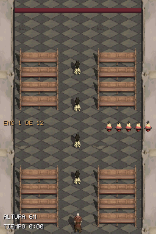 |

**Media.** 6 Exvotos rezando en fila y un Cireneo dormido arriba. El Cireneo carga por el pasillo mientras la fila baja: hay que apartarse a un lado de los bancos.

| A · despierta | B · +3 s |
| :---: | :---: |
| 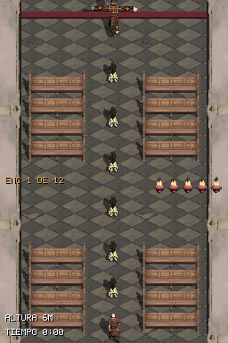 | 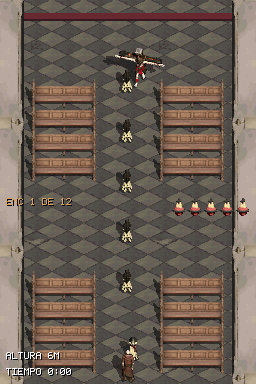 |

**Dura.** 5 Exvotos en fila y 2 más a los lados de los bancos, y 2 Ojos arriba a los lados. Segunda oleada: 3 Exvotos por arriba. Los Ojos cubren el pasillo central y obligan a moverse mientras la fila baja.

| A · despierta | B · +3 s | C · 2ª oleada |
| :---: | :---: | :---: |
| 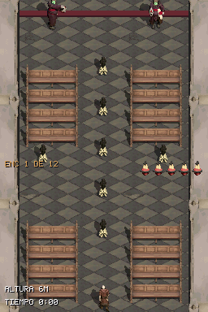 | 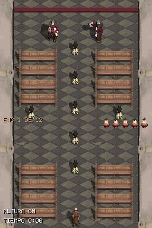 | 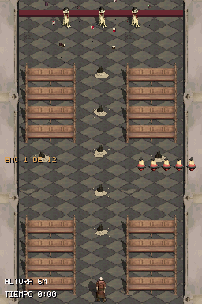 |

## El embudo

Sacos que cierran casi todo el ancho, con un solo paso a la derecha. Los enemigos tienen que pasar por el hueco. Enseña a leer la carga del Cireneo y a estrellarlo contra los sacos.

**Ligera.** 4 Exvotos rezando repartidos arriba. Se cuelan de uno en uno por el paso.

| A · despierta | B · +3 s |
| :---: | :---: |
| 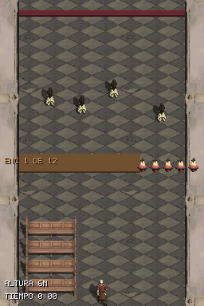 | 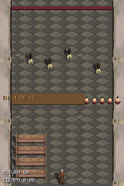 |

**Media.** 1 Cireneo dormido, 3 Exvotos rezando y 1 Ojo arriba. El Ojo mira el paso mientras el Cireneo carga.

| A · despierta | B · +3 s |
| :---: | :---: |
| 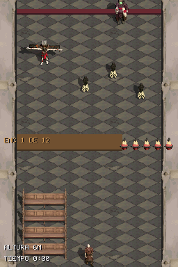 | 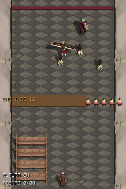 |

**Dura.** 2 Cireneos, 4 Exvotos rezando y 2 Ojos. Dos cargas y dos miradas sobre un único paso: es la sala más táctica del acto.

| A · despierta | B · +3 s |
| :---: | :---: |
| 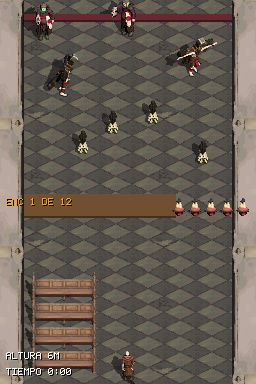 | 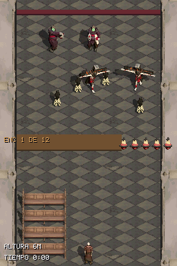 |

## El balcón

Dos columnas arriba y dos estatuas abajo. Las columnas y las estatuas paran todos los disparos. Enseña a mirar arriba y a cubrirse del Ojo.

**Ligera.** 4 Exvotos rezando junto a las columnas. Es la sala de bienvenida: se ven las coberturas sin presión.

| A · despierta | B · +3 s |
| :---: | :---: |
|  | 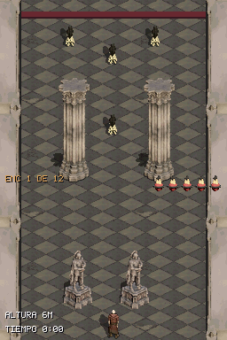 |

**Media.** 1 Ojo dormido en el centro y 4 Exvotos ya despiertos que bajan hacia el héroe. Hay que usar las estatuas contra el Ojo mientras llegan los Exvotos.

| A · despierta | B · +3 s |
| :---: | :---: |
| 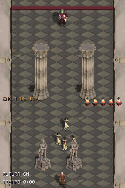 | 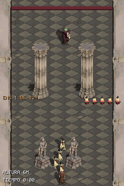 |

**Dura.** 2 Ojos, 1 Cireneo y 4 Exvotos despiertos. Segunda oleada: 3 Exvotos por arriba. Fuego cruzado desde el balcón.

| A · despierta | B · +3 s | C · 2ª oleada |
| :---: | :---: | :---: |
| 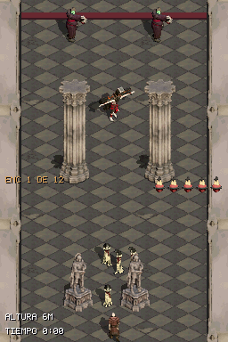 | 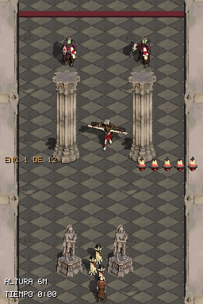 | 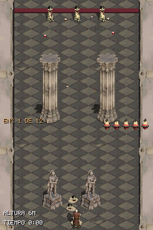 |

## La pinza

Bancos arriba, estatuas a media altura en los laterales y el centro abierto. Los Exvotos rezan en los dos laterales de abajo, justo por donde entras. Enseña a no meterse en medio de dos frentes.

**Ligera.** 4 Exvotos rezando, 2 a cada lado de la entrada. Al despertar llegan por los dos lados a la vez.

| A · despierta | B · +3 s |
| :---: | :---: |
| 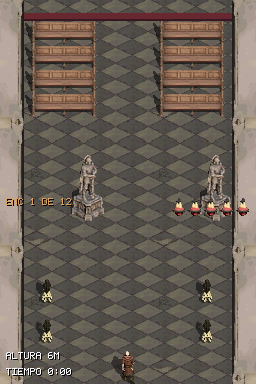 | 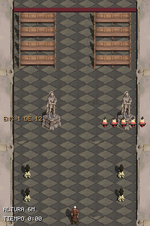 |

**Media.** 6 Exvotos en los laterales, 1 Cireneo dormido y 1 Ojo arriba en el centro. Mientras te cierran por los lados, el Cireneo y el Ojo bajan por el centro.

| A · despierta | B · +3 s |
| :---: | :---: |
| 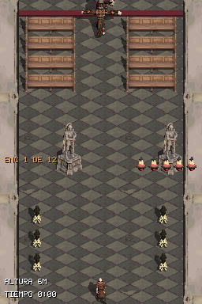 | 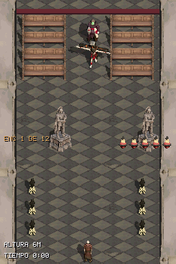 |

**Dura.** 8 Exvotos en los laterales y 1 Ojo. Segunda oleada: 2 Exvotos y 1 Cireneo por arriba. La pinza más cerrada.

| A · despierta | B · +3 s | C · 2ª oleada |
| :---: | :---: | :---: |
| 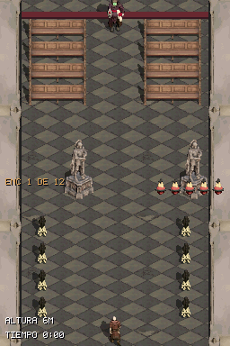 | 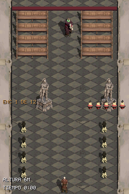 | 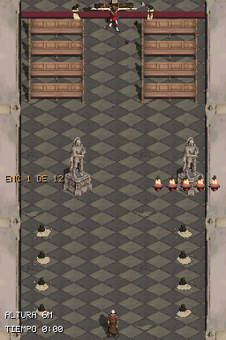 |

## El claro

Sin bancos: estatuas en las esquinas de arriba y velas. Es una arena abierta para la multitud. Los Exvotos ya están despiertos y vienen en masa.

**Ligera.** 6 Exvotos despiertos. Es la primera vez que viene una masa: hay que encadenar disparos y retroceder.

| A · despierta | B · +3 s |
| :---: | :---: |
| 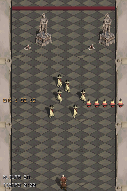 | 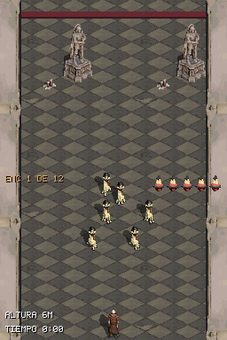 |

**Media.** 8 Exvotos despiertos. Segunda oleada: 3 Exvotos más.

| A · despierta | B · +3 s | C · 2ª oleada |
| :---: | :---: | :---: |
| 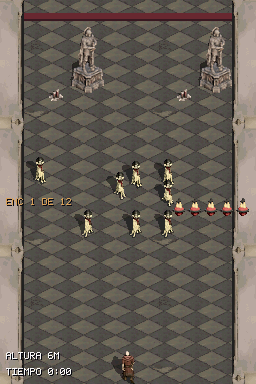 | 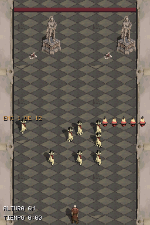 | 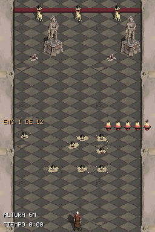 |

**Dura.** 8 Exvotos despiertos, 2 Cireneos y 1 Ojo, sin segunda oleada. Es el encuentro donde muere el jugador sin mejoras.

| A · despierta | B · +3 s |
| :---: | :---: |
| 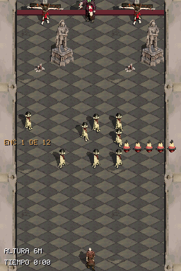 | 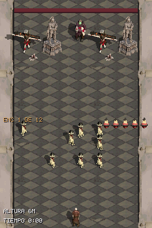 |

## La alambrada

Dos tramos de alambre de espino que cruzan la nave en zigzag y una columna arriba. El alambre frena los cuerpos pero deja pasar los disparos: los enemigos tienen que rodearlo mientras tú disparas a través.

**Ligera.** 4 Exvotos rezando: 3 al fondo, detrás de los dos alambres, y 1 entre ambos, a la derecha.

| A · despierta | B · +3 s |
| :---: | :---: |
|  | 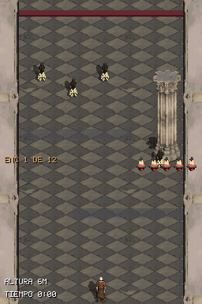 |

**Media.** 4 Exvotos rezando y 1 Ojo arriba a la derecha, junto a la columna.

| A · despierta | B · +3 s |
| :---: | :---: |
| 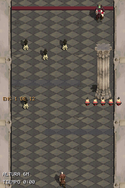 | 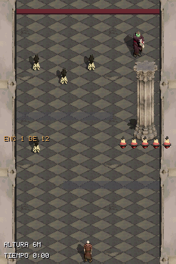 |

**Dura.** 6 Exvotos rezando, 2 Ojos y 1 Cireneo. Segunda oleada: 3 Exvotos. El Cireneo rodea el alambre mientras los Ojos te fijan.

| A · despierta | B · +3 s | C · 2ª oleada |
| :---: | :---: | :---: |
| 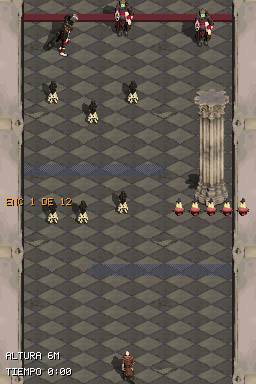 | 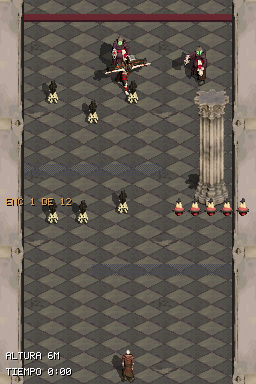 | 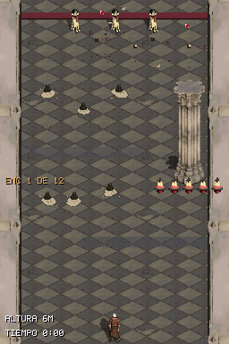 |

## Jefe

Pantalla con barrera y el Abanderado. Invoca Monaguillos que caen de un disparo; el rayo sigue con el daño sobrante hasta el jefe. Con las mejoras del acto, el bot lo mata en unos 14 s.
