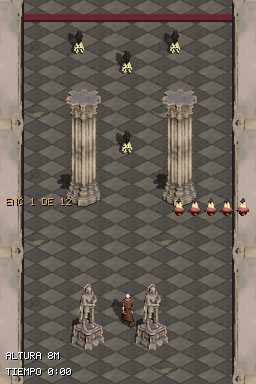
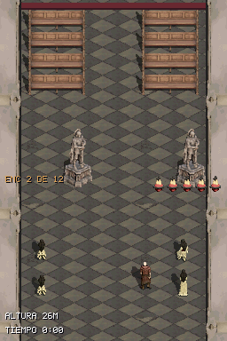
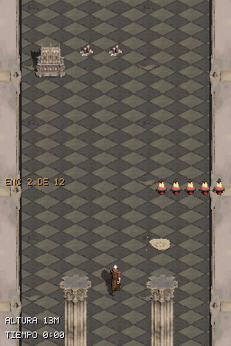
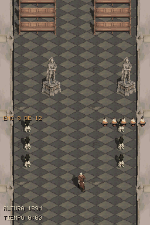
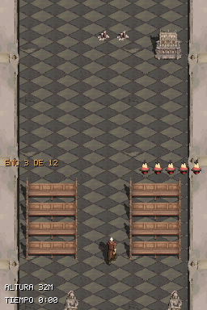
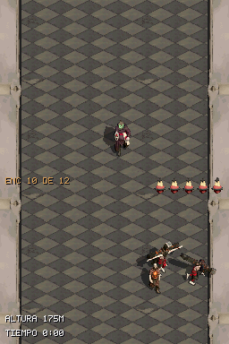
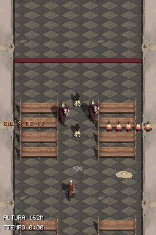
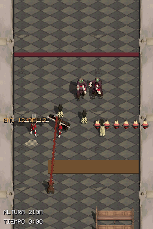
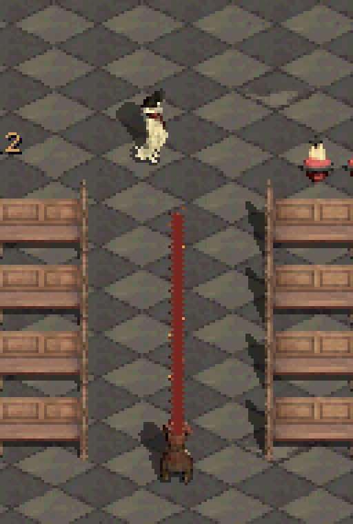
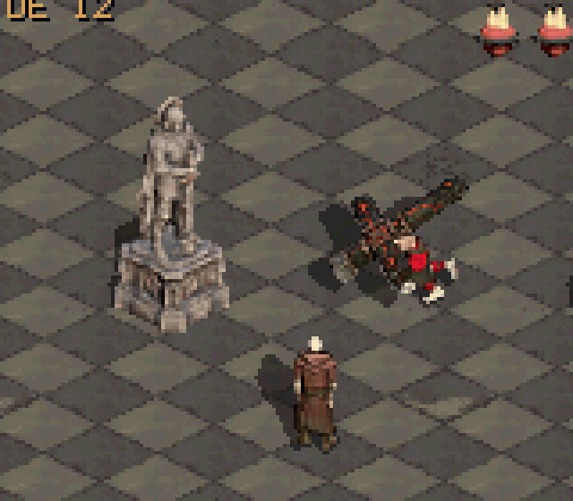

# Acto I por encuentros: prototipo jugable y cuatro vueltas de bot

Rama `feat/encuentros-acto1` (2026-11-16/17). Diseño en `DESIGN.md` §6.13.6. Variantes de build: `encuentros` (para jugar) y `encuentros-bot` (autopiloto que juega solo para medir).

## Qué se ha hecho

- **Prototipo del acto I:** catedral de 256 de ancho, 12 encuentros hechos a mano (6 plantas × 3 poblaciones: ligera, media y dura, por tercios), pasillo con relicario entre encuentros, barrera que se abre al limpiar y Abanderado al final con «VICTORIA». Sin horda, marea ni gemas. Placeholders apagados para sacos, alambre y barrera (pendientes de 3D).
- **Reglas nuevas en la variante:**
  - El rayo sigue solo con el daño sobrante.
  - Los enemigos tienen la vida de la tabla de §6.13.6.
  - Un enemigo dormido o rezando no recibe daño; el rayo lo atraviesa.
  - Columnas y estatuas paran todos los disparos (rama `fix/cobertura-estatuas`, ya copiada aquí).
- **Bot dentro de la ROM:** esquiva Ojo y Cireneo, guarda distancia, dispara cargando y rompe relicarios. Tiene reacción, error de puntería y retraso ante el Ojo configurables, y elige Dones al azar con semilla.

| Ligera (balcón) | Media (pinza) | Pasillo y relicario |
| :---: | :---: | :---: |
|  |  |  |

## Vueltas

**V1, primer bot.**
- Acto de 370 s.
- Sin mejoras muere en el encuentro 10; con 10 Dones de salida es trivial.
- Fallos encontrados:
  - **francotirador:** el bot vaciaba encuentros disparando a los Exvotos rezando desde el pasillo. Se arregló con la regla de inmunidad del dormido, escrita en §6.13.6;
  - el relicario salía siempre en el centro;
  - el bot se atascaba en alambre y sacos;
  - el bot esquivaba de forma perfecta (0 golpes). Tablas en `assets/v1_tablas.md`.

**V2, bot humano y relicario lateral.**
- Reacción de 15 frames, ±6 px de puntería y 20 frames antes de reaccionar al Ojo.
- Relicario a un lado, alternando: nuevas fases en el kit, 955/1024 tiles y peor ventana 389.
- El bot rompe 12/12 relicarios.
- Se ajustó la inmunidad: los enemigos que la planta crea ya despiertos sí reciben daño. Si no, persiguen invulnerables por el pasillo.
- Hallazgo grave: **sin Dones, el jefe no muere.** Tablas en `assets/v2_tablas.md`.

| Relicario a la izquierda | Relicario a la derecha | Claro duro, antes del golpe |
| :---: | :---: | :---: |
|  |  |  |

**V3, el escudo de Monaguillos.**
- Diagnóstico con cifras: de 84 disparos, 12 impactos al jefe y 94 a Monaguillos. Cada Monaguillo, a 250 de vida, pedía 2 disparos y paraba el rayo.
- Arreglo: el Monaguillo invocado tiene 100 de vida, cae de un disparo y el rayo sigue con 50. Sin Dones, el jefe muere en 62 s.
- Bot torpe (30 frames de reacción, ±12 px, 40 frames ante el Ojo, 25 % de cargas sin esquivar): sin mejoras muere en el encuentro 10 con 7 golpes. Con Dones recibe 0 golpes, igual que el bot normal.
- Tablas en `assets/v3_tablas.md`.

**V4, más presión.**
- Segundo Ojo en tres encuentros duros, Ojo en dos medios y Cireneo en la segunda oleada de la pinza dura.
- El claro, más corto: 50 s sin mejoras.
- Abanderado a 5000 de vida.
- Resultado: el torpe sin mejoras muere antes, en el encuentro 9. Con Dones sigue con 0 golpes, encuentros duros de 8-15 s y jefe de 14 s.
- Tablas en `assets/v4_tablas.md`.

| Procesión dura con 2 Ojos | Embudo duro con 2 Ojos |
| :---: | :---: |
|  |  |

## Cifras finales (V4)

| Corrida | Resultado | Golpes | Duración |
| --- | --- | --- | --- |
| natural (Dones de relicarios) | victoria | 0 | 352 s |
| natural, bot torpe | victoria | 0 | 350 s |
| sin mejoras, bot torpe | muere en el encuentro 9 | 6 | 290 s |
| fuerte (10 Dones de salida) | victoria | 0 | 226 s |

## Prueba del usuario en la DS (v4) y v2 del catálogo

**El usuario lo jugó en la DS y le pareció trivial:**
- Los Exvotos rezando solo despertaban a 96 px, así que se mataban desde lejos.
- El Cireneo se esquivaba con un paso.
- Había pocos enemigos y el jefe era muy fácil.
- El alambre casi no se veía.

**Decisiones** (en `DESIGN.md` §6.13.6, «Tras la primera prueba en la DS»):
- Todos los enemigos presentes desde el principio y despiertos a la vez.
- Más listos en vez de esponjas de balas.
- Un Exvoto que esquiva el rayo y un Cireneo que persigue y embiste.
- Salas rediseñadas como catálogo, donde cada sala hace una pregunta y sus tres poblaciones la endurecen: [`catalogo-salas.html`](catalogo-salas.html), generado por `tools/encuentros/catalogo_v2.py`.

**V5 (implementación del catálogo):**
- Exvoto que esquiva la línea de apuntado y anda en zigzag.
- Cireneo perseguidor que queda aturdido al chocar con banco, saco, alambre o estatua (escenario `encuentros_v2_stuns`).
- Jefe con escolta de 2 Ojos y 1 Cireneo que reentran por arriba, con 5500 de vida.
- Alambre opaco.

| Exvoto esquivando el rayo | Cireneo contra la estatua |
| :---: | :---: |
|  |  |

**Bot V5 con reacción humana:**
- Con mejoras gana con 7 golpes, una vida mínima de 3 y el jefe en 43 s; el acto dura 464 s.
- El torpe con mejoras muere en el encuentro 11.
- Sin mejoras muere en el 6.
- Tablas en `artifacts/v2/tablas.md` (sin versionar).

**Segunda prueba en la DS (2026-11-17):**
- Mejor encaminado.
- Problemas abiertos apuntados en `STATUS.md`: mejora al arrancar, salas sin simetría, sin lápidas, muros gruesos, rarezas de la IA del Exvoto, quedarse quieto como estrategia óptima y una partida corta.

## Lo que el bot certifica y lo que no

- **Certifica:**
  - el acto dura lo previsto (~6 min);
  - los encuentros duran 8-17 s con progresión;
  - la curva por tiers existe, porque sin mejoras se muere en la parte dura;
  - el jefe ya no es inmortal;
  - el bot rompe todos los relicarios.
- **No certifica la dificultad con progresión:** el bot esquiva con información exacta y, en cuanto tiene Dones, no le tocan. La dificultad real con los Dones del acto solo se sabe jugando en la DS.
- **Señal de diseño:** con progresión, los encuentros duros duran la mitad que sin ella (8-15 s frente a 26-50 s). Los 12 Dones del acto doblan de sobra la potencia. Si la partida real se siente fácil, la palanca es la curva de Dones (menos potencia por Don, o un Don cada dos relicarios), no más enemigos.

## Guía

Catálogo v2 vigente: [`catalogo-salas.html`](catalogo-salas.html) (esquemas), con su captura de la ROM por sala y dificultad en `assets/guia_v2/<planta>_<tier>_a.png`. La guía de la v4 queda como historial en [`guia.md`](guia.md). Las capturas salen del escenario `encuentros_guia.json`, que fuerza planta y tier desde `g_enc_debug`.

## Pendiente

- Los enemigos «ya despiertos» (balcón media y dura, claro) echan a andar al aparecer, con el héroe aún en el pasillo, en vez de esperar al despertar del encuentro. Es un desvío del brief.

- Jugarlo en la DS (variante `encuentros`) y medir rendimiento con `PERF_PROFILE` antes de mergear.
- Arte 3D de sacos, alambre y barrera (el usuario).
- El HUD de tiempo marca 0:00 en esta variante.
- Desviaciones de fase de 6-32 px en algunas piezas.
- Commits: nada commiteado.
