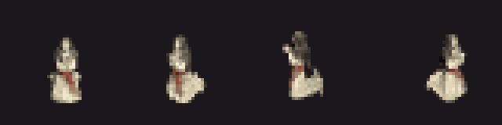
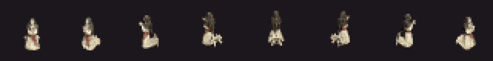
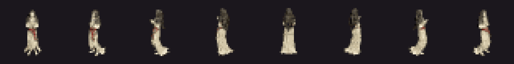
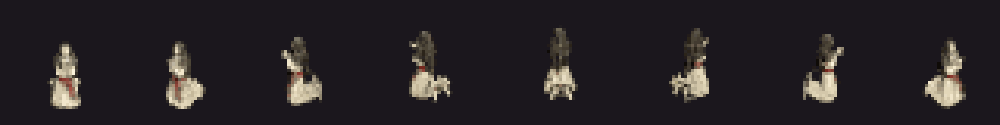
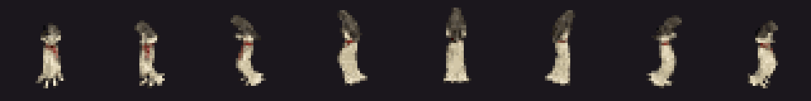

# Animaciones del Exvoto (2026-11-14, rama `feat/exvoto-anim`)

Monja de cera de Tripo (velo negro, faja roja, rosario) para la masa de enemigos. Decisión en `DESIGN.md` §6.10 («Aspecto y animaciones» y «Comportamiento en oración»): rezan quietos, de pie o de rodillas, junto al atrezo devoto; al acercarse el héroe despiertan, los arrodillados se levantan y todos avanzan rezando.

## Resultado a escala de juego

Sprites del lab (celda de 40 px, luz `neutral`, sin contorno), 8 direcciones, 4x, a velocidad real (60 ms por frame de GIF):

**Despertar** (rezo de rodillas ×2 → levantarse → andar rezando ×3; direcciones S, SO, O y SE)

**Rezar de rodillas** · **Rezar de pie** · **Levantarse** · **Andar rezando**

Hojas de contacto en Blender (frente, perfil y planta): `assets/sheet_{pray_stand,pray_kneel,stand_up,walk}.png`. Del lab se guardan `spritesheet.png` y `settings.json` en `assets/lab_<clip>/`.

## Cómo se hace

- **Fuentes:** modelo en `assets/models/characters/exvoto/source/`. Clips de Mixamo elegidos del inbox en `assets/models/animations/pray/`: `pray_standing` (rezo de pie), `pray_kneeling` (rezo de rodillas) y `pray_kneel_to_stand` (reza de rodillas y se levanta). Se descartaron `Praying (2)` (de pie a arrodillarse, el gesto contrario) y `Male Crouch Pose` (pose fija).
- **Script:** `tools/characters/build_exvoto.py`. Transfiere rotaciones en espacio de mundo del Y-bot al Exvoto y escala la cadera por la relación de alturas (0,52).
  - **Andar rezando:** piernas del andar genérico (`walk/walk_normal.fbx`) con la cadera en el sitio, zancada ×0,8 y ciclo más lento (45 frames). Brazos fijos en la pose de `pray_standing`. Espalda encorvada 3×7° y cabeza baja 2×12°.
  - **Levantarse:** tramo f138-207 del clip de Mixamo. Empieza fundido con el rezo de rodillas y acaba en el primer frame del andar, así que encadena sin salto. En el tramo central apoya las manos en los muslos (así es el clip).
  - Ajustes al principio del script: `WALK_*` y `STAND_UP_START`.
- **Comando:** `"C:/Program Files/Blender Foundation/Blender 5.2/blender.exe" -b -P tools/characters/build_exvoto.py -- <ruta del worktree en formato Windows>` (~9 s). Los FBX `exvoto_*.fbx` no se versionan.
- **Lab:** `node tools/lab/export_character_headless.cjs <fbx> <out> --template assets/sprites/characters/skeleton/settings.json --outline none --fitZoom <z>`, con `z` por clip:

| Clip | fitZoom | Alto en pantalla |
|---|---|---|
| `walk` | 0,86 | 26-30 px (encorvada) |
| `pray_stand` | 0,7727 | 29-30 px |
| `stand_up` | 0,9154 | 22 → 31 px |
| `pray_kneel` | 0,6649 | 22-25 px |

## Corrección durante la sesión

El lab encuadra cada clip según lo que ocupa en todo el clip, así que al principio la monja de rodillas salía un 38 % más grande que la de pie y crecía y encogía al levantarse. Se midió en Blender lo que ocupa cada clip proyectado en las 8 direcciones y se compensó con `fitZoom` (base 0,86, igual que el héroe). Comprobado en los sprites: el rezo de rodillas y el primer frame de levantarse miden lo mismo (22-25 px).

## Pendiente

- **Lectura a 40 px:** se lee la silueta (velo oscuro arriba, faja roja, hábito claro) y la diferencia entre de rodillas, de pie y andando. Las manos juntas no se distinguen. El velo negro se funde con el suelo oscuro; quizá necesite contorno o un brillo en el velo.
- **Tamaño:** de pie mide unos 30 px frente a los 32-33 del héroe; se ajusta con `fitZoom` si se quiere igual.
- **Integración en el juego (sin hacer):** sustituir al esqueleto, estado «en oración» con despertar por cercanía, colocación junto al atrezo, muerte derritiéndose y ataque. Radio de despertar y despertar en grupo están por decidir (`DESIGN.md`).
- No hay medición en DS: esta sesión solo genera assets.
