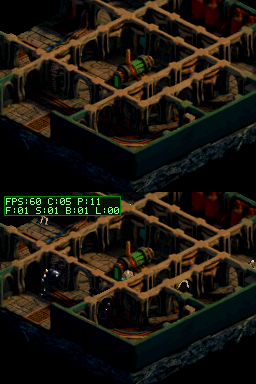
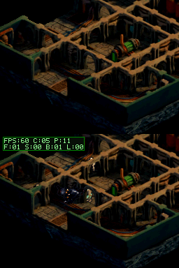
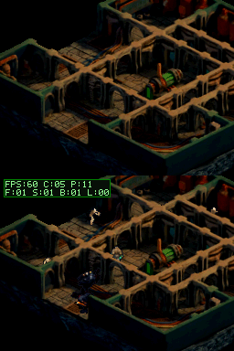

# Pruebas de límites del fondo FBX

## Objetivo

Convertir en pruebas reproducibles los límites detectados al revisar la caché de tiles: atlas mayores que la capacidad residente de VRAM, el ID centinela y paletas con pocos colores.

## Pruebas ejecutadas

- `python -m unittest tests.test_fbx_bg_generator tests.test_floor_copy_contract tests.test_scenario_state_assertions`: 7 pruebas PASS.
- `scripts/run-host-tests.ps1`: suite del proyecto PASS, 20 tests entre cinco comandos.
- La prueba de integración genera en un directorio temporal un mundo sintético de 768×768 píxeles, 96×96 celdas y 9.216 tiles únicos. Comprueba atlas/mapa generados y que el atlas supera los 1.024 slots residentes.
- Un fixture 2048×2048 genera exactamente 65.536 tiles únicos y verifica que el generador los rechaza antes de escribir el header: `0xFFFF` queda reservado por `BG_TILE_INVALID`, así que el máximo utilizable es 65.535.
- El escenario `scenarios/fbx_bg_ring_scroll.json` pasa en la ROM CRC `65BC36B1` (5 capturas, 16 eventos): `cam_x` 122→76 e `cam_y` 170→150; también verifica pulsación y liberación de ambos botones.
- Regeneración temporal con el mundo actual: 1.007 tiles, mapa 64×64, 72.640 bytes estáticos. SHA-256 del C generado idéntico al archivo versionado.
- La primera ejecución encontró un fallo con paletas escasas: Pillow devuelve una tabla menor a 255 entradas. El generador ahora completa las entradas no usadas a cero antes de formar la paleta; el fixture de estrés usa solo dos colores y cubre ese caso.

## Capturas del escenario

## Evidencia en consola

La ROM sincronizada con VBlank (CRC DeSmuME `65BC36B1`, SHA-256 `0970E9163B8FF432DAB09F8AD3B4AF6DE78D90F1D8A364103639859D2411F5F4`) se subió y verificó por readback. El usuario informa que la DSi va perfecta. No hay una lectura numérica nueva de FPS/HUD, así que queda como confirmación cualitativa. La regeneración actual produjo exactamente el mismo asset C, por lo que estos cambios del generador no cambian el contenido de esa ROM.

## Pendientes

- El escenario ejercita scroll X/Y y liberación de input, pero no puede forzar una vuelta completa del ring de 512×256 con el mapa actual. Falta construir una ROM completa de una mazmorra mayor y verificar en DeSmuME/DSi la residencia de tiles y el margen de transferencia en VBlank.
- `ds-game-dev` ahora indica que DeSmuME no certifica rendimiento físico y pide una prueba en hardware con ROM identificada, workload repetible y contadores separados.
- No se repitió la build: el C generado para el mapa real es idéntico. El escenario de scroll sí se ejecutó contra la ROM CRC `65BC36B1`.