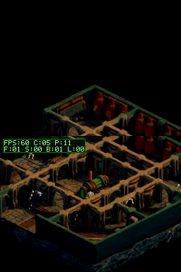
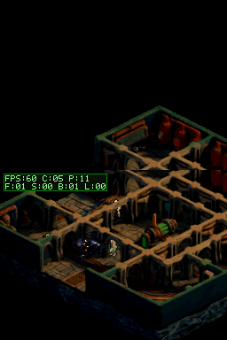
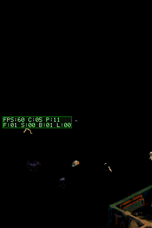

# Perfilado de tres rutas para el suelo FBX

## Objetivo

Reducir el coste de `F` sin atar el renderer al bake actual de 512×512. El generador lee `WORLD_W` y `WORLD_H`; la carga de tiles a VRAM se limita a un área móvil de 512×256 px y el resto del atlas/mapa queda como datos estáticos.

## Comparación

| Ruta | Medición intermedia | Resultado y límite |
| --- | --- | --- |
| BG bitmap 8bpp completo | Build experimental DeSmuME, 240 frames: CPU medio 4.99 ms, máximo 5.86 ms; `F` 1.53 ms; 240/240 a 60 FPS. La imagen completa ocupa 256 KiB de VRAM. | El experimento muestra el bitmap solo abajo; A+B lo ocupan, C queda para actores y no queda bank Sub BG. No escala como bitmap completo más allá de 512×512 y no mejora este perfil frente al ring map. |
| BG tileado con ring map | DeSmuME intérprete, 240 frames: CPU medio 4.89 ms, máximo 5.91 ms; `F` 1.49 ms, `S` 0.82 ms, blits 1.32 ms; 239/240 frames a 60 FPS. Escenario de paseo PASS. | El coste de CPU ya no recorre ni copia el bitmap del mundo por frame; el trabajo depende de las celdas visibles y las filas/columnas que entran al viewport. |
| Pantalla superior a 30 Hz | DeSmuME intérprete, 240 frames: CPU medio 5.48 ms, máximo 6.44 ms; `F` 2.91 ms; 240/240 a 60 FPS. | Mantiene la simulación a 60 Hz, pero deja el fondo superior visualmente a 30 Hz y rindió peor que el ring map en este benchmark. |

La referencia física aportada por el usuario sigue siendo `20 FPS` con `F≈38 ms`; DeSmuME es una comparación interna y no valida la DSi. La ruta 1 es un cálculo de VRAM, no una medición de ROM.

## Generalidad

El generador ya no exige que el atlas entero quepa en los 128 KiB de una bank VRAM: la tabla estática puede crecer hasta el límite de IDs de 16 bits. El cache de VRAM conserva las piezas visibles y cambia las celdas al desplazar cámara. El mapa hardware sigue siendo 64×32, pero solo residen las 33×25 celdas necesarias para cubrir pantalla de 256×192 y scroll subpíxel: máximo 825 tiles visibles, frente a 2.048 celdas del ring anterior. El límite de tiles del atlas sigue siendo 65.535; el consumo de cache no aumenta con el tamaño total de la mazmorra.

### Estrés de atlas mayor

El generador FBX se ejecutó con una fixture 768×768 (tres veces el área actual), 96×96 celdas y 9.217 tiles únicos. Generó correctamente atlas de 589.888 B más mapa de 18.432 B, superando 1.024 tiles sin depender de que todos residan en VRAM a la vez. Es una validación del generador y del límite de atlas; no es una ROM 768×768 ni un perfil de DSi. Evidencia: `assets/large-world-generator.txt`.

## Validación visual

La pantalla superior sigue la misma cámara de suelo que la inferior y muestra el bake sin actores; la inferior conserva actores, sombras y HUD. Esto evita el vacío de mapa que se veía al desplazar la cámara superior una pantalla entera hacia arriba en el spawn. El escenario genera tres capturas y conserva el movimiento:

## Archivos de perfil

- `assets/option1-profile.txt`
- `assets/option2-profile.txt`
- `assets/option3-profile.txt`

- ROM de la ruta tileada: CRC `3A428D6C`.
- Refinamiento genérico del ring: DeSmuME intérprete, 240/240 a 60 FPS; CPU medio 4,919 ms, máximo 5,880 ms; `F=1,508 ms`, `S=0,818 ms`, `B=1,318 ms`. Escenario de paseo PASS.
- ROM final CRC DeSmuME `9CA76D62`, SHA-256 `99A42DF4891390462F4F5B0C45BEB5AED68827DE46F8D1E105471CE6140A7173`. DeSmuME mantiene un perfil casi igual al ring anterior y no resuelve la discrepancia física; la validación DSi sigue pendiente.
- La transferencia autorizada después respondió `FTP_UPLOAD_RESULT=PASS` y el listado remoto confirmó `dungeonds.nds`; tamaño transferido 1,85 MiB. Una descarga para comparar SHA-256 agotó conexión a los 8 s y el siguiente listado también; el byte a byte remoto sigue sin verificar.
- La lectura física del HUD en DSi queda pendiente; la ROM ya aparece en la carpeta remota.
- Perfil/capturas del refinamiento: `assets/final-profile.txt`, `assets/final-spawn.png`, `assets/final-walk.png`, `assets/large-world-generator.txt`.
