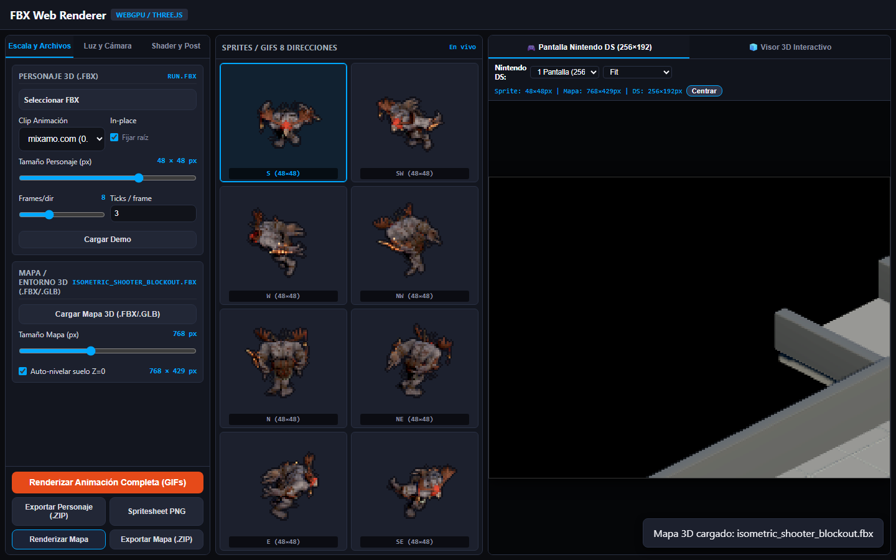
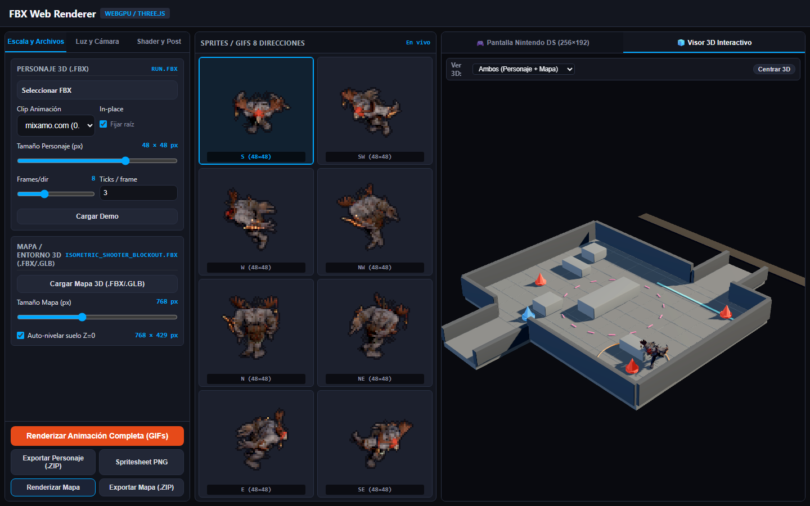
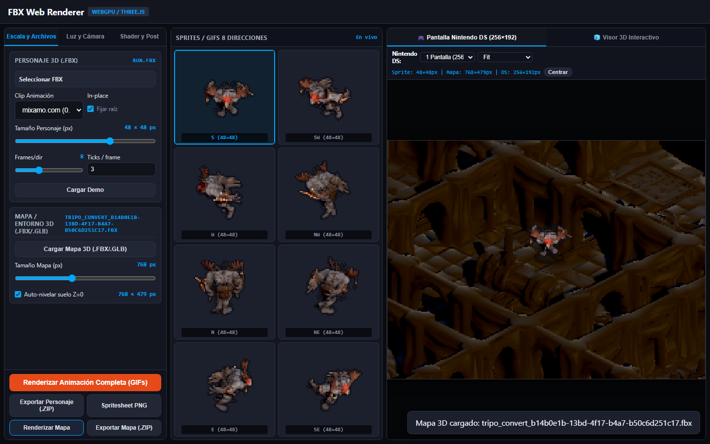

# Sesión 60: Refinamiento Integral a 3 Columnas del FBX-to-Sprite Lab, Carga Multi-Material FBX/GLB, Auto-Framing Ortográfico, Nivelación por Histograma y Anclaje 3D

## Resumen Ejecutivo

En esta sesión se refinó en profundidad el laboratorio web offline (`tools/lab/FBX-Web-Renderer-offline.html`, su módulo modular `tools/lab/FBX-Web-Renderer-parity.js` y el cargador binario `tools/lab/glb_loader_minimal.js`), implementando una reestructuración de la interfaz a **3 columnas fijas sin scroll vertical** (Zero-Scroll 100vh), soporte completo para escenarios multi-material en formato **.GLB** y **.FBX**, auto-encuadre matemático de la cámara dimétrica para mapas de cualquier dimensión, auto-nivelación robusta basada en histograma ponderado de áreas de suelo, anclaje estricto de pies del personaje a `Y = 0` y eliminación definitiva del efecto ghosting en el simulador Nintendo DS.

---

## Refinamientos Implementados

### 1. Reestructuración de la Interfaz a 3 Columnas (100vh Zero-Scroll)
- **Columna 1 — Controles y Ajustes (330px):** Organizada en 3 pestañas verticales compactas (`Escala y Archivos`, `Luz y Cámara`, `Shader y Post`) junto con una barra inferior fijada (`#labActionsBar`) para renderizado completo y exportación en ZIP de Spritesheet y Mapa.
- **Columna 2 — Sprites y GIFs Direccionales (430px):** Panel vertical dedicado (`#labCenterPanel`) con cabecera fija y grid de 2 columnas × 4 filas de tarjetas cuadradas de visualización (`0_S`, `1_SW`, `2_W`, `3_NW`, `4_N`, `5_NE`, `6_E`, `7_SE`). Los mini-canvases se renderizan en tiempo real con interpolación pixelada (`image-rendering: pixelated`) y permiten orientar al personaje con un solo clic.
- **Columna 3 — Stage Principal y Visualización (1fr):** Ocupa todo el ancho restante (>600px) con navegación por pestañas de stage:
  - **Pestaña 1:** 🎮 *Pantalla Nintendo DS (256×192)* con controles de zoom (1x, 2x, 3x, Fit), badge métrico y canvas interactivo navegable con WASD y arrastre.
  - **Pestaña 2:** 🧊 *Visor 3D Interactivo* con cámara orbital Three.js, visualización combinada `Personaje / Mapa / Ambos` y auto-redimensionamiento de viewport (`syncViewportRendererSize`).

### 2. Soporte Multi-Material y Colores Base en .GLB y .FBX
- **`glb_loader_minimal.js`:** Actualizado para parsear `meshData.groups` y `meshData.materials`, instanciando un array de `MeshStandardMaterial` cuando la malla GLB contiene múltiples primitivas y materiales. Se preservan factores de color difuso (`pbrMetallicRoughness.baseColorFactor`) y factores emisivos (`emissiveFactor`).
- **`FBX-Web-Renderer-parity.js`:** Si una malla no dispone de mapas de textura (`diffuseMap == null`), se preservan intactos los colores `mat.color` y `mat.emissive` de Three.js / FBXLoader en lugar de forzarlos a `#ffffff`.
- **Limpieza del Modelo Blockout:** Se actualizó `assets/models/environment/blockout/blockout_scene.py` comentando el plano de suelo gigante de 200×200m y re-exportando `isometric_shooter_blockout.fbx` y `.glb` para evitar contaminación de escala.

### 3. Auto-Encuadre Ortográfico Dimétrico y Parámetro Unificado de Resolución
- Se eliminaron los sliders redundantes o confusos (`#mapResolution`, `#mapMeshScale`, `#mapOrthoScale`, `#rigScale`).
- **Cálculo de Frustum por Bounding Box Proyectada:** `renderMap()` proyecta los 8 vértices de la caja englobante del escenario sobre los ejes `right` y `up` de la cámara ortográfica dimétrica (acimut 45°, elevación 30°/45°), calculando `projW` y `projH` exactos y centrando la cámara automáticamente.
- **Control Unificado `#mapPixelSize`:** Permite elegir el ancho objetivo en píxeles del mapa (256 a 1536 px), calculando la altura proporcional automáticamente.

### 4. Auto-Nivelación por Histograma Ponderado por Área de Suelo
- En escenarios complejos (e.g., dungeons de Tripo o blockouts modulares con desniveles), los métodos basados en `min.y` fijaban el suelo en zócalos o sótanos invisibles.
- Se implementó un algoritmo que itera sobre los triángulos de la malla en espacio mundo, identificando superficies horizontales (`|norm.y| > 0.8`), calculando el área del triángulo `0.5 * |cross(edge1, edge2)|` y agrupando en cubos de elevación de 5 cm. El bucket con mayor área acumulada define el nivel del suelo navegable y se traslada a `Y = 0`.

### 5. Anclaje de Pies del Personaje a Y=0 y Sincronización Métrica 3D
- **`groundCharacterIn3D()`:** En el visor 3D, evalúa los vértices posados y animados del personaje (`posedPoints`) y compensa `$.modelRoot.position.y -= minY`, asegurando que los pies reposen exactamente sobre el plano del suelo `Y = 0` (error < 0.05 m).
- **`sync3DRelativeScale()`:** Sincroniza la escala visual relativa del mapa con respecto al personaje en 3D (`scaleRatio = (mapW / charPx) * charExtent3D / mapUnscaledProjW`), logrando coincidencia de proporciones entre el visor 3D y el simulador 2D de Nintendo DS.

### 6. Cero Ghosting en Simulador Nintendo DS y Desbloqueo de Iluminación
- **Eliminación de Estelas (Ghosting):** `drawDsSimulator()` ejecuta un borrado explícito a negro sólido (`ctx.fillStyle = '#000000'; ctx.fillRect(0, 0, dsW, dsH);`) antes de dibujar el mapa o el fondo procedural. Los márgenes exteriores fuera de límites se mantienen rigurosamente negros `(0, 0, 0, 255)`.
- **Desbloqueo de Iluminación:** Se retiraron los clamps hardcodeados en `renderMap()`, permitiendo que la luz principal (`keyLight`), relleno (`fillLight`) y ambiente (`worldLight`) se apliquen sin distorsión sobre el escenario.

### 7. Grid 2D de Walkability y Motor de Colisiones Físicas
- **Extracción de Malla de Navegación desde Mallas 3D (`buildMapCollisionGrid`):**
  - Rasterización de triángulos de suelo (`|norm.y| > 0.70`, `midY ≈ 0`) marcando bit `1` (FLOOR) en celda métrica de 4 px.
  - Rasterización del footprint en el plano XZ de obstáculos, muros y coberturas bajas (`maxY > 0.30`, `minY < 1.0` o caras superiores horizontales de cobertura) marcando bit `2` (BLOCKED).
  - Manejo robusto de triángulos degenerados/verticales (`denom < 1e-5`), eliminando falsos bloqueos rectangulares en pasillos estrechos.
- **Proyecciones Bidireccionales 2D/3D:**
  - `worldXZToMapPixel(x, z)`: Proyecta coordenadas de mundo sobre la cámara ortográfica dimétrica.
  - `mapPixelToWorldXZ(mx, my)`: Inversión 2×2 exacta para trasladar la posición de pies del sprite 2D a coordenadas 3D del mundo.
- **Garantía de Spawn en Suelo Transitable (`ensureCharacterOnWalkableFloor`):**
  - Verificación de margen de seguridad y clearance alrededor del personaje.
  - Posicionamiento automático en pasillo despejado (evitando bloques de cobertura centrales como `cover_mid`) y búsqueda radial + escaneo exhaustivo más cercano al centro.
  - Recentrado de cámara DS (`dsPanX`, `dsPanY`) sincronizado con el spawn.
- **Motor de Movimiento y Bloqueo de Colisiones en Tiempo Real (`tryMoveCharacter`):**
  - Soporte de movimiento interactivo con WASD / cursores y arrastre de ratón.
  - Bloqueo estricto de entrada a celdas con bit `2` o fuera de suelo transitable (`isMapPixelWalkable`).
  - Deslizamiento sobre ejes (sliding X / Y) y bisección suave en la frontera de impacto sin penetración geométrica.
  - Sincronización continua en el visor 3D interactivo (`syncCharacter3DPositionFrom2D`).

---

## Verificación Automatizada Headless

Se desarrolló y ejecutó la suite determinista en Playwright headless (`tools/lab/verify_lab_refinements.py`), superando todos los hitos de paridad y robustez:

| Test / Hito | Resultado | Métrica / Evidencia |
| :--- | :---: | :--- |
| **Zero-Scroll 100vh** | **PASS** | `scrollHeight <= window.innerHeight` (900px), sin barra de scroll vertical. |
| **Proporciones 3 Columnas** | **PASS** | Sidebar: `330px`, Panel Central: `430px`, Stage Derecho: `664px` (grid `330px 430px 1fr`). |
| **Carga de Personaje FBX** | **PASS** | `Run.fbx` cargado; 8 mini-canvases en tiempo real poblados en la columna central. |
| **Carga de Mapa Blockout FBX** | **PASS** | `isometric_shooter_blockout.fbx` cargado; mapa auto-encuadrado a 768×512 px. |
| **Multi-Material Colores Distintos** | **PASS** | Verificados **3 colores únicos** en la geometría del blockout (muros, pilares, suelos). |
| **Spawn en Suelo Transitable** | **PASS** | `charX: 384, charY: 194`, `isWalkable: True`, evitando muros y coberturas. |
| **Bloqueo de Colisión Obstáculo** | **PASS** | `centerWalkable: False`, `moveBlocked: True`, detención en frontera sin penetración. |
| **Reactividad Luz / Elevación** | **PASS** | Píxel central responde dinámicamente a cambios de elevación (30° a 45°) y atenuación de luz (4.2 a 1.0). |
| **Cero Ghosting en Simulador DS** | **PASS** | Paneo fuera de límites evalúa a negro sólido estricto: `rgba(0, 0, 0, 255)`. |
| **Anclaje de Pies 3D en Y=0** | **PASS** | `charMinY = 0.001` (desviación < 0.05m tras posado y `groundCharacterIn3D`). |
| **Carga de Mapa Multi-Material .GLB** | **PASS** | `isometric_shooter_blockout.glb` cargado con `MinimalGLBLoader`; array de materiales verificado. |
| **Carga y Walkability Sci-Fi Dungeon** | **PASS** | `tripo_convert_...fbx` cargado; auto-spawn en suelo `(400, 212)` con `isWalkable: True`. |

---

## Evidencia Visual

### 1. Simulador Nintendo DS con Escenario Blockout y Personaje Cargador
Layout de 3 columnas completo en 1440×900: Controles a la izquierda, 8 direcciones de sprites en el centro y simulador DS a la derecha.

### 2. Visor 3D Interactivo con Escenario Blockout y Anclaje en Y=0
Cámara Three.js encuadrando el escenario y al personaje con pies anclados al plano del suelo.

### 3. Simulador Nintendo DS con Mazmorra Sci-Fi Completa
Escenario de mazmorra importado en FBX con texturas PBR integradas e iluminación gótica compartida.

