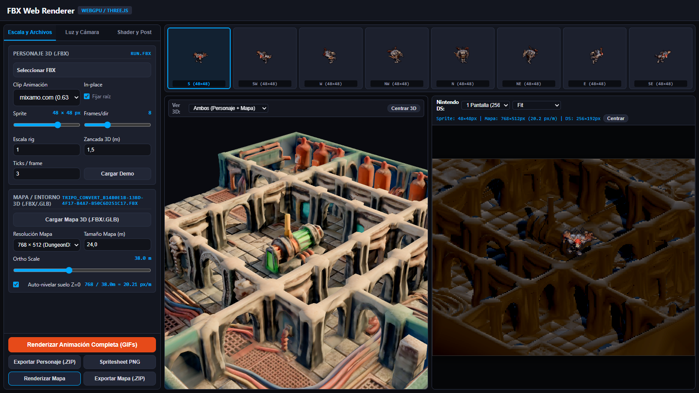
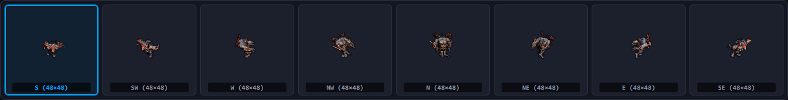
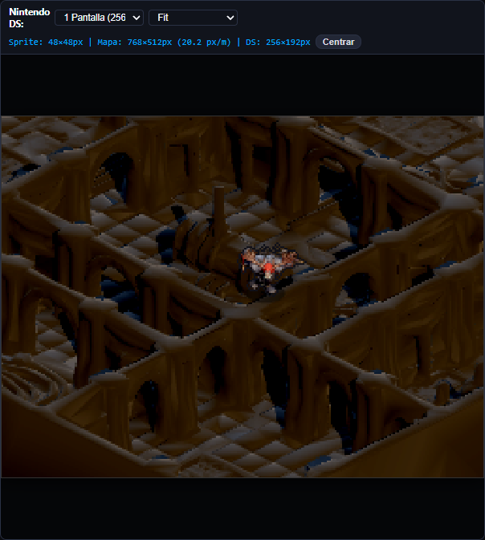
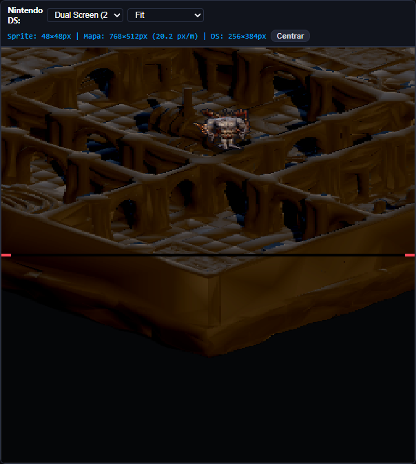
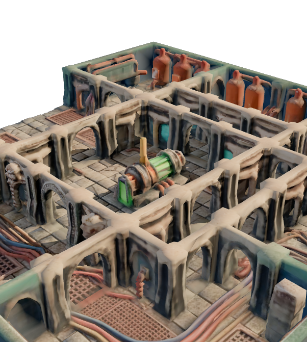

# Sesión 61: Rediseño Integral FBX-to-Sprite Lab, Renderizador 3D de Mapas y Simulador Nintendo DS

## Resumen Ejecutivo

En esta sesión se rediseñó por completo el laboratorio web offline (`tools/lab/FBX-Web-Renderer-offline.html` y su módulo modular `tools/lab/FBX-Web-Renderer-parity.js`), transformándolo en una suite unificada de producción y simulación técnica para Nintendo DS con paridad de renderizado, visor 3D interactivo y simulador de doble pantalla a 60 FPS.

## Arquitectura y Componentes Clave

1. **Layout 100vh Zero-Scroll Estricto:**
   - **Sidebar Izquierdo (360px):** Organizado en tres pestañas compactas (`Escala y Archivos`, `Luz y Cámara`, `Shader y Post`) más barra de acciones fijada en la parte inferior (`Previsualizar`, `Exportar Sprites .ZIP`, `Exportar Mapa .ZIP`).
   - **Tira de 8 Direcciones (Top Row, 155px de alto):** 8 tarjetas (`0_S`, `1_SW`, `2_W`, `3_NW`, `4_N`, `5_NE`, `6_E`, `7_SE`) con mini-canvases en tiempo real renderizados con interpolación `image-rendering: pixelated`. Al hacer click en una tarjeta, el simulador orienta de inmediato al personaje hacia dicha dirección.
   - **Split 50/50 Inferior:**
     - **Izquierda - Visor 3D:** Control de órbita (Three.js OrbitControls), cuadrícula táctica de referencia métrica, toggle de visualización `Personaje / Mapa / Ambos` y panel de métricas de malla (vértices, caras, dimensiones físicas en metros).
     - **Derecha - Simulador Nintendo DS:** Canvas de 256×192 (o 256×384 en modo Dual-Screen), controles de zoom (1x, 2x, 3x, Fit), badge de métricas (FPS, posición `world_x/y`, celda de grid, facing actual), selector de pantalla (Top / Bottom / Dual) y movimiento interactivo con WASD/flechas y arrastre de ratón con resolución angular en 8 direcciones.

2. **Renderizador de Mapas 3D (.FBX y .GLB) y Corrección de Orientación y Escala Métrica:**
   - Soporte dual de formatos de escenario 3D: carga nativa de `.fbx` (vía `cf` FBXLoader) y `.glb` (vía `MinimalGLBLoader` embebido).
   - **Corrección Automática de Orientación (Z-Up a Y-Up):** Detección de mallas provenientes de Blender/Tripo donde la altura de muros está en el eje Z (`sizeVec.z < min(sizeVec.x, sizeVec.y) * 0.8`), aplicando rotación compensatoria `mapModel.rotation.x = -Math.PI / 2` para alinear el suelo con el plano horizontal X-Z de Three.js (eliminando la disposición vertical a 90° de canto).
   - **Escalado Horizontal Métrico Objetivo:** Detección del span horizontal crudo `rawSpan = Math.max(sizeVec.x, sizeVec.z)` y cálculo del escalado efectivo `effectiveScale = targetSpanMeters / rawSpan` (control `mapMeshScale` etiquetado como `Tamaño Mapa (m)`, valor por defecto 24.0 m), evitando que modelos en centímetros importados por `FBXLoader` alcancen 2400 m.
   - **Sincronización Asíncrona de Texturas y Limpieza de Shaders:** `waitForModelTextures` asegura la decodificación de Blob URLs antes del render. Se anula `mat.normalMap = null` y se fijan `roughness = 0.85` y `metalness = 0.05` siguiendo estrictamente `_blender_bake_scifi.py` para evitar que el normal map tangente de Tripo oscurezca las caras en WebGL.
   - **Auto-Nivelación con Normales en Espacio Mundo:** Cálculo de normales transformadas con `norm.transformDirection(node.matrixWorld)` para filtrar polígonos horizontales (`norm.y > 0.8`) y anclar la mediana del suelo exactamente a `Y = 0`.
   - **Encuadre Isométrico 3D Automático:** En modo `map` o `both`, la cámara 3D se ajusta a `position.set(16, 14, 16)`, `controls.target.set(0, 1.0, 0)`, `far = 1000` y `near = 0.1`, encuadrando la mazmorra al completo. En modo `char`, se restituye a primer plano `(0, 1.4, 3.2)` sobre el personaje.
   - Cálculo automático de densidad de píxeles: `density_px_per_m = (ortho_width_px / ortho_size_world)` (ej. 20.21 px/m a 768px y 38m de ancho ortográfico).
   - Render dimétrico ortográfico a 45° de acimut y elevación compartida sin contorno de silueta, permitiendo exportación empaquetada en ZIP (`<name>_world.png` + `<name>_map_settings.json`).

3. **Pipeline Reactivo en Tiempo Real:**
   - Sliders con respuesta instantánea: evento `input` dispara pase rápido de previsualización (`ss=1`) con debounce mediante `requestAnimationFrame`, mientras que `change` ejecuta el render de alta calidad con supersampling Blackman-Harris 4x.

4. **Integración y Build:**
   - `tools/lab/build_offline_renderer.py` actualizado para inyectar tanto `glb_loader_minimal.js` como `FBX-Web-Renderer-parity.js` de forma determinista entre los marcadores `/* SPRITE-LAB-PARITY:START */` y `/* SPRITE-LAB-PARITY:END */`.

## Verificación Automatizada Headless

Se ejecutó una suite determinista completa con Playwright en modo estrictamente headless (`test_lab_playwright.cjs`), validando los siguientes hitos:

- **Zero-Scroll:** Verificado `scrollHeight == innerHeight == 900` y `scrollWidth == innerWidth == 1440` (cero desbordamiento vertical y horizontal).
- **Consola Limpia:** 0 errores de página (`pageerror`) y 0 fallos de JavaScript durante toda la sesión.
- **Navegación de Pestañas:** Cambio verificado entre `pane-scale`, `pane-light` y `pane-shader`.
- **Carga de Personaje FBX:** Carga de `Run.fbx`, renderizado de los 8 facings direccionales y verificación de mini-canvases con píxeles opacos.
- **Carga de Mapa FBX:** Carga de `tripo_convert_b14b0e1b-13bd-4f17-b4a7-b50c6d251c17.fbx`, auto-nivelación a `minZ=0`, auto-escala métrica a 24.0 m y densidad calculada (`20.21 px/m`).
- **Verificación de Texturas del Mapa:** Comprobación de píxeles del canvas de mapa confirmando renderizado activo no negro con **12,781 píxeles iluminados** (suelo de baldosas y muros).
- **Encuadre Isométrico 3D y Relación de Aspecto:** Cámara 3D posicionada en `(16, 14, 16)`, target `(0, 1, 0)` y plano lejano en 1000. Relación de aspecto perfectamente sincronizada al contenedor (`602×671 px`, `aspect = 0.897`) mediante `syncViewportRendererSize()`, eliminando el estiramiento vertical de 4.9x heredado del canvas original de 1050×280 px.
- **Reactividad de Sliders:** Modificación de `visibleSize` de 48 a 36 y de vuelta a 48 px en tiempo real.
- **Interacción y Físicas del Simulador NDS:** Movimiento WASD a la derecha trasladando de `(384, 256)` a `(396, 256)` actualizando facing a dirección 6 (Este). Click en tarjeta direccional 4 actualizando facing a Norte.
- **Modo Dual-Screen:** Toggle a pantalla dual verificado con canvas de 256×384 px.

## Evidencia Visual

### Suite Completa del Laboratorio Rediseñado

### Tira de 8 Direcciones con Canvases Pixelados

### Simulador Nintendo DS con Mapa y Personaje

### Simulador Nintendo DS en Modo Pantalla Dual (256x384)

### Visor 3D Interactivo con Grid Métrico

