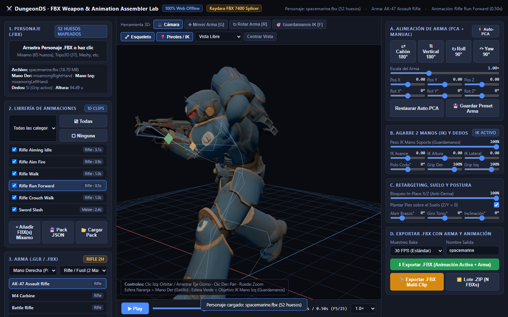
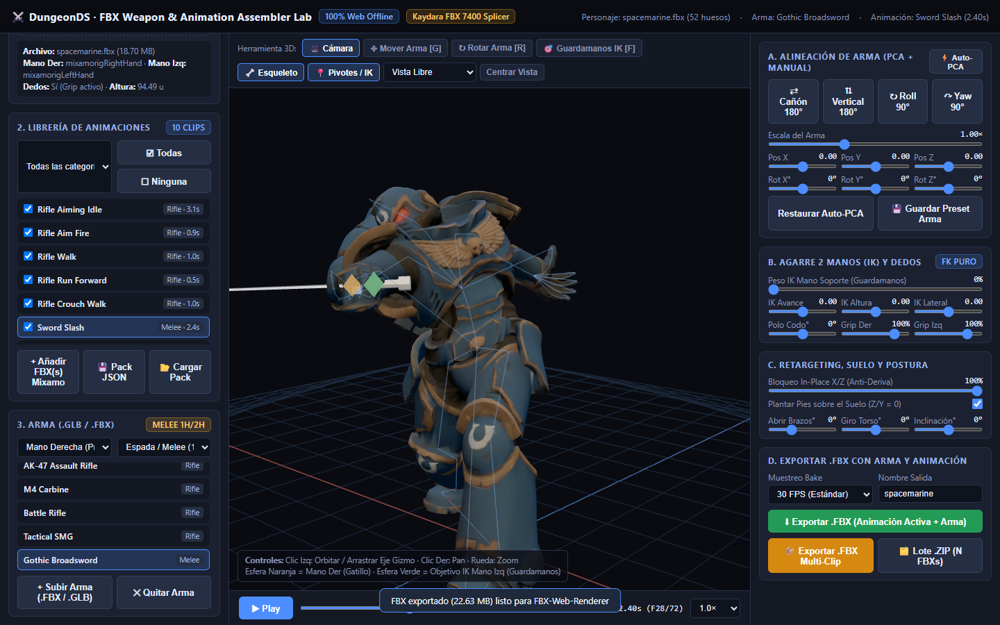
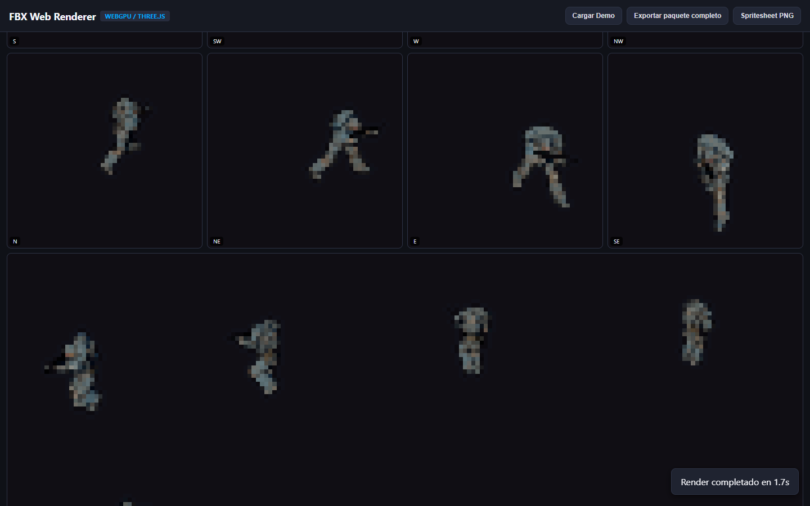

# Walkthrough — FBX Weapon & Animation Assembler Lab (100% Web Offline)

## Objetivo
Construir un laboratorio **100% Web Offline** (`tools/lab/FBX-Weapon-Anim-Lab-offline.html`) capaz de ingestar cualquier personaje humanoide `.fbx` (con o sin animación previa: Mixamo 65 huesos, Tripo3D 37-52 huesos, Meshy, etc.), acoplarle y auto-alinear armas (`.fbx` o `.glb`, principalmente rifles a 2 manos y espadas a 1 mano) mediante PCA geométrico + base anatómica palmar + gizmo/sliders interactivos, aplicar retargeting desde un catálogo semilla pre-empaquetado o desde archivos `.fbx` de Mixamo con **IK analítico de 2 huesos en la mano de soporte** y cierre procedural de falanges, y **exportar un archivo `.fbx` binario estándar (Kaydara FBX Binary 7400)** con el arma y la animación incrustadas listo para abrir en `tools/lab/FBX-Web-Renderer-offline.html` o Blender.

---

## Arquitectura y Módulos Entregados

1. **`tools/lab/fbx_binary_splicer.js` — Parser y Splicer Lossless Kaydara FBX Binary 7400:**
   - Parsea archivos `.fbx` binarios (v7400 uint32 y $\ge 7500$ uint64) en un AST completo preservando `rawBytes` de geometría, pesos de skinning (`Deformer`), materiales y texturas embebidas (`Video`/`Texture`).
   - Inyecta el arma (`Geometry` + `Model` + `Material` + `Texture`/`Video`) emparentada mediante conexión `OO` directamente al nodo `Model` del hueso de la mano (`RightHand` o `LeftHand`).
   - Hornea e inyecta las pilas de animación (`AnimationStack` -> `AnimationLayer` -> `AnimationCurveNode` `T`/`R` -> `AnimationCurve` en ticks `KTime = round(t * 46186158000)`) y serializa a **Kaydara FBX Binary v7400** compatible con `THREE.FBXLoader` y Blender.

2. **`tools/lab/retarget_and_ik_engine.js` — Retargeting Universal, Auto-Alineación PCA e IK Analítico de 2 Huesos:**
   - **Mapeo Semántico y Pose de Reposo:** Detecta automáticamente esqueletos Mixamo (`mixamorig:`), Tripo3D, `Bone_` o `Bip01`, midiendo la estatura real del personaje (compatible con bind poses `Z-up` y `Y-up`) y los ejes anatómicos de ambas manos (`handFwd`, `palmIn`, `hingeAxis`).
   - **Auto-Alineación Geométrica del Arma (PCA + Polaridad):** Calcula los autovectores de la matriz de covarianza 3x3 (Jacobi) sobre la nube de vértices del arma para detectar cañón (`axisBarrel`), vertical (`axisUp`) y lateral (`axisRight`), distingue boca de cañón frente a culata y raíl superior frente a cargador/empuñadura, estima el pivote de agarre (`gripPivot`) y el punto de guardamanos (`foregripLocalPos`), y alinea con la base palmar de `RightHand`.
   - **Retargeting World-Delta + IK Analítico de Mano Izquierda + Grip de Dedos:**
     - Transfiere rotaciones por delta en espacio mundo con alineación de vectores de extremidad en reposo (`alignQuat`).
     - Resuelve analíticamente por ley del coseno el triángulo `LeftArm` ($L_1$) + `LeftForeArm` ($L_2$) hacia el marcador mundial del guardamanos (`foregripWorldPos`) en cada frame antes de hornear las curvas Euler FBX desenvueltas (`unwrapEulerDeg`).
     - Aplica cierre procedural de dedos (índice en gatillo $35^\circ$, dedos medios $80^\circ$, pulgar $45^\circ$) y plantado automático de pies sobre el suelo (`Y = 0`) con bloqueo In-Place X/Z.

3. **`tools/lab/glb_loader_minimal.js` y `tools/lab/seed_catalog_data.js` — Catálogo Semilla Embebido:**
   - Cargador ligero de `.glb` (GLTF 2.0 binario) sin dependencias externas.
   - Catálogo semilla pre-empaquetado con **5 armas** (`AK-47 Assault Rifle`, `M4 Carbine`, `Battle Rifle`, `Tactical SMG`, `Gothic Broadsword`) y **10 animaciones** (`Rifle Aiming Idle`, `Rifle Aim Fire`, `Rifle Walk`, `Rifle Run Forward`, `Rifle Crouch Walk`, `Sword Slash`, `Crouch Slash`, `Jump Attack`, `Heavy Run`, `Death Fall`), más importación por lotes de `.fbx` Mixamo y persistencia en `IndexedDB`.

4. **`tools/lab/FBX-Weapon-Anim-Lab-offline.html` — Laboratorio Standalone Offline (3.21 MB):**
   - Ensamblado por `tools/lab/build_weapon_anim_lab.py` en un único archivo HTML sin servidor ni dependencias de red.
   - Incluye controles rápidos de inversión 180°/90°, sliders de ajuste fino, manipulación directa en viewport 3D (`[G]` Mover Arma, `[R]` Rotar Arma, `[F]` Mover Guardamanos IK) y exportación en 3 modos: `.FBX` individual, `.FBX` Multi-Clip o Lote `.ZIP`.

---

## Verificación E2E Headless (Playwright + Three.js FBX-Web-Renderer)

1. **Rifle a 2 Manos (AK-47 + `Rifle Run Forward` sobre `spacemarine.fbx`):**
   

2. **Espada a 1 Mano (Gothic Broadsword + `Sword Slash` sobre `spacemarine.fbx`):**
   

3. **Validación del `.FBX` Exportado en `FBX-Web-Renderer-offline.html` (Render 8 Direcciones):**
   
