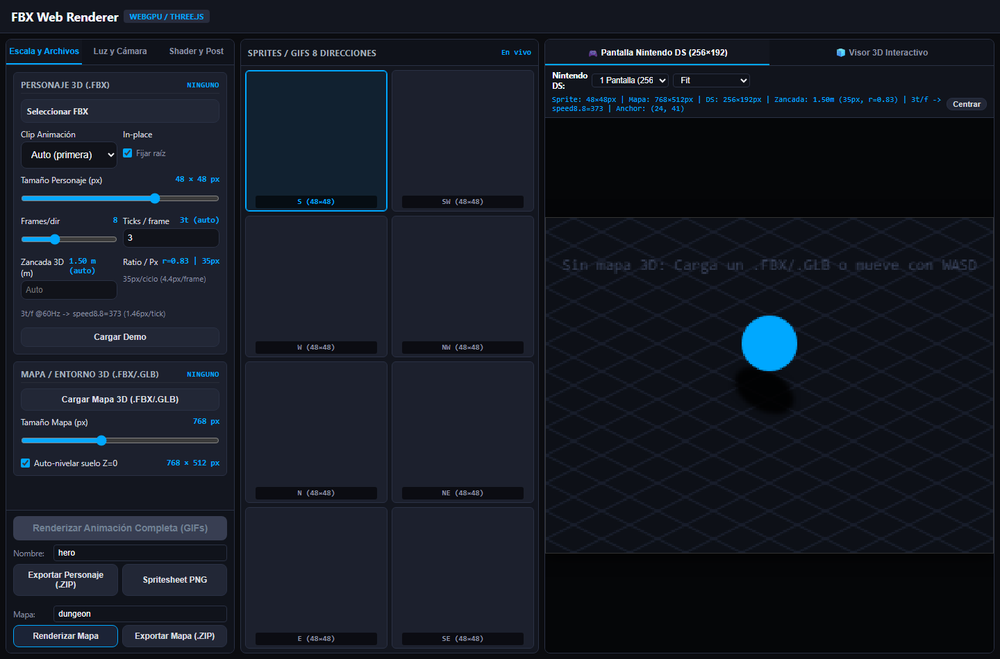
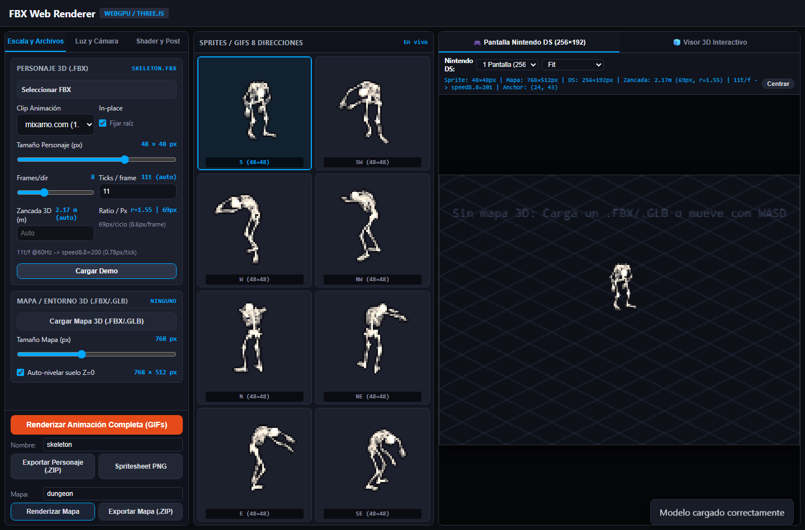
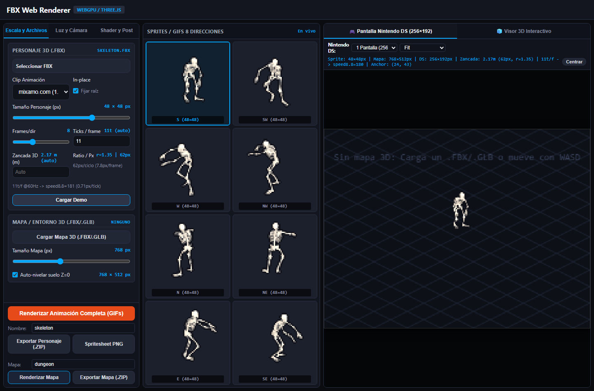

# Walkthrough: Nombres Cortos de Exportación ZIP (Anti MAX_PATH) y Reactividad de Inclinación de Cuello / Cabeza

## Resumen Ejecutivo

En esta sesión se resuelven de raíz dos problemas críticos de usabilidad y fidelidad en `tools/lab/FBX-Web-Renderer-parity.js` y `tools/lab/FBX-Web-Renderer-offline.html`:

1. **Rutas demasiado largas en el ZIP (`MAX_PATH` en Windows)**:
   - Se erradican las concatenaciones kilométricas internas (`${name}_${name}_spritesheet.png`, `${name}/frames/${name}_...`).
   - Se agregan campos de texto limpios en la UI (`#exportCharName` y `#exportMapName`) con valor por defecto corto (máximo 20 caracteres alfanuméricos sanitizados `a-z0-9_`).
   - Se estandariza una estructura plana y compacta dentro de `${name}.zip` donde **ninguna ruta interna supera los 19 caracteres** (estrictamente `< 35` caracteres):
     - `spritesheet.png` (15 chars)
     - `shadow.png` (10 chars)
     - `collage.gif` (11 chars)
     - `dirs/0_S.gif` (12 chars)
     - `frames/0_S/0.png` (14 chars)
     - `shadows/0_S.png` (13 chars)
     - `nds_shadow_anchor.h` (19 chars)
     - `settings.json` (13 chars)
     - `README.md` (9 chars)
   - Y en `exportMapPackage` (`${mapName}.zip`): `world.png`, `collision.png`, `collision.json`, `occlusion.png`, `map_settings.json` (máximo 17 caracteres).
   - Se neutraliza cualquier handler antiguo (`Pp`, `btnDownloadAll`) garantizando que pulsar `#downloadPackageBtn` / `#btnExportZip` ejecuta exclusivamente el empaquetado optimizado.

2. **Control de inclinación del cuello / cabeza (`#neckPitch` / `#neckTilt`) inoperativo**:
   - El control era únicamente un input sin binding real en el rig de Three.js, y las actualizaciones del mixer (`$.mixer.update(...)`) sobreescribían cualquier orientación ósea en cada tick.
   - Se implementa detección automática de huesos de cuello y cabeza (`mixamorig:Neck`, `mixamorig:Head`, `Neck`, `Head`, y malla cabeza en el modelo procedimental demo).
   - Se calcula el eje lateral de cabeceo (pitch) relativo al modelo raíz mediante proyección ortogonal, garantizando cabeceo anatómico idéntico al de Blender/Cycles.
   - Se aplica la rotación tanto en el prototipo de `Three.js AnimationMixer` (`update` y `setTime`) como en la vista en vivo (`renderLiveFrame`), la vista previa 3D y el simulador de Nintendo DS.
   - Se sincronizan bidireccionalmente el slider `#neckPitch` y el input numérico `#neckTilt`.

---

## Evidencias Visuales

### 1. Interfaz del Laboratorio con Inputs de Nombres Cortos
Los campos de texto `#exportCharName` y `#exportMapName` permiten personalizar el nombre base (limitado a 20 caracteres `a-z0-9_`), evitando que los nombres largos de archivos FBX generen colisiones con `MAX_PATH` al descomprimir.

---

### 2. Reactividad de Inclinación de Cuello / Cabeza (+25° vs -25°)

Al modificar el slider de inclinación del cuello, los huesos y la geometría de la cabeza se flexionan dinámicamente tanto en tiempo real con animación activa como durante el renderizado frame a frame.

| Inclinación +25° (Cabeza inclinada hacia adelante / abajo) | Inclinación -25° (Cabeza erguida / hacia atrás) |
| :---: | :---: |
|  |  |

---

## Verificación Automatizada Headless

Se ejecutó el test Playwright `tools/lab/test_zip_names_and_neck_tilt_headless.cjs` con Chromium headless:

1. **Test 1 - Integridad del DOM**: `#exportCharName`, `#exportMapName`, `#neckPitch`, `#neckTilt`, `#neckPitchValue`, `#downloadPackageBtn` y `#btnExportMapZip` presentes y visibles.
2. **Test 2 - Sanitización de nombres**: Cadenas con caracteres especiales y sufijos largos truncadas a $\le 20$ caracteres alfanuméricos limpios.
3. **Test 3 - Detección en modelo procedimental**: Modelo demo detecta el cubo superior de cabeza (`Head`) y actualiza el nombre a `demo_procedural`.
4. **Test 4 - Reactividad en FBX real (`skeleton.fbx`)**:
   - Detección exitosa del hueso `mixamorigNeck`.
   - Modificación a +25°: cambio significativo en cuaternión de mundo ($\Delta q > 0.01$) y divergencia comprobada de píxeles en canvas.
   - Modificación a -25°: cuaternión de mundo $\Delta q = 1.078$, divergencia comprobada de píxeles frente a 0° y +25°.
   - Persistencia de la rotación tras la evaluación de `mixer.update(...)`.
5. **Test 5 - Estructura y rutas de Character ZIP**:
   - Ruta más larga en el ZIP: `nds_shadow_anchor.h` (19 caracteres, estrictamente $< 35$).
   - Todos los archivos requeridos (`spritesheet.png`, `shadow.png`, `collage.gif`, `dirs/`, `frames/`, `shadows/`, `settings.json`, `README.md`) generados correctamente.
   - `settings.json` registra `name: "hero_skel"` y `neckPitchDegrees: -25`.
6. **Test 6 - Estructura y rutas de Map ZIP**:
   - Ruta más larga en el ZIP: `map_settings.json` (17 caracteres, estrictamente $< 35$).
   - Archivos `world.png`, `collision.png`, `collision.json`, `occlusion.png`, `map_settings.json` generados correctamente.
7. **Test 7 - Auditoría de consola**: **0 errores de consola**.
8. **Regresiones verificadas**: `test_autoticks_and_zip_btn_headless.cjs` ejecutado y superado con 0 errores.
