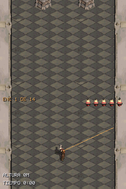
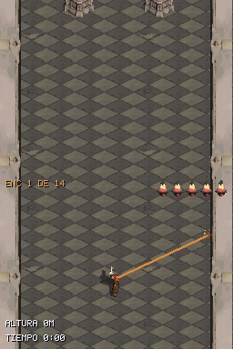

# Walkthrough: Corrección del Buffer de Carga del Láser y Cancelación Inmediata de Animación

## Problema inicial reportado
1. **Pulsación perdida tras disparar:** Tras disparar el francotirador, había fotogramas de recuperación donde tocar la pantalla no registraba la pulsación y no arrancaba la carga, obligando al jugador a soltar y volver a pulsar.
2. **Animación de brazos abiertos sin cargar láser:** Al disparar, el impacto contra enemigos activa *hitstop* y la recuperación del disparo arranca en fotograma 0 (pose de brazos en cruz/abiertos). Si el jugador pulsaba durante el enfriamiento, la animación quedaba congelada en f0 pareciendo que cargaba, pero sin colimar haz alguno (`s_aim_state` seguía en `AIM_IDLE`).
3. **Espera forzada de recuperación y diferencia de escala:** El enfriamiento post-disparo (40 frames) forzaba al jugador a esperar a que terminara la animación antes de poder cargar. Además, los sprites históricos de disparo eran un 10% más pequeños que los de andar (resuelto paralelamente en `main` al unificar la malla a 48 px).

## Solución implementada
1. **Cancelación inmediata del clip (`!touch_down`):**
   - En `source/main.c`, si `!touch_down`, se corta `s_shot_active = 0`. Tanto al disparar como al cancelar una carga a medias soltando el estilete, el personaje regresa inmediatamente a la postura normal de reposo/andar sin quedarse atrapado en el clip encorvado.
   - Tras evaluar `weapons_input`, se recomputa de inmediato `s_hero_clip_frame = hero_clip_frame()` en el mismo fotograma para que una cancelación no deje un fotograma residual del clip anterior.
2. **Reinicio instantáneo de carga al volver a pulsar (`source/weapons.c`):**
   - Si `in->touch_pressed` ocurre en `AIM_IDLE`, se pone `s_weapon_cooldown = 0`, arrancando `AIM_AIMING` de inmediato con temporizador y progreso en 0.
   - Se mantiene el soporte de retención (*hold-to-charge*) para que mantener pulsado el estilete inicie la carga sin requerir un nuevo flanco de bajada.
3. **Fusión de `main`:**
   - Se fusionaron los commits de `main` con los sprites regenerados a escala normalizada de 48 px (`58ca018`), eliminando la discrepancia de escala entre el modelo caminando y cargando.

## Evidencia
Escenario headless automatizado `scenarios/sniper_charge_buffered_hold.json`:
- Primer disparo cargado y soltado (`00_first_aim_ready.png` → `01_first_shot.png`).
- Pulsación inmediata y retención: carga reactiva del segundo disparo sin esperas (`02_buffered_aim_ready.png` → `03_second_shot.png`).

| Primer disparo listo | Primer disparo | Segundo disparo reactivo | Segundo disparo |
| :---: | :---: | :---: | :---: |
|  |  |  |  |

## Verificación
- `build-project.ps1`: `DS_BUILD=PASS` (0 warnings).
- Escenarios headless: `weapons_switching_and_touch` y `sniper_charge_buffered_hold` PASS.
- Hardware real: validado en Nintendo DS por el usuario.
