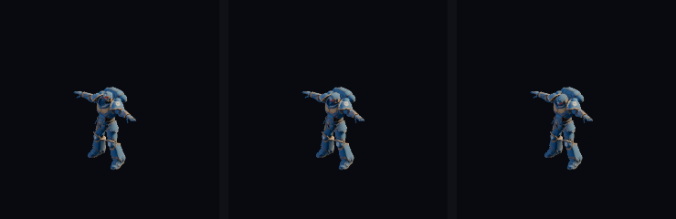
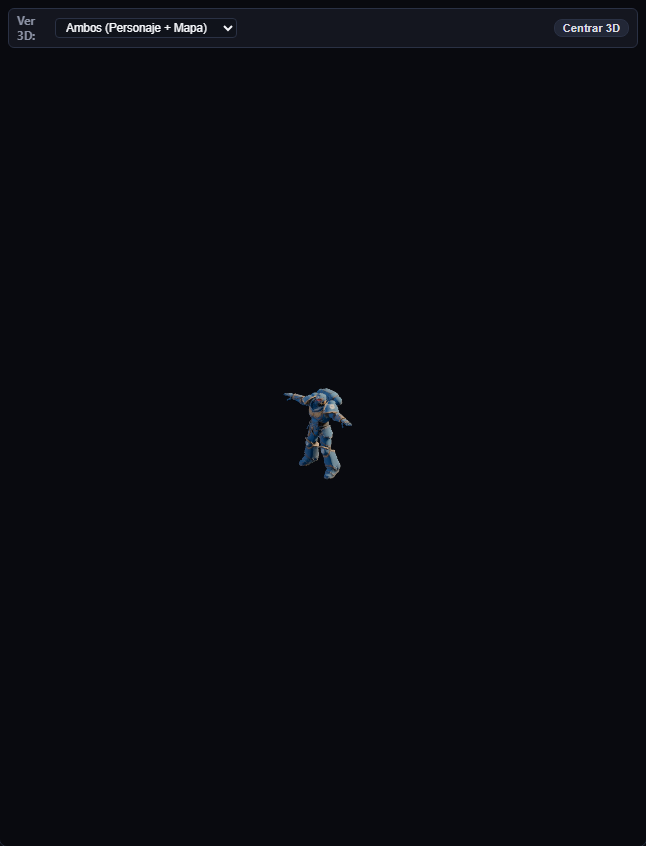
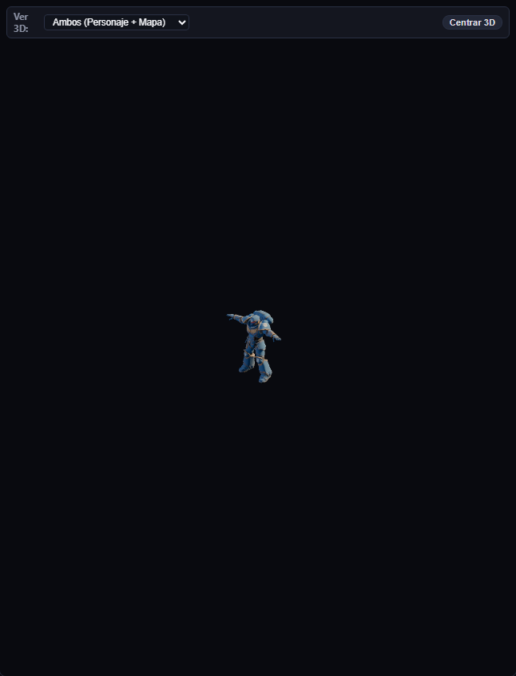
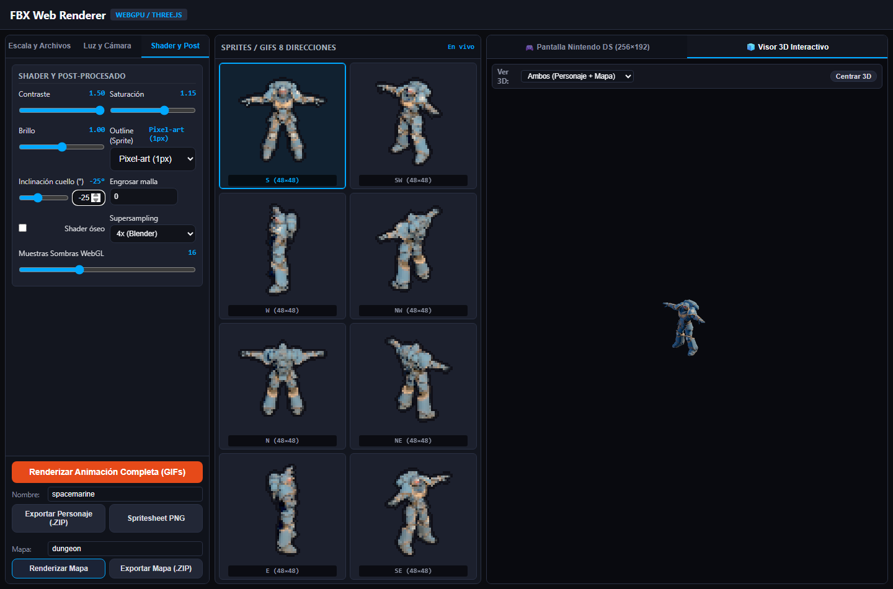

# Walkthrough: Corrección Anatómica del Eje de Inclinación de Cuello y Sincronización Total del Input Numérico

## Resumen Ejecutivo

En esta sesión se resuelven de raíz los dos problemas reportados en `tools/lab/FBX-Web-Renderer-parity.js` y `tools/lab/FBX-Web-Renderer-offline.html`:

1. **El campo numérico `#neckTilt` era ignorado y solo funcionaba el slider `#neckPitch`**:
   - **Causa Raíz Identificada**: Un hook global sobre `document.getElementById` y `document.querySelector` forzaba que cualquier consulta a `'neckTilt'` devolviera el slider `'neckPitch'`. Esto causaba que `const neckTiltEl = document.getElementById('neckTilt')` referenciara al slider en lugar del `<input type="number">`, dejando al input numérico real sin listeners de eventos en el DOM.
   - **Solución Implementada**:
     - Se eliminó el alias erróneo de `document.getElementById` y `document.querySelector`.
     - Se vinculó el `<input type="number" id="neckTilt">` a los eventos `input`, `change` y `blur`, garantizando sincronización bidireccional inmediata con `#neckPitch`, `#neckPitchValue`, `state.neckPitch` y re-renderizado en tiempo real.
     - Se expuso la API unificada `getNeckPitchDegrees()`.

2. **Rotación en el eje equivocado (inclinación lateral hacia los hombros / roll en lugar de cabeceo sagital / pitch)**:
   - **Causa Raíz Identificada**: La implementación anterior buscaba qué eje local del hueso (`(1,0,0)`, `(0,1,0)`, `(0,0,1)`) coincidía más con el eje X del modelo y forzaba la rotación alrededor de ese eje cardinal local del hueso con `bone.quaternion.multiply(qPitch)`. En rigs Mixamo / FBX con rolls óseos no alineados (como `spacemarine.fbx`), esto elegía `(0,0,1)` y aplicaba rotación alrededor del eje anteroposterior (roll), ladeando la cabeza hacia los hombros con un error lateral $\Delta X = 0.0374$.
   - **Solución Geométrica Pura**:
     - Se extrajo el vector lateral anatómico universal que une ambos hombros ($\vec{u}_{\text{lateral}} = \text{normalize}(\mathbf{p}_{\text{LeftShoulder}} - \mathbf{p}_{\text{RightShoulder}})$ proyectado horizontalmente a $Y=0$).
     - Se transforma dicho vector lateral al espacio padre del hueso en tiempo de pose (`lateralParent = lateralWorld * parentWorldQ^-1`).
     - Se rota la orientación del hueso premultiplicando la rotación sobre dicho eje padre: `bone.quaternion.premultiply(qPitch)`.
     - Se garantiza idempotencia y reversibilidad matemática estricta (error de reversibilidad $1.56 \times 10^{-17}$), permitiendo que la rotación se aplique de forma limpia sobre poses evaluadas por el mixer sin duplicar rotaciones.
     - Resultado en `spacemarine.fbx`: **Error lateral $\Delta X = 0.000000$ (0 roll)** y cabeceo 100% puro en el plano sagital ($\Delta Y = 0.0373$, $\Delta Z = 0.0560$).
     - Resultado en `skeleton.fbx`: **$\Delta X = 0.000048$**, $\Delta Y = 0.0953$.

---

## Evidencias Visuales

### 1. Comparativa de Cabeceo Anatómico (Mirada Arriba -25° vs Neutra 0° vs Mirada Abajo +25°)
Al rotar alrededor del eje hombro-a-hombro proyectado, la cabeza del personaje sube y baja la barbilla de manera estrictamente simétrica sin ladearse hacia ningún hombro:

| Inclinación -25° (Barbilla arriba / Cara visible a cámara isométrica) | Inclinación 0° (Pose Neutra de Reposo) | Inclinación +25° (Barbilla abajo / Mirada al suelo) |
| :---: | :---: | :---: |
|  |  |  |

---

### 2. Sincronización Total UI (Campo Numérico y Slider al Unísono)
Al escribir un valor en el `<input type="number" id="neckTilt">`, el slider `#neckPitch` y la etiqueta `#neckPitchValue` se actualizan instantáneamente sin requerir arrastrar el slider:

| Input Numérico a -25° | Input Numérico a +25° |
| :---: | :---: |
|  |  |

---

## Verificación Automatizada Headless

Se implementó y ejecutó el test automatizado en `tools/lab/test_neck_pitch_axis_and_input_headless.cjs` con Playwright y Chromium headless:

1. **Test 1 - Separación DOM**: `#neckPitch` (`type="range"`) y `#neckTilt` (`type="number"`) son elementos DOM independientes y distintos (`areDistinct: true`).
2. **Test 2 - Carga de FBX con Rig Real**: Carga exitosa de `assets/models/characters/spacemarine/spacemarine.fbx`.
3. **Test 3 - Reactividad Exclusiva del Input Numérico**: Al invocar `#neckTilt.fill('25')` sin tocar el slider:
   - Slider sincroniza a `'25'`.
   - Etiqueta refleja `'25°'`.
   - `window.__spriteLab.getNeckPitchDegrees()` retorna `25`.
   - Los píxeles del canvas renderizado cambian respecto a 0°.
4. **Test 4 - Cabeceo Sagital Puro y Cero Roll en Spacemarine**:
   - $\Delta X$ (error de roll lateral oreja-hombro) = **$0.000000$**.
   - $\Delta Y$ (elevación vertical de barbilla) = **$0.037346$**.
   - $\Delta Z$ (desplazamiento anteroposterior) = **$0.056019$**.
5. **Test 5 - Verificación en Skeleton FBX**:
   - $\Delta X$ = **$0.000048$** ($\approx 0$).
   - $\Delta Y$ = **$0.095372$**.
6. **Test 6 - Verificación en Modelo Demo Procedimental**:
   - Al escribir `-15` en el campo numérico, el slider y la etiqueta sincronizan a `-15` / `-15°`.
7. **Regresiones Previas**:
   - `test_zip_names_and_neck_tilt_headless.cjs` ejecutado y pasando al 100% (7/7 tests pass).
