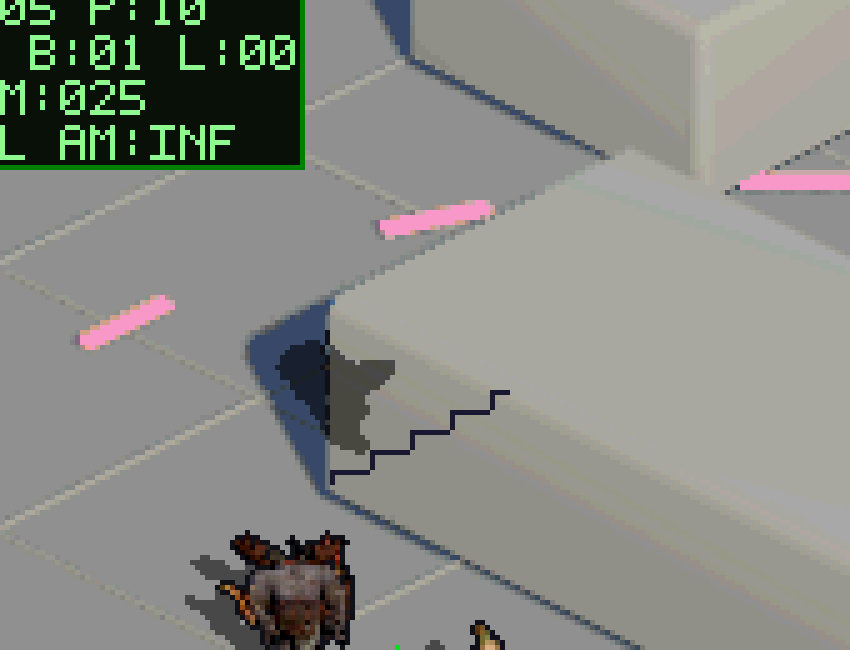
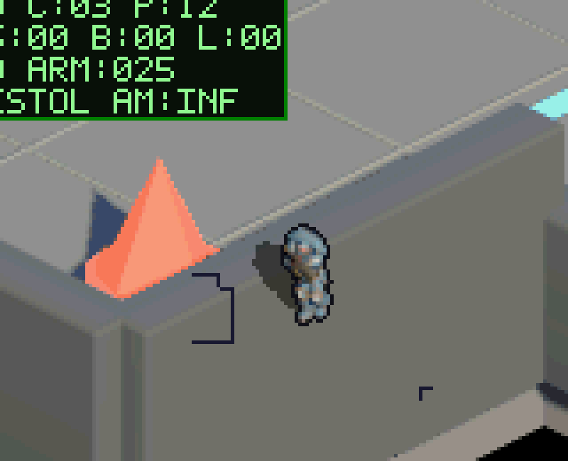

# Fix: oclusión exacta, transparencia compartida y base de pared oculta (2026-11-03)

## Cambios (`source/main.c`)
- **Máscara exacta al píxel:** `s_occlusion_cover` guarda un bit por píxel de cada celda de 4×4 de `s_occlusion_depth`; `occlusion_pixel_hidden()` exige profundidad y cobertura. Elimina los bloques de suelo sobre la silueta de los enemigos en el borde de las paredes. Se rellena por tramo y celda (sin bucles por píxel).
- **Transparencia compartida:** `s_player_see_through` (jugador con píxeles ocluidos a 8/16/24 px sobre sus pies). Con él activo, los enemigos ocluidos se ven con la misma transparencia (frames impares) que el jugador; si el jugador no está detrás, siguen ocultos.
- **Suelo oculto legible:** con el jugador ocluido se dibuja su sombra sobre la pared y `draw_hidden_wall_base()` marca el borde de la huella de colisión (límite caminable) sobre las superficies oclusoras, en una caja de 64×48 px alrededor del jugador.

## Evidencia
Escenario `map_occlusion_collision_coherence` (PASS, 1 vblank por captura):

| Detrás del bloque | Detrás del muro sur |
| :---: | :---: |
|  |  |

## Limitaciones
- Los `cpu_ticks` del emulador (WSL) superan 33514 también con la ROM anterior, así que no son comparables con hardware; se verificó `vblanks == 1` y HUD `FPS:60`. Falta medir en la DS física.
- No hay aún escenario con un enemigo detrás de la pared con el jugador: la transparencia de enemigos está implementada pero sin captura propia.
- Si una celda 4×4 mezcla dos paredes de distinta profundidad se usa la máxima.
