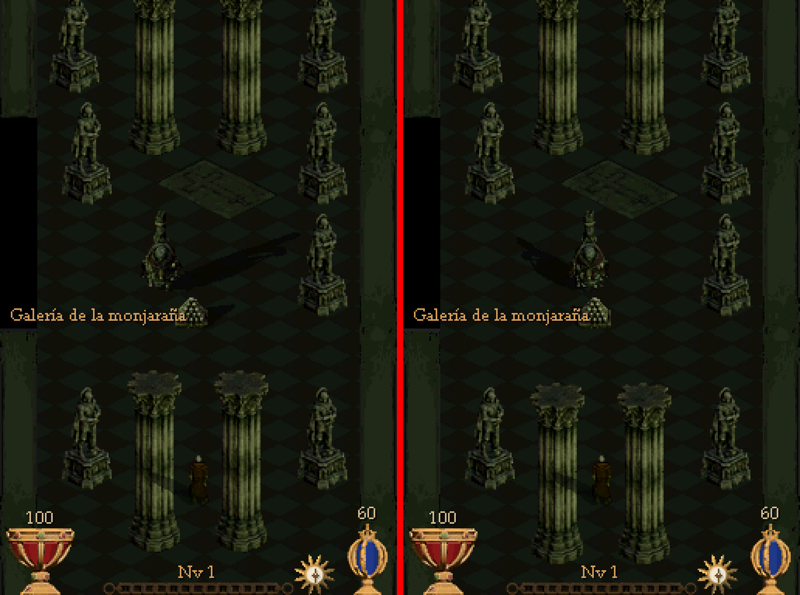
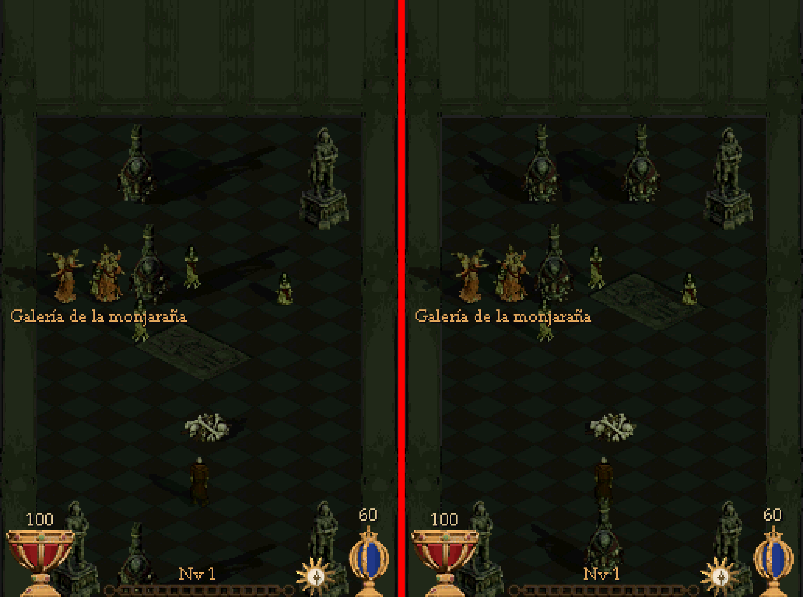
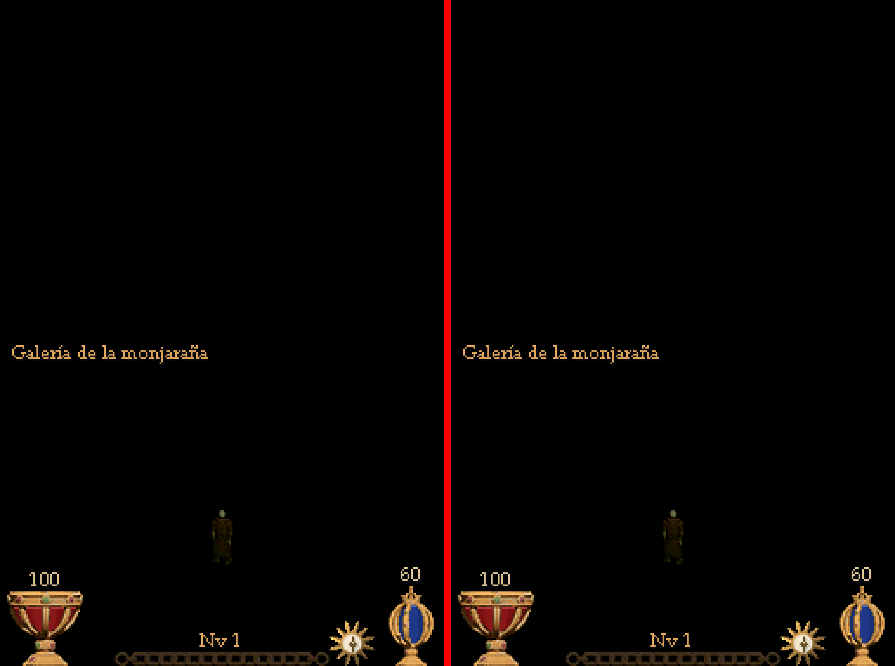
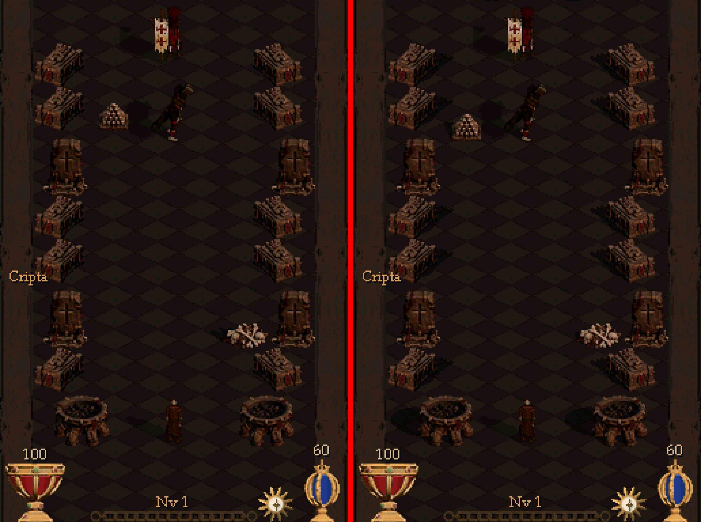
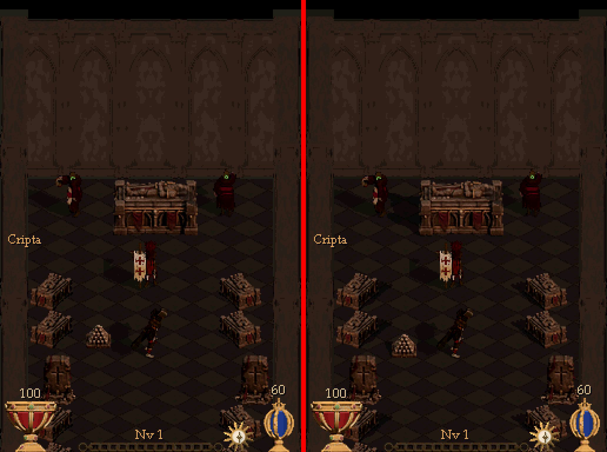

# Rehorneo de cripta y monjaraña: sombras largas en las piezas sueltas

**Rama:** `fix/rehorneo-cripta-monjarana` (base `arpg`), 2026-11-26.

## Qué cambia
En la galería de la monjaraña (sala 14) y la cripta (sala 15) todas las piezas sueltas (capullos, calaveras, huesos, sarcófagos, braseros, lápidas) tienen sombra larga coherente con su luz. Antes el proceso descartaba en silencio la sombra que no cabía en el margen de 8 px. Estatuas y columnas (piezas del kit) siguen con margen de 8 px: con sombra larga la monjaraña pasaba de 440 tiles por ventana.

Cifras: monjaraña ventana 229+143=372/440, total 941/1024; cripta 706/1024. La monjaraña gana un capullo que antes no cabía.

## Verificación
- ROM compilada sin warnings nuevos; capturas 4x comparadas con la versión anterior (izquierda git, derecha final).
- Tras mergear con `arpg` (que había cambiado el baker y la colocación) se regeneró la colocación (`gen_salas_rom.py`) y las luces cripta y monjaraña; **esa ROM posterior al merge no se recompiló ni recapturó**.
- No probado en la DS.

## Evidencia

## MDs
`STATUS-ARPG.md` (entrega; la más vieja a `STATUS-ARCHIVE.md`), `TECHNICAL.md` (regla de regenerar la colocación tras cambiar el lienzo de sombra).
