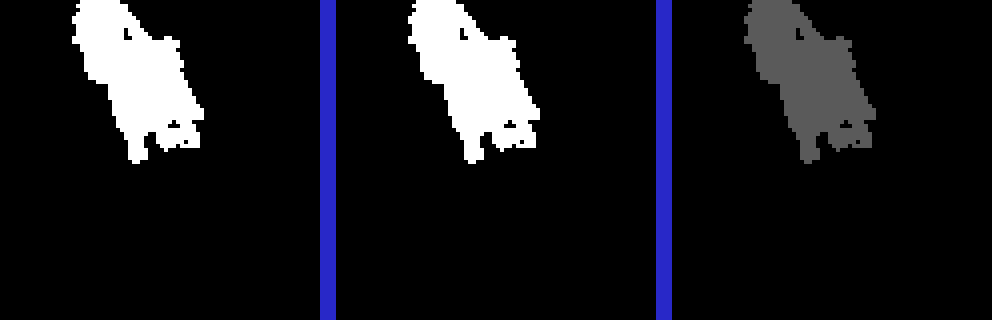

# Generador de sprites: no romper la luz por sala

**Rama:** `fix/sprite-gen-luz-sala` (base `arpg`), 2026-11-26.

## Síntoma
Al regenerar `source/player_sprite.c` la luz por sala dejaba de funcionar y el recuadro de sombra del Abanderado quedaba sobredimensionado.

## Causa
- `fddb9938` editó a mano `player_sprite.c` (tablas sin `const` y con tamaños fijos para el cargador de luz por sala). Regenerar deshacía esas ediciones.
- `061d66a2` corrigió `crop_shadow_to_80` pero no se regeneró al Abanderado.

## Arreglo
- `tools/generate_player_sprites_c.py` encadena `tools/room_light_slots.py` al escribir el `player_sprite.c` del repo.
- `tools/room_light_slots.py` ignora `*_fix.bin` y no emite dos `#define ..._GEN` sin uso.
- Abanderado regenerado: recuadro de sombra ajustado (~400 B menos por clip). Regenerar dos veces no cambia nada más; los paquetes de luz no necesitan rehacerse.

## Verificación
Build PASS sin avisos nuevos; escenario `arpg_luz_sala` PASS; host tests `test_sprite_ground_anchor`, `test_blit_runs_contract`, `test_guardrails` PASS.

Cuerpo y sombra idénticos en píxeles; no se nota jugando.

## Pendiente
`cripta.bin` sale distinto al rehornearlo (paleta, tiles, sala 15); sesión aparte.

## MDs
`STATUS-ARPG.md`, `STATUS-ARCHIVE.md` y `TECHNICAL.md` (§3 y §5.7) actualizados.
