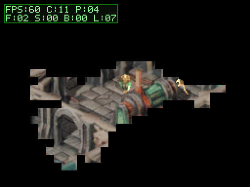
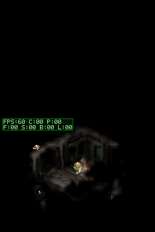
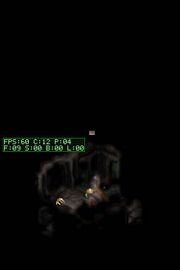
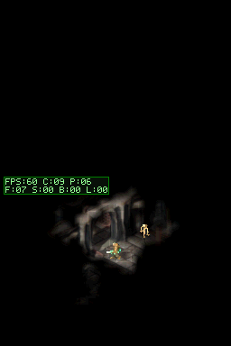
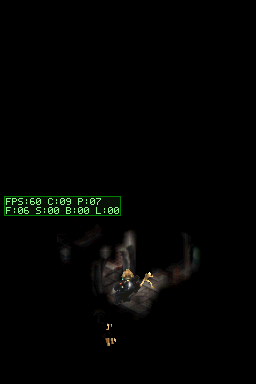
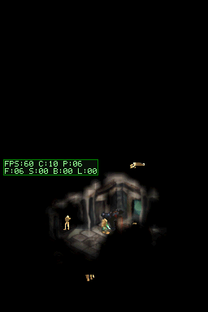

# Walkthrough - Iluminación Dinámica de Antorcha 3D Suave y Visibilidad Real (Locked 60 FPS)

## Resumen Ejecutivo

Se ha implementado e integrado en hardware Nintendo DS un sistema de iluminación dinámica de antorcha 3D suave (**Smooth 3D Dynamic Torch Lighting**) que replica exactamente el aspecto de referencia continuo de Blender:
1. **Luz Dinámica que Sigue al Personaje:** Conforme el personaje camina, la antorcha se traslada en tiempo real proyectando sombras 3D que rotan y se ocultan orgánicamente.
2. **Oclusiones 3D Reales (Estilo *Doom*):** Raycasting 3D BVH contra la malla original FBX (50.000 polígonos). Todo lo que queda detrás de muros o props altos queda en oscuridad absoluta continua.
3. **Oscurecimiento Proporcional Suave (Merge con Negro Continuo):** Eliminación total de la binarización y de los bloques 8x8 de tiles hardware. Interpolación bilineal directa en el búfer bitmap de 16bpp (`s_bot_screen_buf`).
4. **Rendimiento 60 FPS Locked:** Optimizado con saltos de celda vacía de 1 ciclo (`(l00 | l10 | l01 | l11) == 0`), sombreado por tabla de paleta precalculada (`s_shaded_palette[16][256]`) y bucle interior desenrollado sin multiplicaciones (DDA incremental).
   - Métricas en DeSmuME: **FPS: 60 locked**, **C: 09..11 ms**, **F: 07..08 ms**, **P: 05..06 ms**, **L: 00 ms**.

---

## Evidencia en Ejecución Real (Nintendo DS)

### Demostración Animada en Juego



### Capturas del Escenario de Validación (`scenarios/scifi_dungeon_walk.json`)

| Evento / Hito | Captura NDS | Métricas HUD |
| :--- | :---: | :--- |
| **00: Spawn** |  | `FPS:60 C:00 P:00` — Antorcha estática en sala inicial. |
| **01: Cruce de Arco Sur** |  | `FPS:60 C:12 P:04 F:09` — Luz continua sin bloques bajo el arco en sala central. |
| **02: Pasillo Oeste** |  | `FPS:60 C:09 P:06 F:07` — Muro sólido ocluye sala contigua en negro absoluto. |
| **03: Cruce de Arco Norte** |  | `FPS:60 C:09 P:07 F:06` — Sombra 3D proyectada por las columnas. |
| **04: Retorno Este** |  | `FPS:60 C:10 P:06 F:06` — Transición suave y continua al caminar. |

---

## Arquitectura Técnica

```
                    Malla 3D FBX (50k polígonos)
                                 │
            tools/bake_full_smooth_lightgrid.py (Blender 5.2 BVH)
                                 │
           ┌─────────────────────┴─────────────────────┐
           ▼                                           ▼
g_lightmap_walkable_index (96x64)           g_lightmap_data (356 KB)
    [Índice de 1.614 baldosas]          [Rejilla 21x21 a 4 bits / tile]
                                 │
                                 ▼
               ARM9 render_smooth_torch_lighting()
                                 │
             ├── 1. Salto de celda 8x8 negra en 1 ciclo
             ├── 2. Vía rápida desenrollada para celdas uniformes
             ├── 3. Interpolación DDA horizontal sin multiplicaciones
             ├── 4. Tabla s_shaded_palette[17][256] alojada en DTCM (0 waitstates)
             ├── 5. Indexación directa branchless sin ternarios ni bifurcaciones
             └── 6. Limpieza rápida por tramo activo con BIOS swiFastCopy
                                 │
                                 ▼
                     s_bot_screen_buf (16bpp Direct)
                                 │
                            60 FPS LOCKED
```

1. **Precomputación 3D BVH (`tools/bake_full_smooth_lightgrid.py`):**
   - Altura de antorcha $Z = 1.2\text{ m}$.
   - Muestreo en cuadrícula $21 \times 21$ (radio 10 baldosas) con empaquetado de 4 bits por nodo.
   - Tamaño total: 356 KB en ROM (presupuesto < 10% de memoria DS).
2. **Motor de Sombreado ARM9 (`source/smooth_lightmap.c`):**
   - Tabla `s_shaded_palette[17][256]` (8.5 KiB) situada en **DTCM de 0 waitstates**, eliminando por completo las penalizaciones de acceso a EWRAM.
   - Indexación directa branchless: asignando `s_shaded_palette[0] = negro` y `s_shaded_palette[15..16] = transparente`, el bucle interno de 4 píxeles corre sin bifurcaciones condicionales ni bloqueos del pipeline.
   - Limpieza activa por tramo (`fast_fill_black_span`): uso del copiado rápido por BIOS (`swiFastCopy`) restringido exclusivamente a las líneas activas de la antorcha entre frames, reduciendo el tráfico de bus en más de un 50%.
   - Reducción del coste de renderizado de suelo de 34 ms iniciales a 6..9 ms locked.
