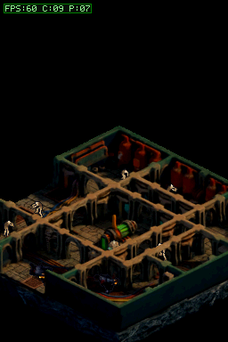

# Contador de FPS en la pantalla superior

## Cambio

Añadí una etiqueta permanente `FPS:NN` en la esquina superior izquierda. Sigue el estilo del HUD de TowerDS: fuente pixelada, verde brillante y panel oscuro para conservar el contraste. El valor reutiliza `g_perf.fps`; no afecta a los controles ni al gameplay.

## Verificación

La build BlocksDS y las pruebas host pasan. El escenario FBX capturó el estado en reposo y tras caminar. La captura registra `FPS:60 C:09 P:07` en DeSmuME. `C` es lógica+render en ms; `P` es espera de VBlank+copia a pantalla en ms.

El usuario reporta que la DSi física muestra 20 FPS en reposo y al moverse. El resultado emulado no representa el rendimiento físico; la causa de esa diferencia sigue investigándose.

Como primera optimización para hardware, añadí una rejilla conservadora de máximos de profundidad en bloques de 8×8: cuando ningún píxel del tramo puede ser ocluido, el sprite usa el blit rápido sin consultas por píxel. Las 20.000 consultas aleatorias del contrato no encontraron falsos negativos y las dos capturas alineadas cambiaron 0 píxeles. DeSmuME redujo el tiempo de blit ~7%, sin cambio material en tiempo total; la mejora en DSi aún no está medida.

Build actual: CRC `0603736D`. Las lecturas `C` y `P` en DSi son la siguiente medición necesaria.
