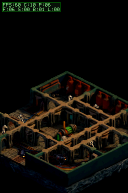

# Contador de FPS en la pantalla superior

## Cambio

El HUD permanente de la pantalla superior sigue el estilo de TowerDS: fuente pixelada, verde brillante y panel oscuro. La segunda línea desglosa el trabajo de CPU como `F` (suelo), `S` (sombras), `B` (sprites/blits) y `L` (lógica), además de `C` (CPU completa) y `P` (presentación). Es telemetría solamente: no cambia controles ni gameplay.

La comparación del código explica una diferencia estructural que merece medirse: TowerDS dibuja el framebuffer inferior directamente en el buffer de VRAM que luego presenta mediante flip; esta rama construye ambas pantallas en RAM y copia 192 KB a VRAM cada frame. Además, la escena FBX compone los sprites por software. Esto sugiere fuentes de coste, pero no demuestra cuál causa la caída física.

## Verificación

La build BlocksDS, las pruebas host (incluido el contrato de los glifos/contadores) y el escenario FBX pasan. La captura DeSmuME muestra `FPS:60 C:10 P:06` y `F:06 S:00 B:01 L:00`. Es una comprobación visual/emulada, no una medición de DSi.

En la DSi, el usuario midió `FPS:20 C:40 P:10` tanto en reposo como al moverse. La nueva build añade el desglose por etapas para identificar ese coste en el hardware. La captura siguiente es la del HUD ampliado bajo DeSmuME.

Build diagnóstica actual: CRC `3C31A321`, SHA-256 `6C3AF12D5DE40E544564680D2FEE1711CDFE92929C35C97813E48590DF2621BF`. El resultado DSi de `F/S/B/L` sigue pendiente.
