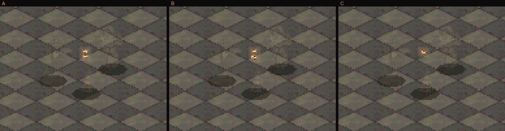
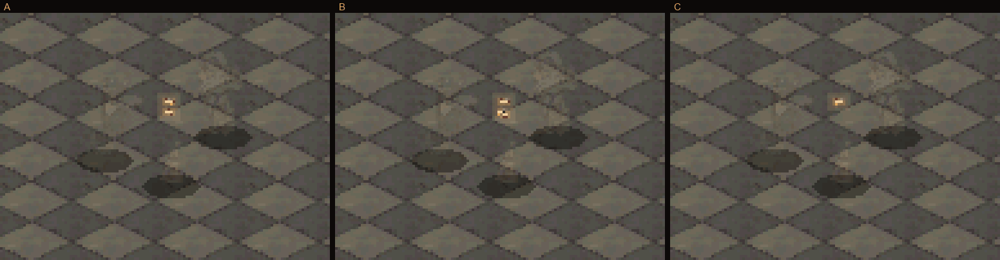
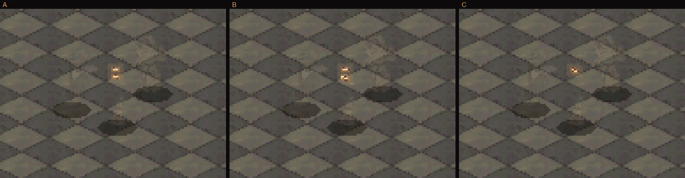

# Glifo — diseño para la protodemo (2026-11-22, rama `feat/glifo` desde `proto/arpg`)

Sesión de diseño: mecánica base, auras, sinergias con Rayo y Ejecución, lenguaje visual y assets. **Aprobada por el usuario** (runa A, cifras iniciales a criterio y a ajustar jugando); pasada a `DESIGN.md` §7.6 y §7.7.

## 1. Qué ya existe en la ROM

La «Maldición» del árbol antiguo (`source/curse.c`): se lanza con el lápiz en arco (20 frames, alcance 140 px), deja un círculo de 40 px de radio de suelo que se dibuja tenue 0,5 s y después **ralentiza un 40 %** durante 4 s; cuesta 30 de maná; máximo 3 a la vez. Dibujo provisional: tramado violeta ceniza. La propuesta reaprovecha el lanzamiento, el apuntado, el radio y el tope; cambia qué hace la zona y cómo se ve.

## 2. Mecánica base: el Sello

1. **Lanzar:** el lápiz toca el suelo y el héroe arroja el **Vial** (la reliquia del Glifo) en arco; se rompe al caer. Coste 30 de maná.
2. **Apertura (0,5 s):** el suelo se agrieta trazando la runa; aún no hace nada. Telegrafía para el jugador.
3. **Espera (1,5 s):** la runa respira. Aquí actúa el aura que lleve (sin aura, nada).
4. **Detonación:** golpe único de **80** a todo lo que esté dentro. Después la grieta se cierra (0,5 s).

Total ≈ 2,5 s. Hasta 3 glifos a la vez. Radio 40 px de suelo (elipse de 80×40 en pantalla).

**Por qué 80:** el Exvoto y el Bebé tienen 100 de vida y tambalean a ≤25 %. Un Sello sin mejoras los deja **a 20, tambaleando**: no mata, prepara la Ejecución. Con líneas de `Daño` pasa de 100 y mata del tirón. Así la misma cifra sirve a las dos formas de jugar (§5).

## 3. Auras de la protodemo (Rara / Épica)

| Aura | Durante la espera | En la detonación | Runa |
|---|---|---|---|
| **Redil** (atracción) | Arrastra al centro a **28 px/s** fijos, se mueva o no el enemigo | Golpea al montón | Brazos en espiral y un pozo de luz que gira en el centro |
| **Zarza Ardiente** (fuego) | 1 capa de Quemado cada 0,5 s a quien esté dentro (se renueva mientras siga dentro) | +2 capas a todos | Las grietas echan lenguas de llama |

**Redil con las velocidades reales** (andando hacia fuera, contra 28 px/s):

| Enemigo | Velocidad | Resultado |
|---|---|---|
| Abanderado | 18 px/s | Atraído (10 px/s hacia dentro) |
| Párroco, Monja, Cireneo | 25 px/s | Clavado; si se para, va al centro |
| Ojo del Tribunal | 26 px/s | Clavado: no puede reposicionarse para apuntar |
| Exvoto | 30 px/s | Casi parado (sale a 2 px/s) |
| Bebé | 37 px/s | Muy frenado (sale a 9 px/s) |

Los que están quietos (rezando, apuntando, tambaleando) van al centro a 28 px/s: en 1,5 s recorren 42 px, todo el radio.

**Zarza con las cifras del Quemado** (3 por capa cada 15 frames, tope 5 capas): quien se queda toda la espera acaba con 3 capas + 2 de la detonación = 5, el tope: 60 de daño por segundo durante 2 s.

Reservadas para después: **Juicio** (los de dentro reciben más daño de todo) y **Marca** (el marcado estalla al morir).

## 4. Líneas (stats) del Glifo

`Daño`, `Radio`, `Espera` (abre y detona antes), `Coste de maná`.

**Legendaria de Zona 1 (propuesta): Ampolla del Santo Óleo.** Efecto único: *Doble Sello* — tras detonar, la runa se reabre una vez sin coste en el mismo sitio (con su aura).

## 5. Escuelas: main de cualquiera, mejor juntas

- **Main Glifo:** líneas de `Daño` y `Coste`, Redil + Zarza y la Ampolla. Juega a la distancia: lanzar, retroceder, dejar que el suelo trabaje. Su problema es el maná (60 al principio = 2 glifos); lo resuelven `Regen. de maná` del Pecho y el maná de rematar.
- **Glifo + Ejecución (el bucle principal):** el Sello deja a la multitud tambaleando → `L` remata uno tras otro → cada remate da maná (ya existe: 75 % de soltar 25 de maná) → siguiente glifo. Con Zarza, los tambaleantes están quemados y la **Pira** de la Ejecución los hace estallar en cadena.
- **Glifo + Rayo:** Redil apelotona a la fila → un rayo con **Lanza** atraviesa a todos. Zarza quema → **Auto de Fe** hace el doble a los quemados.
- **Ejecución como pegamento:** las tres escuelas acaban en tambaleo o en Quemado, y la Ejecución se alimenta de los dos (Pira, maná al rematar).

## 6. Lenguaje visual

Círculo litúrgico entre chamanismo y catolicismo: **la runa no se pinta, el suelo se agrieta siguiendo su trazo y por la grieta sale luz**. Común a todas las variantes: fisura irregular de 1 px con núcleo marfil → oro → ámbar (paleta `FX_SH_*`, §6.10), motas que suben, y los cuerpos tapan la runa. Cada aura cambia la runa. Rondas A/B/C:

- **A — Sello litúrgico:** doble anillo con inscripción, crismón en el centro, cruces en los puntos cardinales.
- **B — Custodia solar:** rayos desde el centro como un ostensorio, hostia central, 12 cruces en el anillo.
- **C — Chamánico tosco:** laberinto en espiral (Chartres), anillo de espinas, muescas de hueso.

**Elegida: A.** Mockups (script, fuera de la ROM; no son evidencia de juego; página para el móvil: https://claude.ai/artifact/Xy3VBpV1wSJ5ko87Sr9Wqd):
- Sello: 
- Redil: 
- Zarza Ardiente: 

Script: `tools/glifo_mockup/glifo_mockup.py`.

## 7. Assets

- **Runa:** no hace falta modelo 3D; se genera por script (una imagen por aura con el orden en que se abre cada píxel de la grieta, para la animación de apertura).
- **Vial (reliquia del Glifo):** el icono 3D ya estaba pendiente (§7.6); además pasa a ser el proyectil que se lanza.
- **Sonido:** grieta que se abre y detonación (el sistema de SFX ARPG ya tiene llamadas para el glifo).
- **Enemigos:** ninguno nuevo; el Quemado y el tambaleo ya existen.

## 8. Integración en la ROM (2026-11-22)

Implementado en `source/glifo.c` (sustituye a `source/curse.c`, retirada junto con la ralentización y el nodo Miasma, que pasa a ser la Zarza).

- **Ciclo y cifras** según §2: vuelo 20, apertura 30, espera 90, detonación 80, cierre 30; alcance 140, radio 40, coste 30, máximo 3. Suelos de las líneas: `Espera` hasta el 40 % del tiempo base, `Coste` no baja de 10.
- **Auras componibles** (decisión del usuario en esta sesión): un glifo lleva ninguna, una o las dos. El Sello A es siempre la base; el **Redil transforma** la misma runa (remolino hacia el centro + pozo de luz) y la **Zarza se añade** encima de la runa que haya (llamas que nacen de la grieta). Runas horneadas por `tools/glifo_rune/bake_glifo_rune.py` → `source/glifo_rune_data.c` (no editar a mano).
- **Reliquias:** líneas Daño, Radio, Espera y Coste; auras Redil y Zarza (Raras); legendaria Ampolla del Santo Óleo (*Doble Sello*).
- **Inventario** (fallos encontrados probando en la DS y arreglados): la pestaña Glifo no tenía engarces; el tomo se equipaba sin ninguna señal; no se podía desengarzar una reliquia (nunca hubo forma); y otros 8 fallos de selección, vista previa, bolsa llena, textos largos y guardados dañados. Guardado v4 con migración (añade tomo y reliquias de Glifo a partidas v3). Controles en `DESIGN.md` §7.4.
- **Radial:** mantener `L` 5 frames (antes 15) abre el menú de hechizos.

Evidencia de la ROM real (emulador), 4 combinaciones en GIF 4x a 20 fps: `assets/rom/glifo_sello*.gif` (página para el móvil: https://claude.ai/artifact/HJaHGWqUuouXp1UasV2Tw1). Flujo de equipar e inventario: `assets/rom/equipar/` y `assets/rom/inventario/`. Escenarios `glifo_equipar` e `inventario` (en la batería) PASS; `glifo_sello*` solo evidencia.

**Pendiente:** con Redil los enemigos acaban en el mismo punto; la runa está dibujada para radio 40 (con la línea Radio la zona crece y el dibujo no); Vial que vuela provisional (`g_ph_maldicion`); SFX de detonación; medición `perf` en la DS con 3 glifos. Soltar en el Crisol funde sin confirmar (pregunta abierta al usuario).

Documentos: `DESIGN.md` (§7.4–§7.7), `STATUS.md`, este walkthrough y su fila en el índice. `TECHNICAL.md` y `assets/MANIFEST.md` sin cambios (la runa es dato generado por script, no un asset del catálogo).
