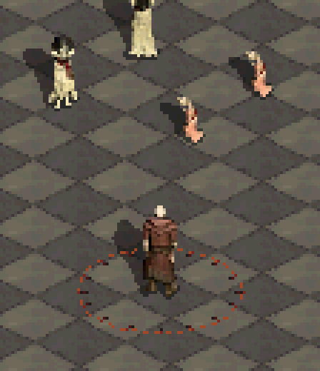
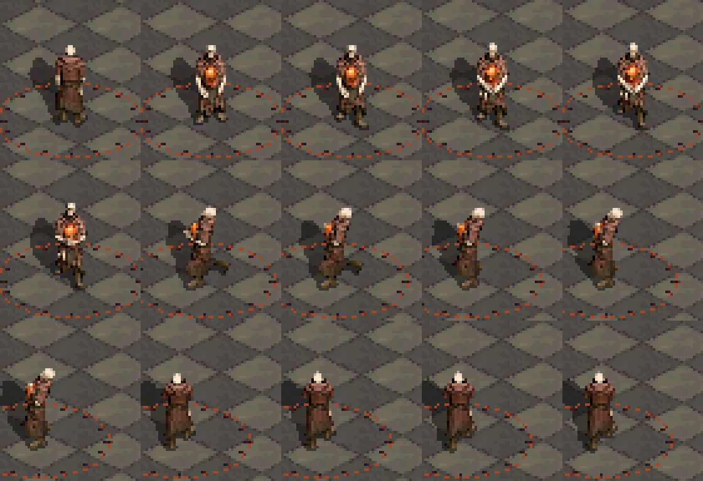
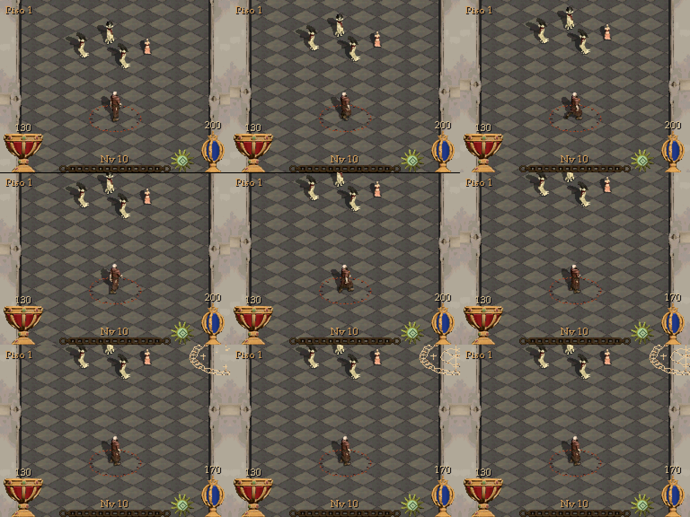
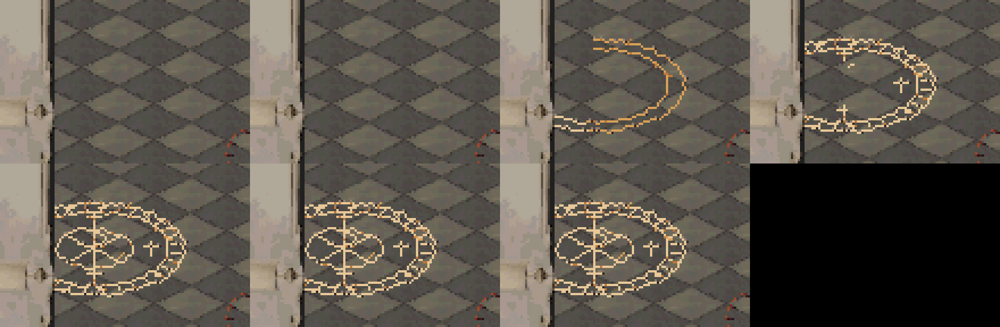
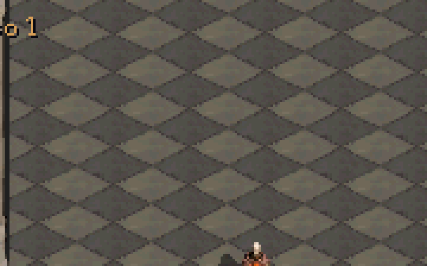
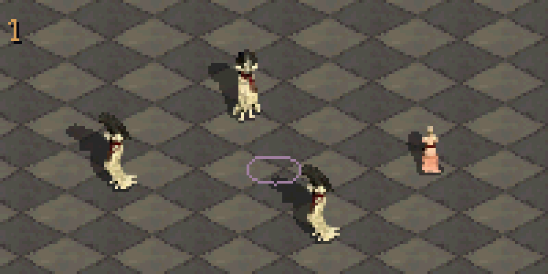

# Glifo: pulido tras probarlo en la DS (2026-11-22)

Rama `feat/glifo-pulido`, sobre `proto/arpg` (b27d882b). Cada vuelta se probó en la DS con la variante `perf`; el usuario dio el rendimiento por bueno.

## Qué cambia

- **Sin proyectil: el héroe reza.** Al soltar el lápiz el héroe junta las manos (clip Mixamo «pray standing» sobre el Corazón, `corazon_pray`, `nitrofiles/punch/pray_d0..d7.bin`) y al cerrarse las manos el sello aparece en el punto tocado. El Vial queda solo como icono de la reliquia.
- **Reza andando.** El héroe se mueve a su velocidad normal mientras apunta y mientras reza: piernas del andar y torso del rezo, con la misma composición en runtime que el puñetazo andando.
- **Alcance infinito, solo sobre suelo.** El sello va exactamente donde toca el lápiz. Sobre muro, columna u obstáculo no se lanza ni gasta maná (`ground_point_is_free` en `collision.c`). La runa, las llamas y el pozo se recortan en el borde del muro con una máscara de suelo por sello, calculada al aparecer.
- **Previsualización tenue.** Con el lápiz apoyado sobre suelo se ve la runa entera, quieta, en un tono fijo apagado (~3/8 entre el marfil y el suelo: la capa de mapa de bits no puede mezclar con el fondo), al radio real y con la forma del Redil. Sin anillo de alcance ni marca morada.
- **Runa al radio real.** Con la línea `Radio` el dibujo crece con la zona.
- **Sonidos** del banco gratuito: grieta `lab_creak.wav`, detonación `lab_mining0.wav` (una sola vez con Doble Sello). Fuera `glifo_activate.wav` y `glifo_cast.wav`.
- **Crisol:** soltar un objeto de la bolsa en el Crisol pide confirmación, como Y.
- **L hace las dos cosas:** cada pulsación pega al momento; mantenida, además abre el radial; al soltar se cierra.

## Evidencia (ROM real)

| | |
| :--- | :--- |
| Rezo andando hacia la cámara |  |
| Hoja del rezo andando (frente, lado, espalda) |  |
| Sello lejano lanzado mientras se anda |  |
| Muro: no se lanza; junto al muro, la runa se corta |  |
| Previsualización tenue y sello real |  |
| Runa a radio grande con Redil y Zarza |  |

Escenarios nuevos (`suite: false`): `glifo_reza_andando`, `glifo_lejos`, `glifo_muro` (con aserciones de maná y glifo activo), `glifo_preview`, `glifo_sello_radio*`.

## Verificación

Builds `default`, `arpg-todo` y `perf` sin avisos nuevos; `glifo_equipar`, `inventario`, `glifo_muro` y `glifo_preview` PASS. Rendimiento validado jugando en la DS por el usuario (sin log `perf`).

## Documentos

`DESIGN-ARPG.md` (ciclo del Glifo, L, Crisol), `assets/MANIFEST.md` (clip `corazon_pray` y SFX del Glifo), `AGENTS.md` (solo subagentes nativos de Claude y reglas de velocidad de los agentes), `STATUS-ARPG.md`.
