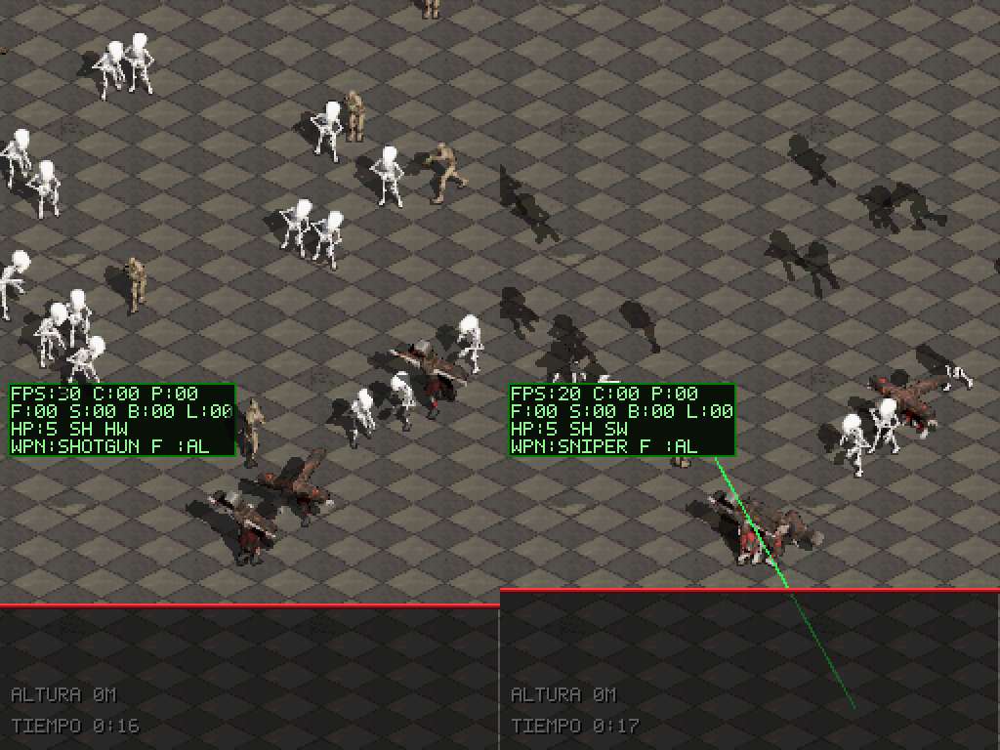
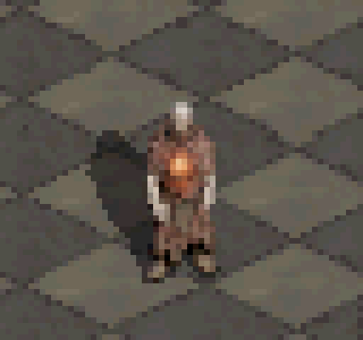
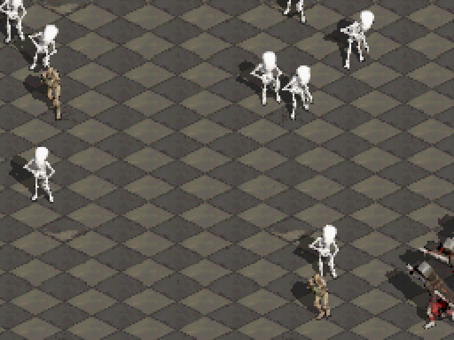
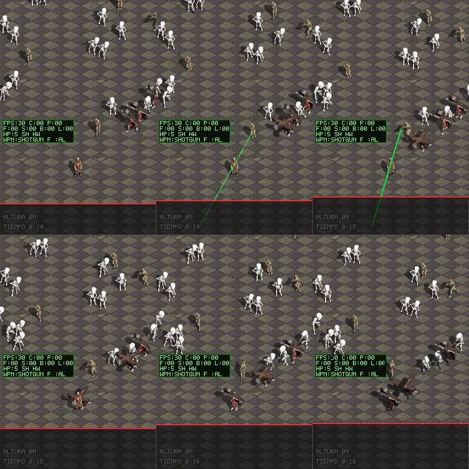
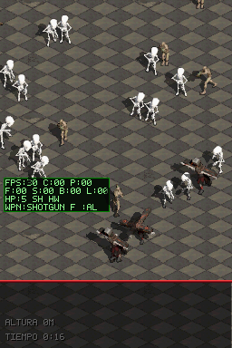
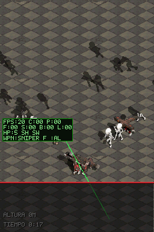

# Sombras por hardware y pase de rendimiento de la horda

**Fecha:** 2026-11-13 / 2026-11-14
**Rama:** `perf/hw-shadows`
**Objetivo:** que quepa el doble de enemigos (de 24 a 48) a 60 FPS en la DS, con el mínimo impacto en el juego. Parte del profiling de [`stress-enemies-profiling/`](../stress-enemies-profiling/walkthrough.md).

## Resultado en la DS física

Variante `stress-perf` (horda que sube a 48, enemigos de 1 PS, héroe invulnerable, `PERF_PROFILE=1`). Dos partidas de 43 y 50 s jugadas por el usuario (2026-11-14).

| | Antes (2026-11-13) | Ahora |
|---|---|---|
| 48+ enemigos, sombras suaves | 34–36 ms, 20 FPS | **14,3–15,1 ms** de media por segundo |
| 48+ enemigos, sin sombras | 17–21 ms, 30–38 FPS | — |
| Peor frame con horda llena | 46,8 ms | 17–18,5 ms |
| Frames perdidos con horda llena | sostenido a 20–30 FPS | 0–5 por segundo en los peores tramos (parte, la escritura del log a SD) |
| Pool normal (24) | 60 FPS con sombras alternadas | 8–12 ms, 60 FPS (la versión normal se jugó sin caídas) |

Presupuesto: 16,7 ms. Lo que más pesa ahora con horda llena: dibujo de sprites (~6 ms), IA (~2 ms), proyectiles (~1,4 ms), limpieza (~1 ms) y sombras (~1 ms).

Nota: la primera partida de estrés se jugó por error con las sombras viejas activadas (L+R+A) y fue a 30 FPS; además el log no se escribía (ver abajo).

## Qué se hizo (fase 1, A–F)

Cada paso se midió en DeSmuME con `scenarios/perf_stress_bench.json` (A/B, solo comparativo). CPU media del banco (~30–35 enemigos vivos):

| Paso | Cambio | CPU (emulador) |
|---|---|---|
| Base | sombras por software | 34,1 ms |
| A | sombras por hardware (ventana OBJ + oscurecer) | 22,4 ms |
| D | IA: rejilla de separación, tabla de direcciones, LOD fuera de pantalla, BFS y línea de visión más baratos | 17,9 ms |
| B | blit por tramos opacos precalculados | 16,7 ms |
| C | limpieza a 8 palabras por iteración + camino caliente en ITCM | 16,4 ms |
| E | ITCM para IA, navegación, colisión y horda | 15,6 ms |
| F | picos: rebase de la franja troceado (16,4 → 2,7 ms), láseres (5,9 → 3,7 ms), tope de 2 muertes con fragmentos por frame | ~15,5 ms |

Identidad de píxel comprobada en B (188 capturas con semilla fija) y 0 fugas de `DIRTY_VERIFY` tras B y C.

## Diferencias visibles aceptadas

Decididas en `DESIGN.md` §3: sombras solapadas se funden en un tono; bajo la marea la sombra toma la oscuridad de la marea; la sombra de un actor ocluido se oculta entera; las marcas de suelo de las armas ya no se oscurecen bajo las sombras. La separación entre enemigos se conserva.

## Arreglos colaterales

- **Log de `PERF_PROFILE`:** abría `/dungeonds_perf.log`, que tras `nitroFSInit` apunta a `nitro:/` (solo lectura) y fallaba en silencio. Ahora usa `fat:/` (o `sd:/`).
- **Tests de host:** stub `tests/host/stubs/nds/ndstypes.h` para compilar `ITCM_CODE` en el host.

## Verificación

- Compilación sin warnings: `default`, `stress-perf`, `sandbox`, `cathedral-playground`, `playground-perf`.
- Tests de host 15/15 (nuevos: `test_hw_shadows_contract`, `test_ai_perf_contract`, `test_blit_runs_contract`, `test_dirty_clear_contract`, `test_spikes_contract`).
- Escenarios: `strip_hw_shadows_stress`, `perf_stress_bench`, `perf_stress_climb`.
- DS física: versión normal jugada sin caídas; versión de estrés medida (tabla de arriba).

## Pendiente

- Picos de un frame (9–13 ms en la etapa del jugador) al subir más rápido de lo previsto por la franja.
- `strip_horde_tide`: escenario frágil por temporización (pasa o falla según 2 frames); deuda previa.
- La ROM crece ~72 KB (tramos opacos) y la RAM ~40 KB (doble búfer del suelo).
