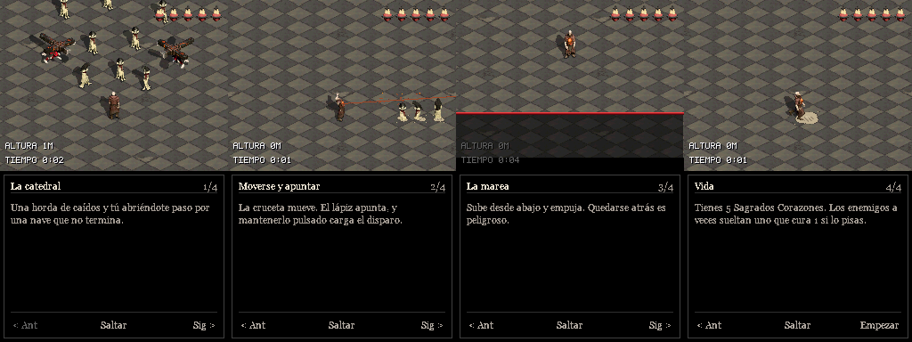

# Tarjetas de introducción (`feat/intro-tarjetas`, 2026-11-15)

Al elegir `NUEVA PARTIDA` se muestran 4 tarjetas antes de empezar: La catedral, Moverse y apuntar, La marea y Vida. Decisión en `DESIGN.md` §6.3.

- **Arriba:** bucle de vídeo de la pantalla inferior del juego real (256x192, 30 imágenes/s, sin pérdida) cargado bajo demanda desde NitroFS (`nitrofiles/intro/*.bin`, 828 KB en total; la ROM pasa de 5,19 a 6,03 MB). Se regenera con `tools/gen_intro_clips.py`.
- **Abajo:** título, texto y botones `< Ant`, `Saltar`, `Sig >` (`Empezar` en la última). Lápiz, cruceta, `A`/`B` y `L`/`R`; `Saltar` o `START` empiezan la partida. No sale al reiniciar desde la pausa.
- **Verificación:** compilación 0 warnings, host 21/21, escenario `intro_tarjetas` PASS (píxeles superiores idénticos a los clips). Validado en DS física por el usuario (sin registro de rendimiento).
- **Pendiente menor:** los bucles de las tarjetas 2, 3 y 4 saltan de golpe al reiniciar; compresión con pérdida descartada.
