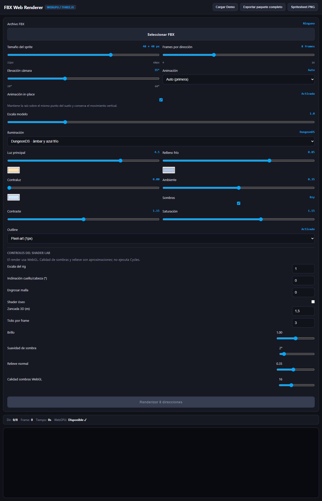

# Resultados de sprites por encima del visor 3D

## Cambio

- Se movió el visor 3D animado después de la cuadrícula de GIFs y del botón de descarga.
- Se limitó el visor a 280 px de alto (mínimo 240, máximo 320) para que quede como referencia secundaria al final de la página.

## Verificación

- Chromium headless cargó el HTML autónomo sin errores de consola (dos warnings existentes).
- La estructura del documento coloca `gifsGrid` y `btnDownloadAll` antes de `canvasArea`.
- La captura muestra el visor reducido al final; no se generaron sprites en esta comprobación.

## Evidencia

