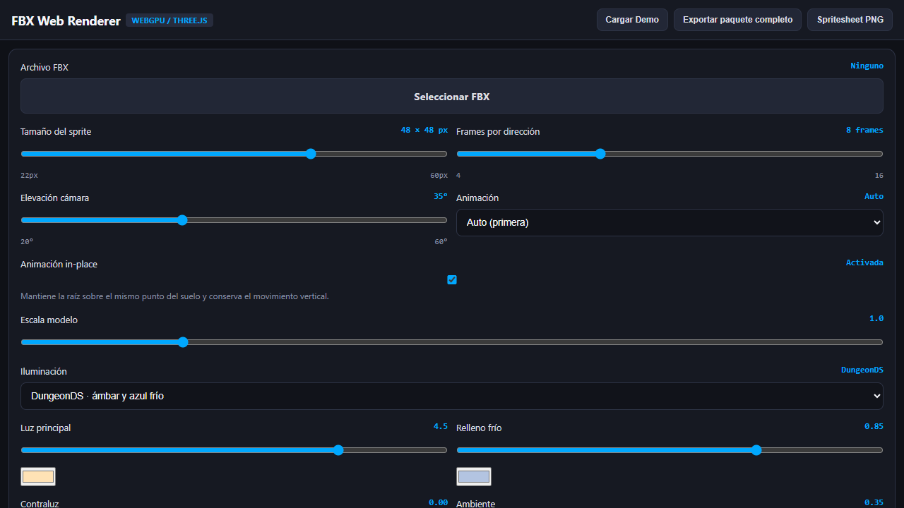

# Un solo control de tamaño para el lab 3JS

## Cambio

- El slider `Tamaño del sprite` define los píxeles reales de cada celda exportada; valor inicial: 48 × 48 px.
- Se eliminó el slider separado `Tamaño visible del sprite`.
- El encuadre fija internamente el llenado en 96% y ajusta la distancia de cámara para mantener una escala común entre poses y direcciones.

## Verificación

- Chromium headless cargó el HTML autónomo: cero errores de consola (dos warnings existentes).
- La instantánea de accesibilidad muestra `Tamaño del sprite` en 48 × 48 px y ya no muestra el slider de tamaño visible.
- El FBX no se cargó en esta comprobación; el ajuste de ocupación con un modelo queda pendiente de revisión visual.

## Evidencia

