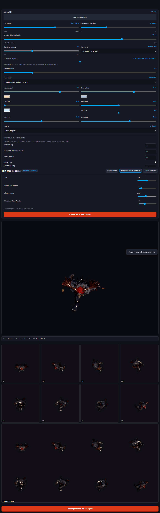

# Lab 3JS: paridad funcional de sprites

## Objetivo

Completar el visor 3JS para el flujo de render de personajes y exportacion de sprites, de modo que el lab Blender deje de ser necesario para ese flujo. La escena se renderiza con Three.js WebGL: los controles de calidad de sombras y relieve son aproximaciones y no igualan el motor Cycles.

## Cambios

- El visor conserva frames RGBA procesados para poder generar un atlas transparente de 8 direcciones por N frames.
- Se anaden exportaciones PNG del atlas, PNG individual por frame, GIF por direccion, collage y ZIP con `settings.json`.
- Se anaden controles de rig, inclinacion de cuello/cabeza, displacement, shader oseo, zancada, ticks, brillo, suavidad de sombras, relieve normal y calidad WebGL.
- La resolucion del sprite pasa a 22-60 px, valor inicial 48 px; la elevacion de camara admite minimo 20 grados.
- `tools/lab/build_offline_renderer.py` integra la capa legible en el HTML autonomo y puede repetirse sin duplicar el codigo.
- `AGENTS.md` exige automatizacion de navegador exclusivamente headless.

## Verificacion

- `node --check tools/lab/FBX-Web-Renderer-parity.js`: PASS.
- `node tools/lab/inspect-offline-fbx.cjs assets/characters/charger/Run.fbx`: PASS; ocho facings, 101 muestras y root-motion restaurado.
- Chromium lanzado por Playwright CLI en modo headless: el FBX `Run.fbx` cargo y renderizo ocho direcciones; 0 errores de consola (dos avisos heredados de Three.js).
- Exportacion: PNG RGBA transparente de 384x384; ZIP con 86 entradas, ocho GIFs direccionales, collage, spritesheet y 64 PNGs por frame.

## Limites

La paridad es de flujo, controles principales y entregables. La rasterizacion, sombras y muestreo no pueden ser pixel-identicos a Blender Cycles porque el visor usa WebGL. El ZIP indica el motor y conserva los valores relevantes para repetir el render.

## Evidencia

