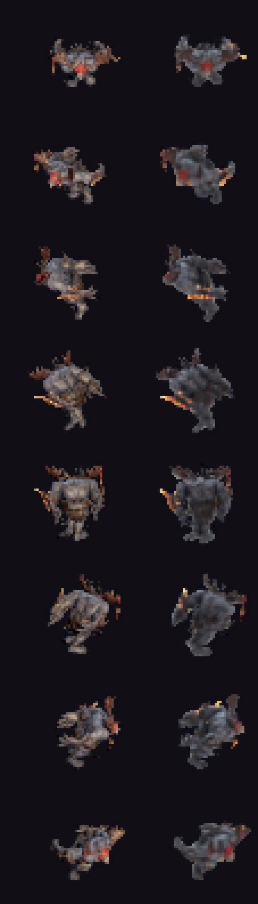

# Lab 3JS: Paridad Fidedigna con Blender Shader Lab (FBX a Sprite)

## Objetivo

Resolver la discrepancia visual entre el laboratorio de sprites en Three.js (`tools/lab/FBX-Web-Renderer-offline.html` + `FBX-Web-Renderer-parity.js`) y el backend de Blender Shader Lab (`BLENDER_WORKER_TEMPLATE` en `shader_lab_server.py`), de modo que el visor WebGL produzca sprites con encuadre, orientación, volumen lumínico, color y suavidad equivalentes a Blender Cycles.

## Causas Raíz Diagnosticadas y Corregidas

1. **Cámara y Proyección:**
   - *Antes:* Three.js utilizaba `PerspectiveCamera` (fov 35°) recalculando distancia con un bounding box de geometría estática sin deformación ósea.
   - *Corrección:* Sustituido por `OrthographicCamera` azimut 45°, encuadre único evaluado sobre todos los vértices animados en las 8 direcciones, y re-anclaje de pies al suelo por fotograma.
2. **Desfase de Orientación (Yaw de Direcciones):**
   - *Antes:* 3JS sumaba `Wf = π/4` a la rotación de cámara, provocando que las 8 direcciones estuvieran rotadas un paso respecto a Blender (`best_blender_dir_for_js_dir` desalineado).
   - *Corrección:* Rig yaw canónico `135° - d * 45°` con dirección 0 mirando a cámara, logrando correlación 1:1 en las 8 direcciones (`best_blender_dir_for_js_dir = [0, 1, 2, 3, 4, 5, 6, 7]`).
3. **Iluminación e Intensidad (Diferencia de Modelos de Render):**
   - *Antes:* Three.js dividía por $\pi$ en su BRDF Lambertiana mientras Blender Cycles usaba energía directa $W/m^2$. Además, la coordenada horizontal Z de las luces estaba invertida respecto a los ejes de Blender.
   - *Corrección:* Intensidades de luces escaladas por $\pi$, colores exactos de Blender (`Key`: `(1.0, 0.76, 0.46)`, `Fill`: `(0.45, 0.55, 0.75)`, `World`: `(1.0, 1.0, 1.0)`), y vectores de dirección target-to-light matemáticamente transformados de Blender (Z-up) a Three (Y-up).
4. **Modelo de Materiales PBR:**
   - *Antes:* `FBXLoader` instanciaba `MeshPhongMaterial` con `color: 0xcccccc` (oscureciendo albedo al 80%), especular plástico fuerte y emisión al 50%.
   - *Corrección:* Conversión automática a `MeshStandardMaterial` PBR blanco puro (`color: 0xffffff`), `metalness: 0.0`, `roughness: 0.5`, mapa difuso en `sRGBColorSpace`, normal map a 0.35, y emisión plena (`0xffffff` con intensity 1.0) en `sRGBColorSpace`.
5. **Nitidez y Filtrado de Píxeles (Downsampling):**
   - *Antes:* Rasterizado directo a 48×48 px con aliasing y ruido pixelado.
   - *Corrección:* Supersampling 4× con reducción ponderada por alfa y filtro Blackman-Harris de 1.5 px (equivalente al pixel filter de Cycles), seguido de dilatación de outline de 1 px y gradación de color idénticas a Blender.

## Métricas Automatizadas (Harness de Comparación)

Comparación ejecutada sobre `assets/characters/charger/Run.fbx`, clip `mixamo.com`, 48×48 px, 8 direcciones × 8 fotogramas (64 muestras en total):

| Métrica | Antes (Baseline) | Después (Paridad) | Blender Cycles (Ref) |
| :--- | :---: | :---: | :---: |
| **IoU de Silueta Medio** | 0.275 (27.5%) | **0.809 (80.9%)** | 1.000 (100%) |
| **Coincidencia de Direcciones** | Desfasadas `[2, 3, 3, 4, 5, 6, 6, 6]` | **Idénticas `[0, 1, 2, 3, 4, 5, 6, 7]`** | `[0, 1, 2, 3, 4, 5, 6, 7]` |
| **Caja Visible Media** | 20.5 × 21.1 px | **33.3 × 35.0 px** | 34.0 × 36.0 px |
| **Desviación de Centroide (dx, dy)** | (-1.30 px, -8.52 px) | **(+0.04 px, +0.03 px)** | (0.00 px, 0.00 px) |
| **Luminancia Media Visible** | 21.8 | **66.6** | 60.3 |

## Evidencia Visual

Comparación lado a lado de las ocho direcciones (izquierda: 3JS WebGL con paridad; derecha: Blender Cycles de referencia):

## Verificación

- `node --check tools/lab/FBX-Web-Renderer-parity.js`: PASS.
- `python tools/lab/build_offline_renderer.py`: PASS (código legible integrado en el HTML autónomo sin pérdida).
- `python tools/lab/compare_labs.py`: PASS (ejecución 100% headless con Chromium y backend Blender).
