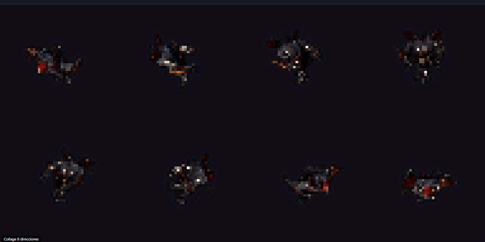
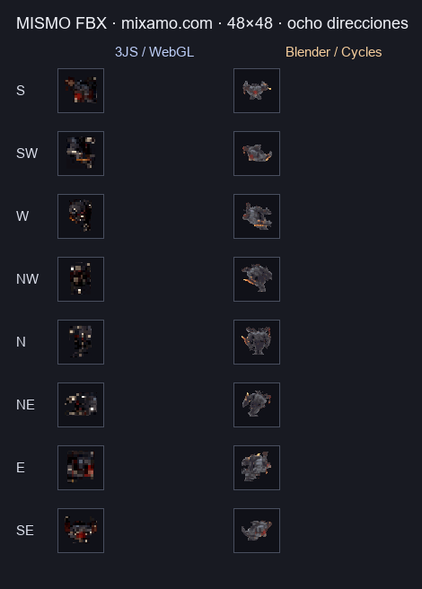

# Ajuste real del tamaño visible en el lab 3JS

## Problema

El control `Tamaño del sprite` fijaba correctamente el lienzo de salida, pero el personaje riggeado ocupaba mucho menos espacio que en Blender. El encuadre de Three.js medía los límites de la geometría en reposo, sin deformación de la armadura, y además usaba un azimut distinto al del lab Blender.

## Cambio

- El cálculo de límites ahora recorre los vértices de la pose animada y actualiza las matrices del esqueleto, igual que el cálculo de malla evaluada del lab Blender.
- El render usa el azimut isométrico de 45° de Blender.
- El margen de encuadre sale directamente del tamaño de la celda: con outline se reservan 2 px; sin outline se usa toda la celda. No se añade otro control de tamaño visible.
- El ajuste se recalcula para las poses y direcciones del ciclo y mantiene un encuadre común para todas.

## Verificación

- `node --check tools/lab/FBX-Web-Renderer-parity.js`: PASS.
- `python tools/lab/build_offline_renderer.py`: PASS; el HTML offline se reconstruyó desde la capa legible.
- Chromium Playwright sin `--headed` (headless), `Run.fbx`, clip `mixamo.com`, 8 direcciones × 8 frames: render completado en ~3 s, 0 errores de consola (2 avisos heredados).
- A 48×48, la caja alfa media pasó de 21.1×21.3 px a 36.1×36.2 px. El render Blender de referencia para el mismo FBX/clip medía 34×36 px.
- A 32×32, la caja alfa media queda en 24.2×24.4 px, escala proporcionalmente con el único control de tamaño.

## Límite

El render sigue usando Three.js WebGL y proyección perspectiva; Blender usa cámara ortográfica y Cycles. El tamaño visible queda alineado en el FBX de referencia, pero no implica igualdad píxel a píxel entre motores.

## Evidencia

## Comparativa Blender vs 3JS

La captura anterior mostraba solo el resultado 3JS. Esta comparativa coloca las ocho direcciones de la salida corregida junto a la referencia de Blender para el mismo `Run.fbx`, el clip `mixamo.com` y celdas de 48×48 px:

Las capturas originales de los laboratorios usan escalas distintas en pantalla; la comparativa ajusta cada silueta a la celda final de 48 px para que la diferencia no dependa del zoom de la interfaz. Las medidas medias de las 64 muestras siguen siendo 36,1×36,2 px en 3JS y 34×36 px en Blender.

Capturas de origen: [3JS](assets/run-48px-headless.png) · [Blender](../lab3js-vs-blender/assets/blender-collage.gif).
