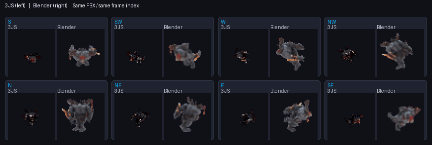
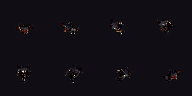
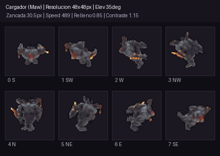

# Lab 3JS vs Blender

## Objetivo y material

Comparar la legibilidad que producen los dos laboratorios con el mismo modelo animado: `assets/characters/charger/Run.fbx`. Se usó el clip `mixamo.com` (acción Blender `Armature|mixamo.com|Layer0`, frames 1–20, duración indicada por 3JS: 0,63 s). Los FBX nuevos del marine y el necron no se usaron porque están riggeados pero aún no tienen animación.

## Parámetros igualados

| Parámetro | Valor |
| --- | --- |
| Resolución / frames | 48×48 px; 8 frames por dirección |
| Direcciones | S, SW, W, NW, N, NE, E, SE |
| Cámara | Elevación 35°; azimut inicial 45° |
| Animación | `mixamo.com`, in-place, 8 muestras |
| Outline y color | Pixel-art 1 px; contraste 1,15; saturación 1,15; brillo 1,0 |
| Luces | Principal 4,5; relleno 0,85; ambiente 0,35; suavidad 2°; normal 0,35 |
| Calidad | 16 en el control de calidad de cada laboratorio |

El encuadre también tenía el mismo objetivo nominal: 3JS usa `visibleFill=96%`; Blender calcula el encuadre ortográfico sobre las poses y direcciones y deja 46 px de margen objetivo dentro de la celda de 48 px (95,8%). La salida de comparación sincronizada fuerza 100 ms por frame para poder inspeccionar los mismos índices; no representa la velocidad de reproducción original.

## GIFs

### Comparación sincronizada

Cada panel muestra el mismo índice de frame y dirección: 3JS a la izquierda, Blender a la derecha. La comparación se generó desde los PNG por frame exportados por ambos laboratorios.

### Salidas de cada laboratorio

**3JS — contacto estático de las ocho direcciones** (el paquete del lab también incluye GIFs animados individuales por dirección):

**Blender Shader Lab — collage GIF animado de ocho direcciones:**

Ajustes exportados: [3JS](assets/3js-settings.json) y [Blender](assets/blender-settings.json).

## Comparación

En esta muestra, **Blender sale claramente más legible**. Medí los 64 PNG de cada salida (8 direcciones × 8 frames), contando píxeles con alfa:

| Medida media por frame | 3JS | Blender |
| --- | ---: | ---: |
| Caja visible (ancho × alto) | 21,1 × 21,3 px | 34,0 × 36,0 px |
| Celda cubierta por píxeles visibles | 11,0% | 28,6% |
| Luminancia media de los píxeles visibles | 21,1 | 59,9 |

Blender ocupa aproximadamente 1,6× más anchura y 1,7× más altura; la cobertura de píxeles alfa es 2,6× mayor. También queda mucho más luminoso en esta salida. Esto coincide con la impresión de que el modelo se distingue mejor en Blender.

La comparación muestra una diferencia práctica entre los laboratorios, pero no aísla la calidad de Cycles frente a WebGL: los valores “16” no son equivalentes (muestras Cycles frente a calidad del shadow map WebGL), los materiales/color management se procesan de forma distinta y, aunque el objetivo de encuadre nominal está igualado, el tamaño final de la silueta no. El autoencuadre actual de 3JS no está llenando la celda como Blender para este FBX; esa es la principal discrepancia visual a resolver.

## Evidencia y límites

- Blender generó el collage en modo background con el backend del Shader Lab.
- 3JS cargó el FBX, seleccionó `mixamo.com`, renderizó ocho direcciones y exportó el paquete en Chromium headless: 0 errores de consola y 2 avisos deprecados de Three.js.
- La comparación usa los mismos índices de frame; no garantiza que cada índice represente el instante exacto idéntico porque cada pipeline muestrea el clip a su manera.
- La prueba mide un FBX animado; no concluye aún cómo se comportan los modelos de marine y necron sin animación.
