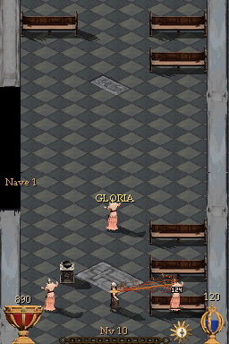
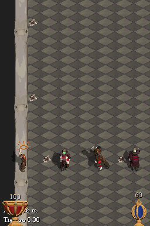
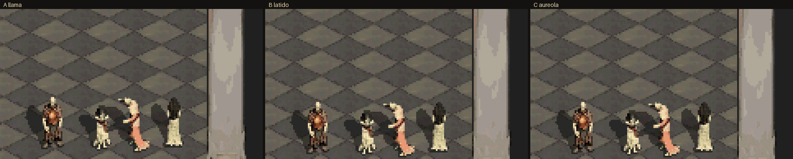
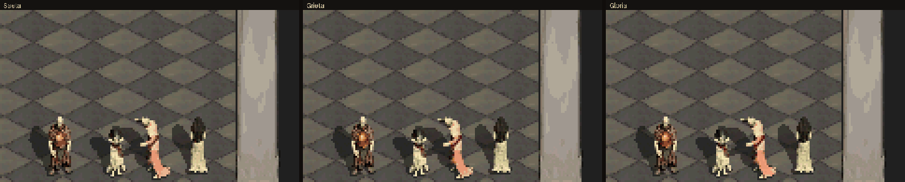

# Rayo cargado del Corazón Abierto: halo de carga y disparo «Gloria»

Rama `proto/laser-test`, integrada en `arpg` el 2026-11-27.

## Qué cambia para el jugador

- **Señal de carga:** un halo sobre la cabeza que se dibuja como un reloj mientras se carga; al estar cargado suelta una gloria de rayos. Sustituye al anillo de suelo de «listo».
- **Disparo «Gloria»:** haz ancho de rayos separados con lenguas de fuego, fogonazo en el pecho e impacto. Las cruces de impacto genéricas ya no salen.
- **Por capas:** rayos, llamas, impacto y fogonazo son capas independientes, para que una pasiva futura cambie solo una.
- **Alcance:** revisado y correcto (elipse 2:1, 110 px horizontal / 55 vertical). Sin cambios.
- Saeta y Grieta quedan en el código, seleccionables con SELECT solo en la variante `rayos-test`.

## Evidencia en la ROM integrada

| Listo (halo + gloria) | Disparo (fotograma 12) | Apuntado en el sandbox |
| :--- | :--- | :--- |
|  |  |  |

## Ronda 1: señal de carga (A, B, C; elegida C)

Artifact: https://claude.ai/artifact/93zkpQMkSSxPkNX3U3dqGH

A «Llama que se cierra» ([GIF](assets/laser_A.gif), [contacto](assets/contact_A.png)) · B «Latido» ([GIF](assets/laser_B.gif), [contacto](assets/contact_B.png)) · C «Aureola», elegida ([GIF](assets/laser_C.gif), [contacto](assets/contact_C.png)). Estado previo: [laser_actual.gif](assets/laser_actual.gif); fotogramas clave: [keyframes.png](assets/keyframes.png). Código de A, B y C conservado en las ramas `proto/laser-a`, `proto/laser-b`, `proto/laser-c` (y `proto/laser-abc`).

## Ronda 2: disparo (Saeta, Grieta, Gloria; elegida Gloria)

Artifact: https://claude.ai/artifact/HfjTw46e4P6iYCJC393CBZ

Saeta ([GIF](assets/laser_saeta.gif), [contacto](assets/contact_saeta.png)) · Grieta ([GIF](assets/laser_grieta.gif), [contacto](assets/contact_grieta.png)) · Gloria ([GIF](assets/laser_gloria.gif), [contacto](assets/contact_gloria.png)).

## Verificación

- Build `arpg` por defecto: 0 warnings, tras el merge también.
- `test_guardrails`: PASS (efectos con paleta `FX_SH_*`).
- Escenarios `sniper_*` en la variante `sandbox`: PASS salvo `sniper_hit_sweep_east` y `sniper_hit_sweep_west` (`up4.e0_hp` queda en 100). **Deuda previa:** fallan igual en `arpg` sin esta entrega (aserciones de vida desfasadas); no se han tocado. Los `sandbox_sniper_fire*` son solo de capturas y no producen resultado.
- **Sin medir:** 60 FPS en la DS (ROM `perf` compilada, no subida).
- **Pendiente:** la mini ROM `rayos-test` sale sola del campamento porque `arpg-boxeo` arranca en un campamento negro.

## MDs

`DESIGN-ARPG.md` (aspecto del Rayo y catálogo de las seis variantes), `STATUS-ARPG.md` y `STATUS-ARCHIVE.md`. Sincronizados con `roguelike`.
