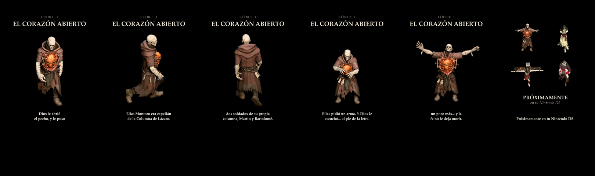

# Biblia del lore y primer lote de vídeos de redes

Sesión `docs/lore-biblia` (2026-11-14 → 2026-11-16).

## Qué se entrega

- **`LORE.md`**, la biblia del mundo: eje temático (los monstruos son las personas que la Iglesia condenó por cosas que hoy son buenas; mundo abiertamente LGBT), reglas de escritura (el abuso se insinúa con claridad pero nunca se describe), cronología en lenguaje llano, personajes y relaciones cruzadas, y lo que sigue **[ABIERTO]**. Referenciada desde `AGENTS.md` y `DESIGN.md` §6.11.
- **10 guiones** (`assets/videos/guiones/lote-01.md`), escritos contra la biblia, con nombres cruzados entre historias y una frase final por personaje con su propia voz. Incluye el calendario de los próximos 10 días y el desglose del siguiente vídeo.
- **Generador de lotes** `render_guiones.py` (skill `codice-lore-video`): del markdown al vídeo con un comando. Voz por frase con caché, voces de personaje (diseñadas a medida o recortadas de la muestra elegida), parejas de personajes, un plano por frase con puesta en escena (direcciones, primer plano, trayectos por la pantalla con la zancada medida) y paso natural por defecto.
- **Sprites nuevos para vídeo:** `corazon_walk` y `exvoto_walk_b` (segunda monja de cera con otra postura y otro paso, generada con `EXVOTO_VARIANT=b` en `tools/characters/build_exvoto.py`).
- **Vídeos publicados:** `assets/videos/lore01_01_el_corazon_abierto.mp4` (v2), `lore01v3_01_el_corazon_abierto.mp4` (v3, recortada) y `lore01_03_jimena_y_aldonza.mp4` (versión definitiva con puesta en escena).

## Lo aprendido publicando (TikTok, Instagram, YouTube)

| Versión | Cambio | Resultado |
| :--- | :--- | :--- |
| 01 v1 | Primer fotograma negro, frase de contexto al principio | TikTok 3,8 s de media sobre 48 s; la mayoría se va en el segundo 2 |
| 01 v2 | Sin negro, frase fuerte primero, subtítulos por encima de la zona de botones | TikTok 7,2 s; Instagram de 8 a 10 s |
| 01 v3 | Igual que v2, recortada a 38 s | Algo peor que la v2 en todas las plataformas |
| 03 | Un plano por frase con puesta en escena propia | Elegida por el usuario como modelo |

- Subir a TikTok desde Metricool deja el vídeo en 0 visualizaciones; a mano funciona. Instagram y YouTube desde Metricool, sin problema.
- Voces de personaje: con mucha emoción pierden el acento y alargan palabras; mejor recortar la frase de la muestra que eligió el usuario (`archivo:` en la tabla de voces).
- Calendario: no repetir personaje en días seguidos.

Las reglas que salen de aquí están en `.agents/skills/codice-lore-video/SKILL.md`.

## Evidencia

Tiras de 6 fotogramas de los vídeos publicados:

- 
- 
- 

## Pendiente

- Vídeos 02 y 04–10: guiones reescritos con arranque fuerte y puesta en escena; probados sin voz, sin generar con voz. Los MP4 antiguos de esos números no se versionan.
- Capa de props en el generador (velas, columnas que desfilan) para el día 1 del calendario.
- Lore del Campanero y destino del padre Anselmo (`LORE.md` §9).
- Voces con efecto de radio (Remedios, Bartolomé): sustituir por recortes de su muestra si molestan.
