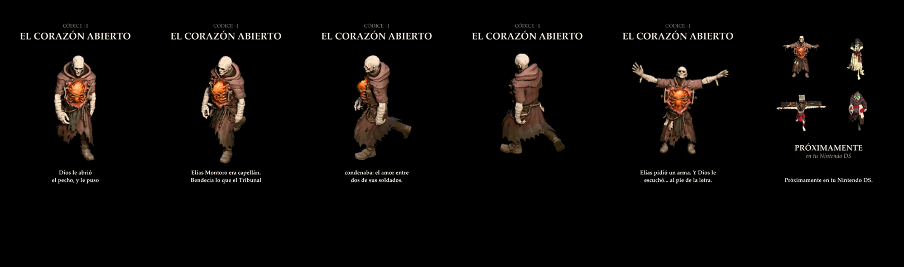
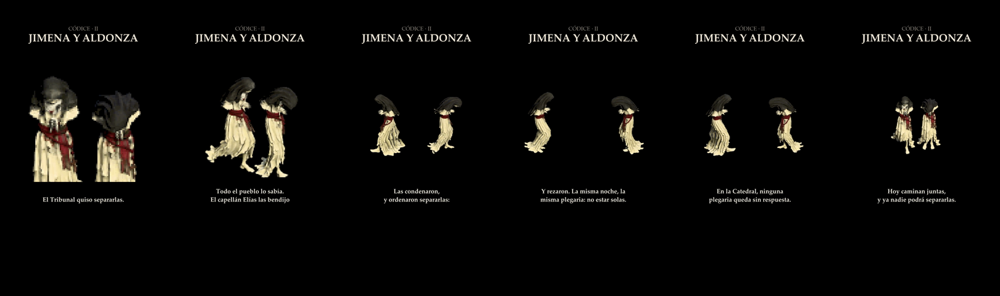
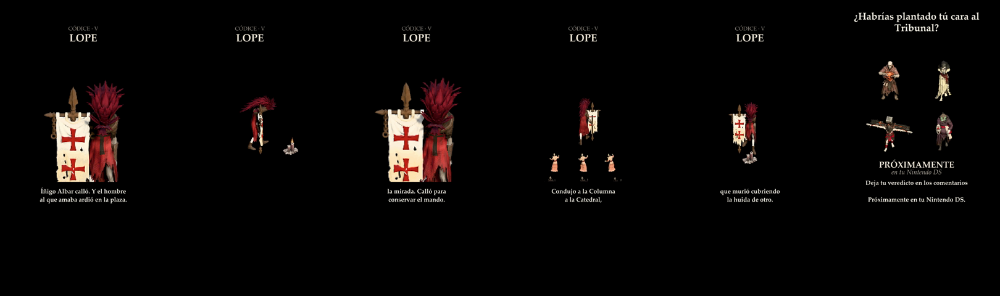

# Biblia del lore y primer lote de vídeos de redes

Sesión `docs/lore-biblia` (2026-11-14 → 2026-11-16).

## Qué se entrega

- **`LORE.md`**, la biblia del mundo: eje temático (los monstruos son las personas que la Iglesia condenó por cosas que hoy son buenas; mundo abiertamente LGBT), reglas de escritura (el abuso se insinúa con claridad pero nunca se describe), cronología en lenguaje llano, personajes y relaciones cruzadas, y lo que sigue **[ABIERTO]**. Referenciada desde `AGENTS.md` y `DESIGN.md` §6.11.
- **10 guiones** (`assets/videos/guiones/lote-01.md`), escritos contra la biblia, con nombres cruzados entre historias y una frase final por personaje con su propia voz. Incluye el calendario de los próximos 10 días y el desglose del siguiente vídeo.
- **Generador de lotes** `render_guiones.py` (skill `codice-lore-video`): del markdown al vídeo con un comando. Voz por frase con caché, voces de personaje (diseñadas a medida o recortadas de la muestra elegida), parejas de personajes, un plano por frase con puesta en escena (direcciones, primer plano, trayectos por la pantalla con la zancada medida) y paso natural por defecto.
- **Sprites nuevos para vídeo:** `corazon_walk` y `exvoto_walk_b` (segunda monja de cera con otra postura y otro paso, generada con `EXVOTO_VARIANT=b` en `tools/characters/build_exvoto.py`).
- **Vídeos publicados:** `assets/videos/lore01_01_el_corazon_abierto.mp4` (v2), `lore01v3_01_el_corazon_abierto.mp4` (v3, recortada) y `lore01_03_jimena_y_aldonza.mp4` (versión definitiva con puesta en escena).

## Lo aprendido publicando (TikTok, Instagram, YouTube)

| Versión | Cambio | Resultado |
| :--- | :--- | :--- |
| 01 v1 | Primer fotograma negro, frase de contexto al principio | TikTok 3,8 s de media sobre 48 s; la mayoría se va en el segundo 2 |
| 01 v2 | Sin negro, frase fuerte primero, subtítulos por encima de la zona de botones | TikTok 7,2 s; Instagram de 8 a 10 s |
| 01 v3 | Igual que v2, recortada a 38 s | Algo peor que la v2 en todas las plataformas |
| 03 | Un plano por frase con puesta en escena propia | Elegida por el usuario como modelo |

- Subir a TikTok desde Metricool deja el vídeo en 0 visualizaciones; a mano funciona. Instagram y YouTube desde Metricool, sin problema.
- Voces de personaje: con mucha emoción pierden el acento y alargan palabras; mejor recortar la frase de la muestra que eligió el usuario (`archivo:` en la tabla de voces).
- Calendario: no repetir personaje en días seguidos.

Las reglas que salen de aquí están en `.agents/skills/codice-lore-video/SKILL.md`.

## Evidencia

Tiras de 6 fotogramas de los vídeos publicados:

- 
- 
- 
- 

## 07 Lope (2026-11-19)

Cuatro vueltas con el usuario sobre un mismo MP4 (`assets/videos/lore01_07_lope.mp4`):

1. **Guion:** el borrador era enigmático; se reescribió con una culpa concreta (Íñigo pudo plantar cara al Tribunal y calló para conservar el mando), el estandarte que toca el suelo y el juramento de no dejar caer a nadie. Pregunta final: «¿Habrías plantado tú cara al Tribunal?».
2. **Animación nueva `abanderado_derrota`** (Mixamo «Plant A Plant» espejado, `tools/characters/build_abanderado_derrota.py`): el asta cae, Íñigo se derrumba y golpea el suelo con el puño izquierdo 4 veces y la recoge. La muñeca llega a ~9 cm del suelo y de frente los golpes se leen poco, porque la melena tapa el brazo.
3. **Correcciones del usuario:** monaguillos fuera salvo en la Columna (capitán arriba a 2,3×, formación 3×3 detrás a 0,8×); plano 2 en `medio` con el altar visible; paso lento (`lento 1.5`); relicario sin recuadro negro que cortaba el penacho; cita final más lenta (voz a 0,8 y `(pausa 0.5)`).
4. **Pendiente de comprobar en el MP4 final:** nadie escuchó el audio nuevo ni revisó el subtítulo de la cita; el recuadro negro del altar sigue existiendo en los planos con `altar` sin `medio` (p. ej. el 08).

El feedback, generalizado, está en la skill `codice-lore-video` (reglas 7-9). Cambios de generador sin revisión de código: `render_guiones.py` (fichas `medio` y capitán, `CHAR_SPEED`, `CROWD_PACE_LEAD`, `ALTAR_MEDIO_*`) y parches del lab para volcar 56 fotogramas (`--noCHeader` en `export_character_headless.cjs`).

## 04 El Liebre (2026-11-20)

Vídeo final `assets/videos/lore01_04_el_liebre.mp4` (74,1 s, con voz; la historia acaba a los 60 s). Tira: [`lore01_04_el_liebre_tira.png`](assets/lore01_04_el_liebre_tira.png).

1. **Nueve pruebas con animaciones a medida** (escondido, arrodillado con la cruz, tumbado sobre ella) que salían mal: poses raras y una cabeza que se plegaba hacia atrás, porque el exportador del lab solo aplica rotaciones de los huesos.
2. **Simplificación decidida con el usuario:** 6 animaciones ya probadas (Mixamo tal cual y las del juego). Inés aparece cuando se dice que le escondió, Bartolomé ya en la cruz cuenta que la pidió, y el martillo de Tadeo se oye sobre negro. Guion recortado de 86 s a 60 s de historia: fuera la mentira del acta, que sigue en `LORE.md`.
3. **Correcciones del usuario:** fuera el correr mirando atrás (la huida y Martín, en un solo plano continuo de espaldas); todos los planos a cuerpo entero; martillo metálico de tres golpes (`assets/videos/sfx/martillo_clavo.wav`, elegido entre 3); cita de Bartolomé plana (`assets/videos/voces/bartolome_cita.mp3`, elegida entre 3), porque la voz original sobreactuaba.
4. **Generador:** fichas `negro` y `sfx … fin`; el volumen de los efectos pasa de 0,5 a 0,8. Exportador del lab: `--dirs` y `--pivot`; HTML offline del lab regenerado.

Lo generalizado está en la regla 10 de la skill `codice-lore-video`. Sin revisión de código de los cambios del generador y del lab. `DESIGN.md` y `TECHNICAL.md` no cambian.

## 09 Los monaguillos (2026-11-21)

Vídeo final `assets/videos/lore01_09_los_monaguillos.mp4` (57,8 s, con voz). Tira: [`lore01_09_los_monaguillos_tira.png`](assets/lore01_09_los_monaguillos_tira.png). Pregunta final: «¿Habrías hablado tú, sabiendo el castigo?».

1. **Guion:** el borrador no tenía pregunta moral; se añadió y la cita pasó a un plano propio del monaguillo (en la primera prueba salía con Íñigo en primer plano).
2. **Correcciones del usuario:** el plano de «Aún marchan tras él» era un primer plano cortado del Abanderado, sin monaguillos. Quedó como marcha de espaldas tras Íñigo y, para no repetir la animación, una segunda marcha de frente hacia cámara solo con monaguillos (con dos animaciones y de frente el generador mezcla todas y salían casi todo abanderados).
3. **Decisión de producción:** no se hace Gaspar humano para el 05; los personajes salen siempre como condenados recreando su pasado (`lote-01.md`, calendario y regla de imagen).
4. **No verificado:** nadie ha escuchado el audio final. `DESIGN.md`, `TECHNICAL.md`, `LORE.md` y `assets/MANIFEST.md` no cambian; el generador no se toca.

## 10 No es mi corazón (2026-11-22)

Vídeo final `assets/videos/lore01_10_no_es_mi_corazon.mp4` (66,1 s, con voz). Tira: [`lore01_10_no_es_mi_corazon_tira.png`](assets/lore01_10_no_es_mi_corazon_tira.png). Pregunta final: «¿Quién está más vivo: el que murió o el que lo lleva?».

1. **Sesión previa (Command Code, sin voz):** pregunta moral elegida por el usuario; fuera el arranque «Martín Arce recibió tres balas…» (literal y repetía el 04), sustituido por «En el pecho de este capellán late el corazón de un soldado muerto».
2. **Lavado final:** se dice que Martín y Bartolomé se amaban antes de «aquel amor» (antes no se entendía); «le dio lo único que aún latía» pasa a «le puso dentro el corazón de Martín» (chocaba con «el muchacho frío» y no se entendía de quién era el corazón); Inés sube siguiendo ese latido como pista final (enlaza con el 06); la frase de Elías a cuerpo entero y la cita de Martín sobre el corazón en busto, con la voz de Martín a 0,8 (`CHAR_SPEED`).
3. **Revisado:** fotogramas de los 14 planos, subtítulos sin cortes raros y volumen igual que el 07 (la cita suena unos 3 dB por encima del narrador). Nadie ha escuchado el audio final.
4. `DESIGN.md`, `TECHNICAL.md`, `LORE.md` y `assets/MANIFEST.md` no cambian.

## 05 Sor Leonor (2026-11-23)

Dos montajes del mismo vídeo para publicarlos como A/B (mismo guion, audio y planos):

- **A clásico:** `assets/videos/lore01_05_sor_leonor.mp4` (62,1 s), con el generador de siempre. Tira: [`lore01_05_sor_leonor_tira.png`](assets/lore01_05_sor_leonor_tira.png).
- **B dinámico (Remotion):** `assets/videos/lore01_05_sor_leonor_remotion.mp4`: el título entra con un golpe, subtítulo palabra a palabra con la palabra activa en dorado apagado, zoom lento por plano, golpes de zoom en «halló» y «fabrica» y destello en la condena. Composición `Lore05` en el proyecto Remotion del devlog (`C:\codexlocal\devlog\src\lore\`, fuera de este repo); toma el audio y los planos del render A, y los tiempos por palabra salen de repartir cada frase por longitud sobre los tramos con voz (no hay Whisper local). Tira: [`lore01_05_sor_leonor_remotion_tira.png`](assets/lore01_05_sor_leonor_remotion_tira.png).

1. **Guion:** arranque nuevo («Este farol condenó a una novicia por decir que no») para que no se confunda al Ojo con Leonor, y pregunta moral «¿Mintió Leonor… o mintió el farol?».
2. **Correcciones del usuario:** Leonor aparece como monja de cera (`exvoto_walk_b`) en sus frases y en la cita; el Ojo solo como el Tribunal, a `lento 2` porque iba «aceleradísimo».
3. **Publicación:** en Instagram, las dos como Reels de prueba (mismo público, no seguidores) y se comparte la ganadora; en TikTok y YouTube, las dos separadas unas horas y se oculta la peor. Se compara el porcentaje visto y los comentarios por 1.000 vistas (tabla de `## Publicado` en `lote-01.md`).
4. **No verificado:** nadie ha escuchado el audio final ni comprobado en movimiento el ritmo nuevo. Si gana B, conviene meter el montaje en el generador para que siga siendo un solo comando.
5. **Calendario:** mañana toca el 06 Inés, también monja de cera; para no repetir personaje dos días seguidos, adelantar el Campanero.
6. `DESIGN.md`, `TECHNICAL.md`, `LORE.md` y `assets/MANIFEST.md` no cambian; el generador no se toca.

## Pendiente

- Vídeo 06: guion reescrito con arranque fuerte y puesta en escena; probado sin voz, sin generar con voz. El MP4 antiguo de ese número no se versiona.
- Capa de props en el generador (velas, columnas que desfilan) para el día 1 del calendario.
- Lore del Campanero y destino del padre Anselmo (`LORE.md` §9).
- Voces con efecto de radio (Remedios): sustituir por recortes de su muestra si molestan.
