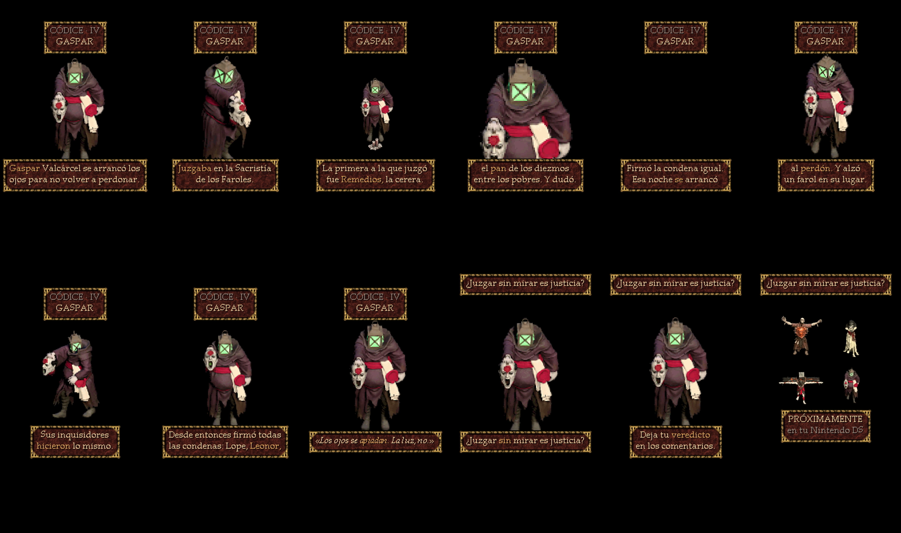

# Lote 02 de lore: vídeos y montaje definitivo en Remotion

Sesiones del 2026-11-26 (01 Los Bebés) y 2026-11-27 (02 Gaspar). Guiones, textos de los posts y tabla de lo publicado en `assets/videos/guiones/lote-02.md`.

## 02 · Gaspar (`CÓDICE · IV`)

- **Vídeo:** `assets/videos/lore02_02_gaspar_remotion.mp4` (69,3 s, con voz). Sale solo el Ojo (`ojo_look`, `ojo_walk`, `ojo_sentence`), la vela apagada a sus pies cuando se nombra a Remedios y un plano en negro para el momento de los ojos.
- **Lore nuevo** (`LORE.md`, el Ojo del Tribunal): la primera condena de Gaspar fue la de Remedios. La miró, vio a quien repartía el pan de los diezmos, dudó, firmó igual y esa noche se arrancó los ojos; sus inquisidores hicieron lo mismo. Elegido por el usuario frente a «un monaguillo», que se pisaba con el vídeo de don Tomás.
- **Pregunta:** «¿Juzgar sin mirar es justicia?». Título: «Se arrancó los ojos para no perdonar · Códice».

## Remotion + la plantilla, estilo definitivo

Decisión del usuario (2026-11-27): lo que se publica es el montaje de Remotion con la plantilla del tema (`GameBox`). El render clásico pasa a ser un paso intermedio.

- `render_guiones.py` escribe el plan de montaje (`scratch/codice-video/<prefijo>/remotion.json`: planos, tramos, cabecera, pregunta).
- En `C:\codexlocal\devlog` (fuera del repo): `src/lore/prepare_lore.py` lo convierte en `public/<id>/` y `src/lore/<id>.json`, y la composición genérica `src/lore/LoreVideo.tsx` monta cualquier vídeo. Cada vídeo nuevo es una línea en `src/Root.tsx`.
- Flujo de tres comandos en la skill `codice-lore-video` (regla 11 y «Flujo recomendado»).

MDs: cambia `LORE.md` (sincronizado con `arpg`); el resto no cambia.
