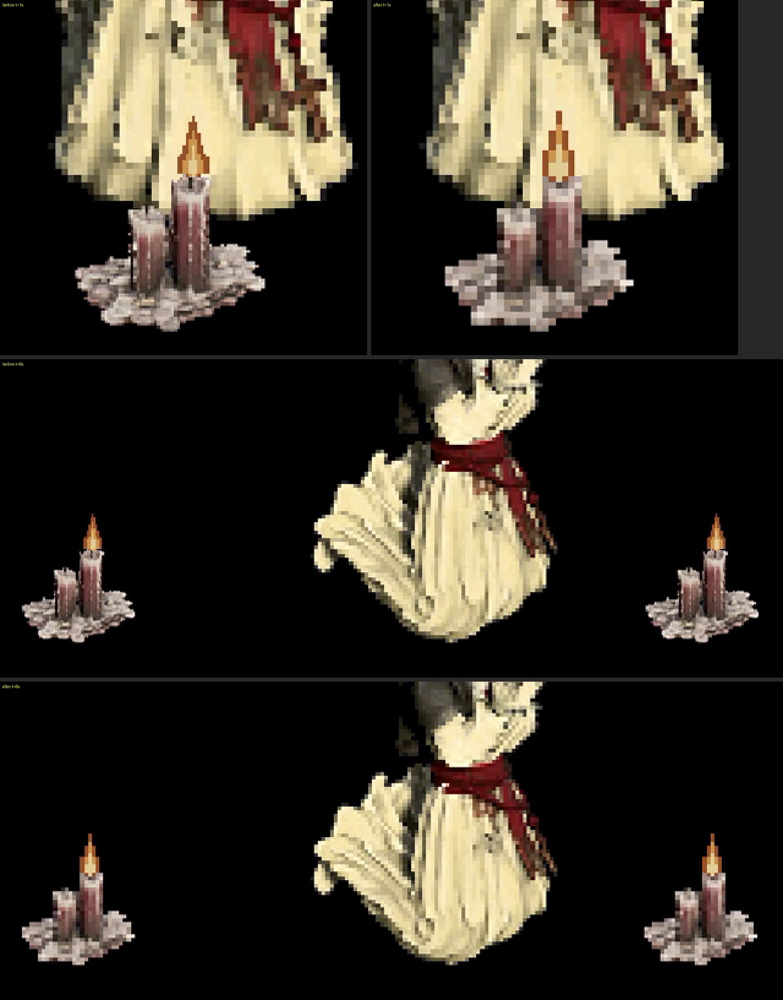
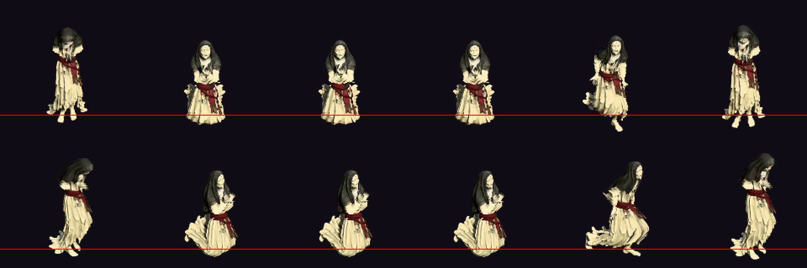
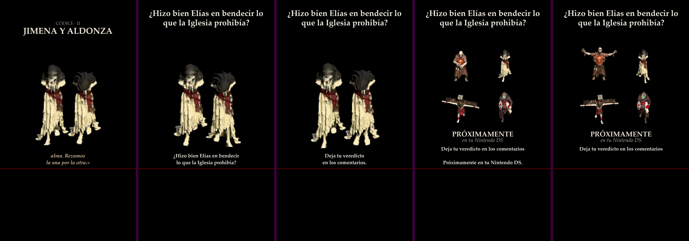
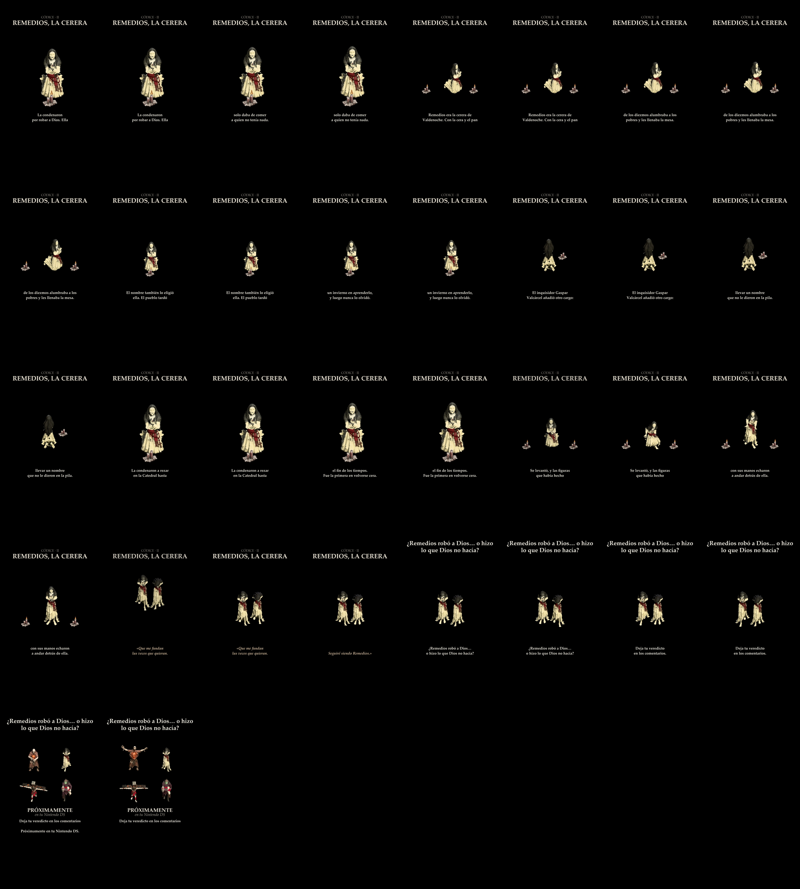
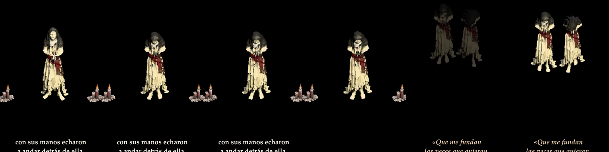
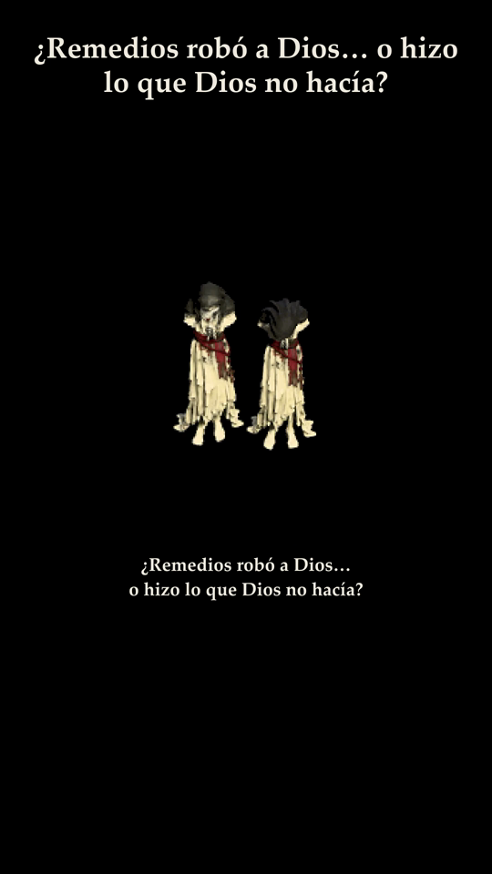
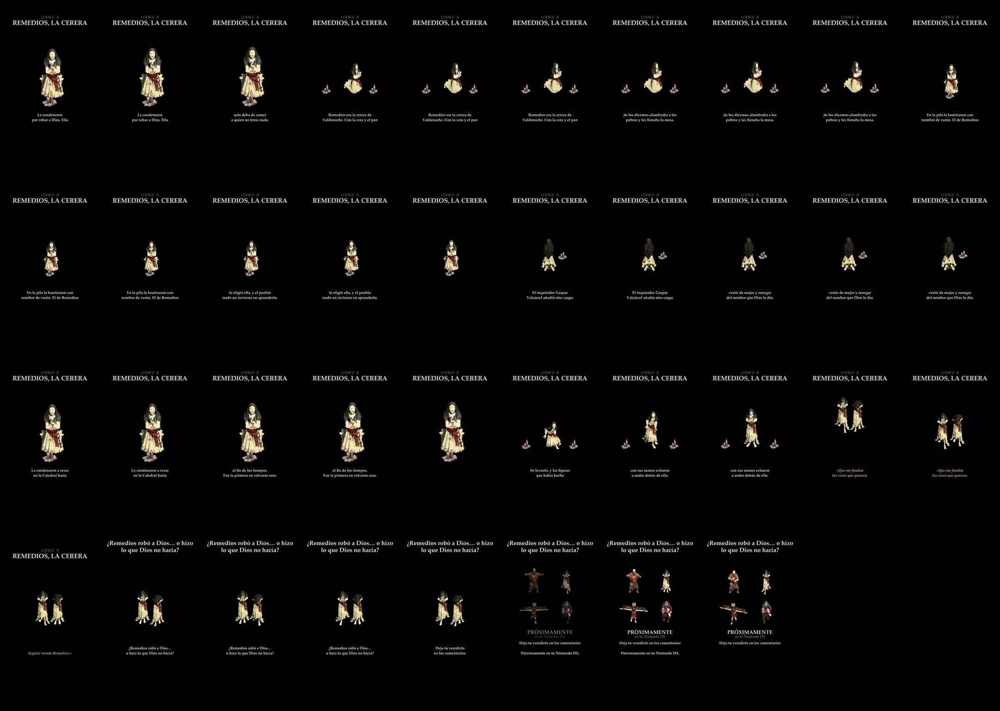

# Vídeo de lore 02 · Remedios, la cerera

Rama `docs/lore-video-02`, 2026-11-17. Primer vídeo de lore que acaba con una **pregunta moral** para pedir comentarios. Vídeo final: `assets/videos/lore01_02_remedios_la_cerera.mp4` (1080×1920, 75,2 s). Guion: `assets/videos/guiones/lote-01.md`, apartado 02.

## Qué se hizo

- **Guion reescrito:** seis frases del narrador (el robo de los diezmos para los pobres, que la bautizaron con nombre de varón y eligió el de Remedios, el cargo de Gaspar Valcárcel, «vestir de mujer y renegar del nombre que Dios le dio», la condena y la primera en volverse cera), la cita de Remedios («Que me fundan las veces que quieran. Seguiré siendo Remedios.») y la pregunta `> Pregunta: «¿Remedios robó a Dios… o hizo lo que Dios no hacía?»`.
- **Cierre con pregunta** (skill `codice-lore-video`, regla 6): el narrador dice la pregunta y luego «Deja tu veredicto en los comentarios.». La pregunta queda escrita arriba hasta el final, también sobre el mosaico de «Próximamente», y el último fotograma se sostiene 1,5 s. Mientras se dice, sale también como subtítulo: el usuario eligió **dejar las dos**.
- **Animaciones nuevas del exvoto** para los vídeos: `exvoto_rezar` (de rodillas, en bucle) y `exvoto_levantarse` (una vez), a la escala de `exvoto_walk` (`tools/characters/build_exvoto_pray.py`).
- **Que se entienda que es trans sin decirlo** (petición del usuario tras la primera versión): frases 3 y 4 cambiadas, propuesta A de dos; `LORE.md` alineado.
- **Velas a la densidad de píxel de los sprites:** se renderizaban grandes y el vídeo las encogía al 45 %, con píxeles más finos que la monja. Ahora salen ya al tamaño final (`tools/props/render_video_props.py`, `w` 6,3 y llama a escala) y el generador no las encoge. Mismo tamaño en pantalla. 
- **Textos de los posts** (TikTok/Instagram con la pregunta en la primera línea, título y descripción de YouTube, comentario fijado) en `lote-01.md`, sección «Publicado».

## Comprobaciones

Animación de rezar comparada con el andar: 

Pregunta escrita arriba hasta el final (probada sin voz con el 03): 

Prueba sin voz, un fotograma cada 2 s: 

- Primer fotograma con la cerera y el título, sin negro.
- Velas donde dice cada plano; las dos «vela apagada» salen apagadas. De espaldas (N), la vela «delante» queda a un lado para que el cuerpo no la tape.
- Al pasar de levantarse a la cita andando no hay salto de tamaño: de pie miden casi lo mismo (al final de levantarse alza la cabeza y parece algo más alta). 
- Nada en el 30 % inferior; la pregunta se lee arriba y como subtítulo: 

Versión con voz, un fotograma cada 2 s: 

## Verificación

- Render con voz sin errores, 75,2 s (la previsión era 45-50 s; la primera versión con voz dio 70,2 s y el guion nuevo añade 5 s). Sin tests de juego: no toca la ROM.
- No escuchado por el agente; pendiente de que lo vea el usuario.

## Pendiente / flojo

- Dura más que la previsión: si retiene peor que el 08, recortar frases de contexto del medio (nunca el arranque ni la cita).
- En el mosaico final, el subtítulo «Próximamente en tu Nintendo DS» repite lo que ya dice el cartel (pasa en todos los vídeos del lote).
