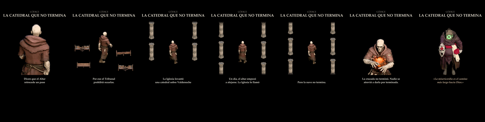
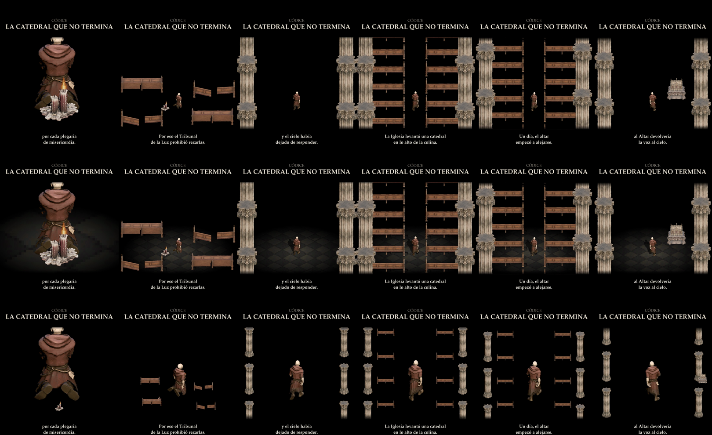
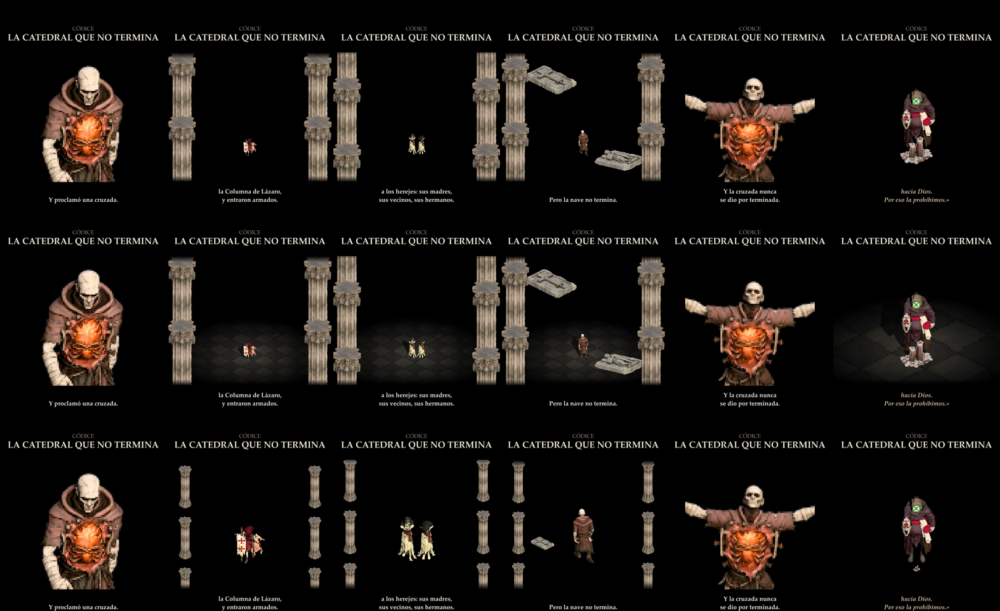
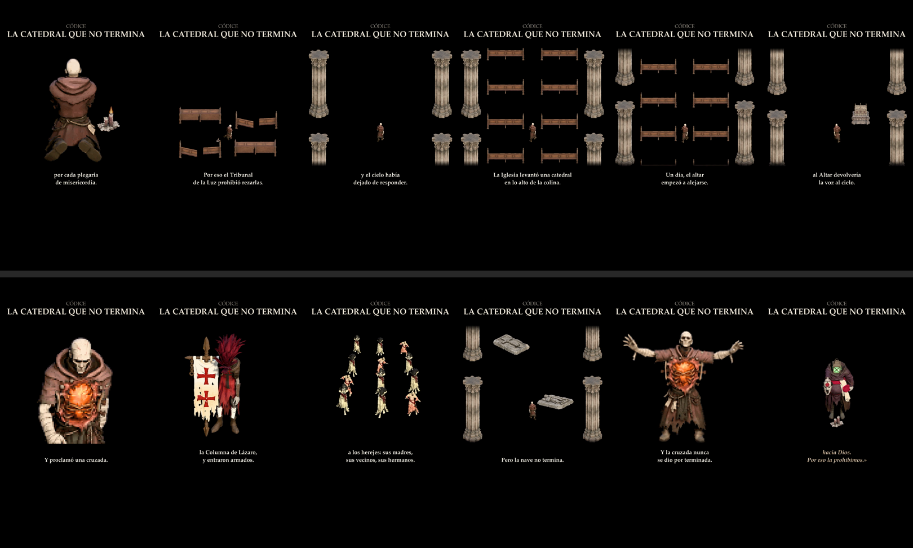
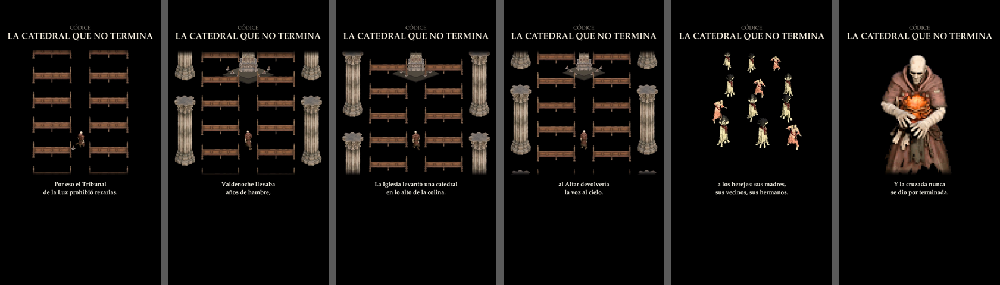
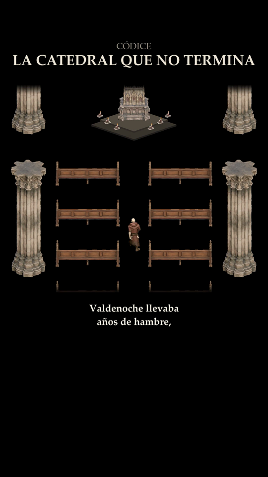
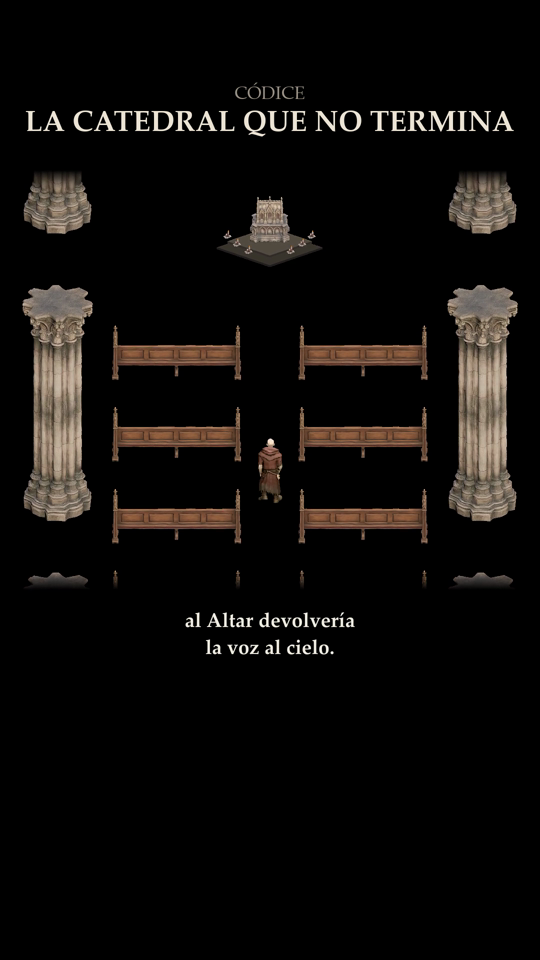
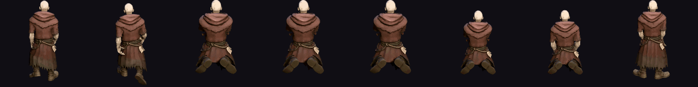
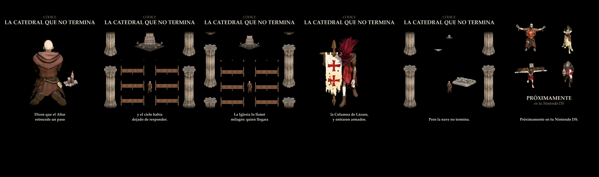

# Vídeo de lore 08 · La Catedral que no termina

Rama `docs/lore-video-08`, 2026-11-16. Primer vídeo de lore con escenografía: personajes y props de la catedral sobre negro. Vídeo final: `assets/videos/lore01_08_la_catedral_que_no_termina.mp4` (1080×1920, 67,9 s). Guion: `assets/videos/guiones/lote-01.md`, apartado 08.

## Qué se hizo

- **Guion reescrito contra `LORE.md`:** arranca con el gesto prohibido (Elías reza de rodillas y enciende una vela) y cuenta la sequía, la catedral, la nave que se alarga, la Marcha de la Columna de Lázaro y la guerra contra el propio pueblo («Dios había puesto a los herejes: sus madres, sus vecinos, sus hermanos»). Cierra el Ojo junto a la vela: «La misericordia es el camino más largo hacia Dios. (pausa) Por eso la prohibimos.»
- **Estilo visual decidido** (skill `codice-lore-video`, «Estilo visual de los planos»): composición metafórica sobre negro, sin suelo, con props sueltos a escala real del juego y a la densidad de píxel de los sprites del Códice.
- **Guiones como fuente única:** cada plano dice personaje, animación, dirección y props; los ajustes de producción se apuntan en el guion. Los demás guiones del lote son preliminares y se reescriben el día que toca.
- **Generador** (`render_guiones.py`): fichas de props (`<prop> [delante|detrás|izq|der]`, `bancos`, `bancos en fila`, `columnas [desfilan]`, `lápidas`, `altar` / `altar lejos`), plano continuo entre frases (`sigue`), `solemne`, `multitud N`, `entero`, `alejar`, `general`, `(pausa N)` dentro de una frase, `Estilo: A|B|C` por vídeo y `--estilo`. Partes con más de dos animaciones.
- **Assets nuevos:** props re-renderizados para vídeo (`assets/videos/props/`, `tools/props/render_video_props.py`); animaciones `corazon_rezar` y `corazon_levantarse` (`tools/characters/build_corazon_pray.py`); `abanderado_solo` a 320×320 sin cortejo.
- **Reorganización:** guiones en `assets/videos/guiones/`, muestras de voz en `assets/videos/voces/`.

## Rondas con el usuario

1. Primera prueba con props de la DS, fuera de escala: concepto bien, escala mal.

   

2. Ronda A/B/C (filas: A escala real sin suelo, B con suelo insinuado, C escala metafórica). **Elegida A.**

   
   

3. Estilo A corregido: columnas espaciadas, bancos dentro de la nave, Abanderado solo y en grande, procesión de herejes, carga del corazón congelada con zoom out.

   

4. Bancos normales en dos hileras densas, frases 3-6 en un solo plano continuo y altar al fondo que se aleja.

   

5. Presbiterio despejado, altar que baja al 60 % y vela más visible; versión con voz y pausa en la cita de Gaspar.

    

Animaciones de rezar comparadas con el andar: 

Tira del vídeo final: 

## Verificación

- Render con voz sin errores; pista de audio presente (media -20 dB); el plano continuo (10,6-31,7 s) no tiene cortes de escena; la cita de Gaspar tiene 1,5 s de silencio entre sus dos frases.
- El vídeo 03 se re-renderizó sin voz con el generador nuevo y sale igual.
- Aprobado por el usuario; no escuchado por el agente.

## Pendiente / flojo

- `banco_roto` y `banco_volcado` se fabrican por código a partir de `banco_gotico` (sus modelos se perdieron).
- La tarima del altar es un dibujo simple; la vela del plano 2 sigue pequeña.
- Estilos B y C siguen en el generador pero no se re-renderizaron con los últimos cambios.
