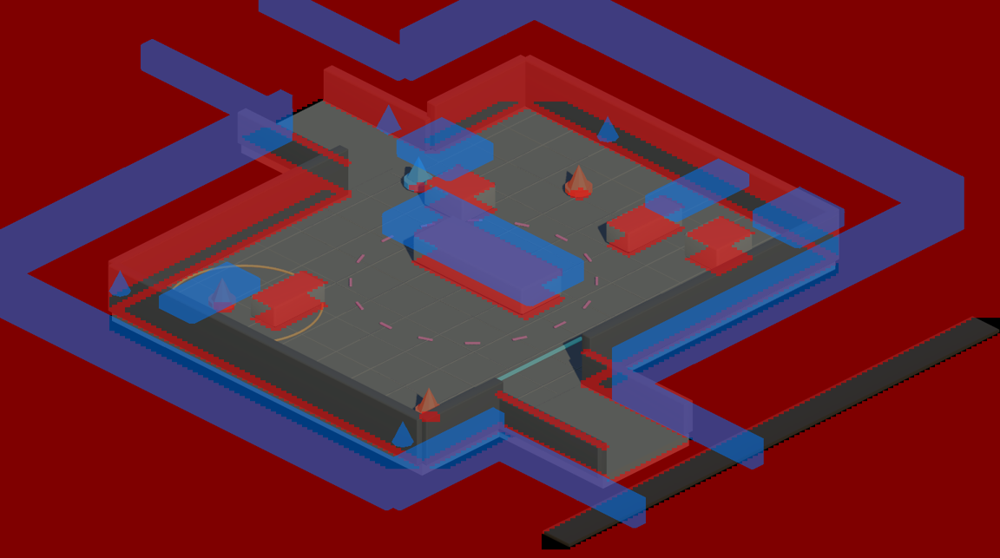
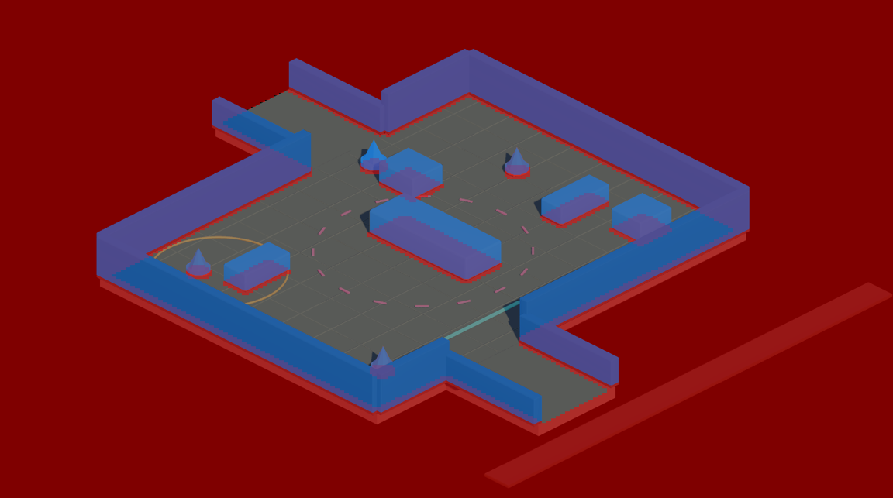
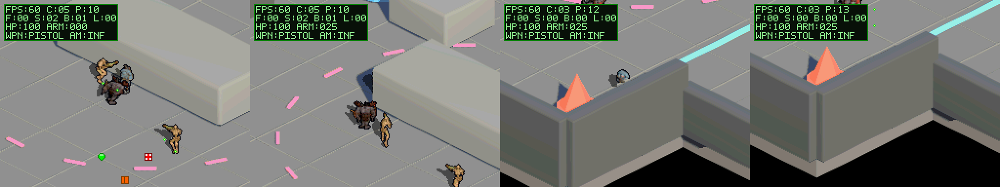

# Colisión y oclusión coherentes con el render (2026-11-02)

Primer paso del plan de [auditoría de saneamiento 2D/3D](../audit-saneamiento-2d3d/walkthrough.md): `world.png`, `collision.png` y la oclusión salen ahora de la misma geometría y el mismo pase de render.

## Antes / después

Rojo = bloqueado, azul = oclusor.

| Antes | Después |
| :---: | :---: |
|  |  |

| Métrica | Antes | Después |
| :--- | ---: | ---: |
| Píxeles oclusores sobre vacío | 65,3 % | 0 % |
| Oclusores con base por encima del propio píxel | n/a (heurística) | 0 |
| Runs de oclusión | 32.962 | 43.545 (+ índice por fila) |
| Ritmo de frames del escenario (frames lógicos / vblanks) | 904 / ~922 | 901 / 922 |

## Cambios

**Lab (`tools/lab/FBX-Web-Renderer-parity.js`, embebido en `FBX-Web-Renderer-offline.html`)**
- Nuevo pase `renderMapGroundDepth()`: misma cámara y mismo culling por cara que el render de color, a un render target sin MSAA. Cada píxel guarda la Y de mapa del punto de suelo bajo la superficie visible (R,G) y si es oclusor (B; altura > 0,25 m). Se exporta como `occlusion_depth.png`; `occlusion.png` es su vista binaria.
- Colisión: sólo la huella sobre el suelo de lo que entra en la franja corporal 0,30–1,20 m (polígonos recortados + aristas, para que los muros verticales no desaparezcan). Se elimina el bloqueo de la tapa de obstáculos bajos a su altura (creaba muros invisibles detrás de las cajas). El suelo se muestrea en el centro de celda y el suelo no alcanzable desde la región principal se marca bloqueado.
- `tools/lab/export_map_package_headless.cjs`: exporta el paquete del mapa desde un modelo con los ajustes de un `map_settings.json` (Chromium headless con ANGLE/SwiftShader; con `--use-gl=swiftshader` WebGL pierde el contexto).

**Baker (`tools/bake_isometric_shooter_bl.py`)**
- La profundidad sale directamente de `occlusion_depth.png` (tolerancia 1 px por run) en lugar de la heurística "último píxel de la columna".
- Nueva tabla `g_dungeon_occlusion_row_start[WORLD_H + 1]`; se eliminan los segmentos heredados del mundo WH40k.

**Runtime (`source/main.c`)**
- `build_occlusion_depth_map` recorre sólo las filas visibles y, por fila, busca en binario el primer run que alcanza la cámara. Sin el índice, los runs extra provocaban picos de ~370k ticks y caídas a 30 FPS al desplazar la cámara.
- La rejilla de colisión es la única fuente de "suelo": se elimina `world_point_has_floor` (bloqueaba en píxeles oscuros del render).
- Modo dios de depuración (L+R+B) para escenarios headless largos.

`world.png` se conserva: el nuevo render coincide geométricamente al píxel (206 px distintos de 490.852) pero con otro tinte de suelo.

## Verificación

- Build BlocksDS limpia.
- Escenario `scenarios/map_occlusion_collision_coherence.json` **PASS** (922 frames). Rutas pre-simuladas con las reglas de `position_is_free`/`sweep_position` y posiciones aseguradas (±4 px):

1. Delante del bloque central, detenido por su huella: visible.
2. Esquina noroeste detrás del bloque: casi oculto (el bloque mide ~1 m y el sprite ~0,75 m a escala de mapa, ver pendientes).
3. Tras el muro sur: piernas ocultas, cabeza visible.
4. Más al fondo tras el muro: oculto.

- Tests host: nuevo `tests/test_map_export_coherence.py` (6 OK); `test_occlusion_grid_contract.py` lee ya el `OCCLUSION_DEPTH_SHIFT` real y pasa. Eliminados `test_occlusion_depth_contract.py` y `test_world_void_contract.py` (probaban el mundo WH40k por sectores). Siguen fallando como en `main`: `test_shadow_masks.py` (assets e30 ausentes) y `test_scenario_state_assertions.py` (import `run_scenario`). `tools/lab/test_shadow_anchor_export_headless.cjs` falla igual que en `main` (atlas de sombras 768 ≠ 96), antes de llegar al mapa.

## Pendientes detectados

- Escala: mapa a 40,42 px/m frente a sprites ~30 px de alto → el personaje mide ~0,75 m en el mundo.
- Runner de la skill: una aserción `state_changes` con `at`/`min_value`/`max_value` se marcó `passed` con un valor fuera de rango en una ejecución con estado congelado; revisar en el repo de la skill.
- Siguientes pasos del plan: movimiento en coordenadas de suelo, oclusión más fina que 4×4 sin parpadeo, purga de legacy.
