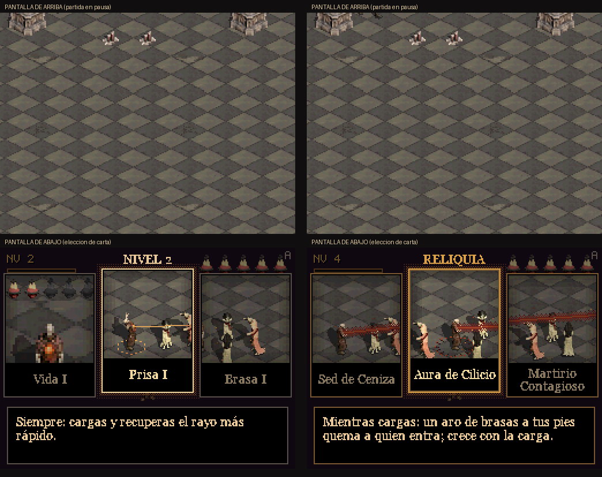
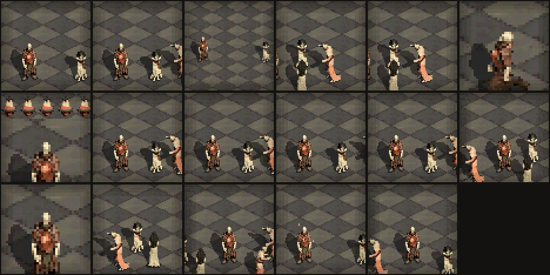
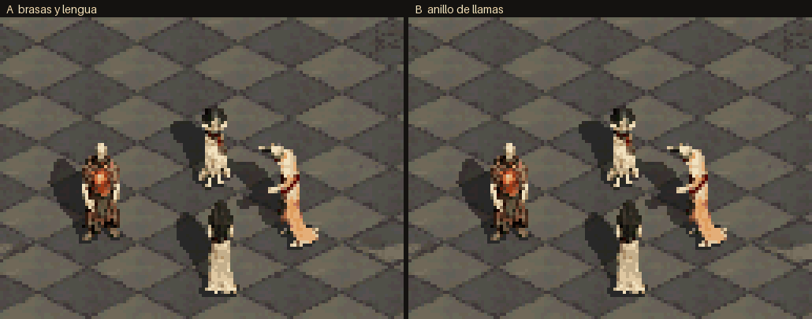
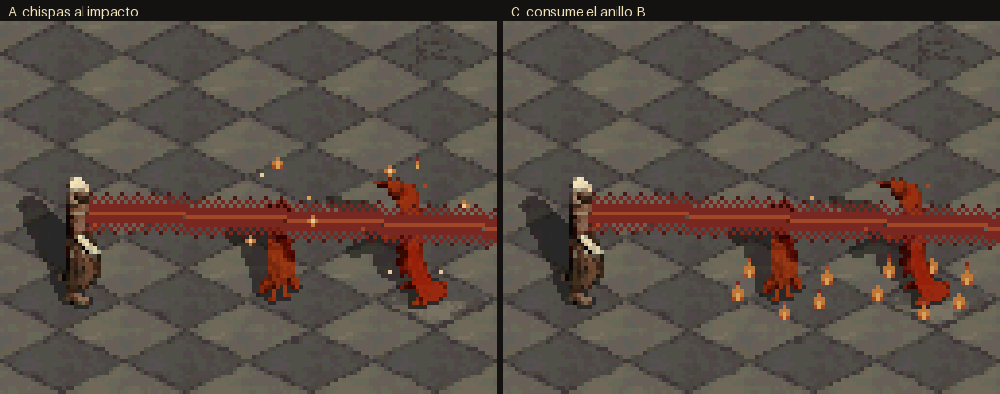
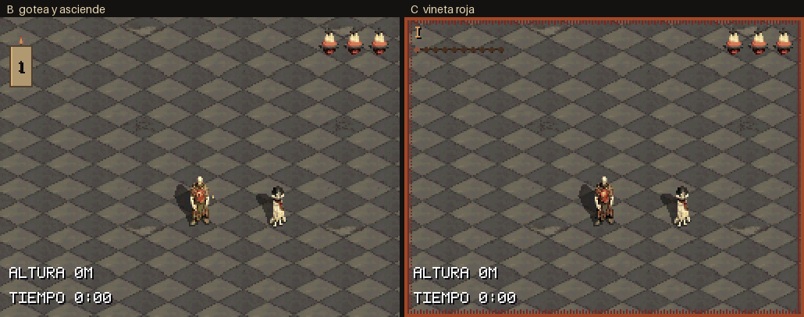
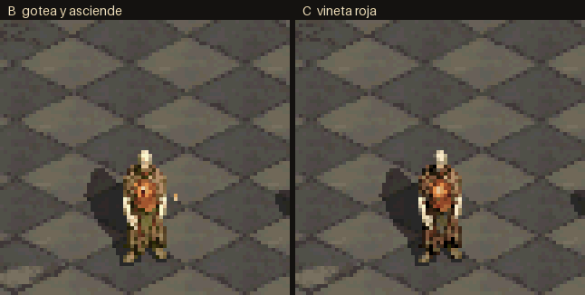
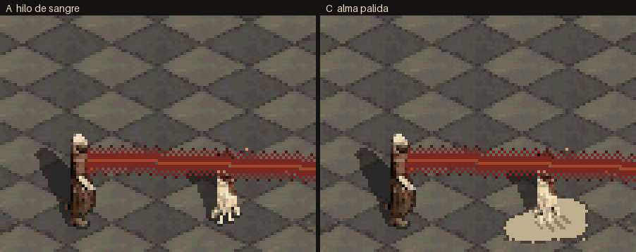

# Mejoras v0.4: primera versión completa y ronda A/B/C

Rama `docs/mejoras-diseno`. Diseño en `DESIGN.md` §6.12 y cifras provisionales en §6.12.10.

## El sistema en una página
- **Gemas y experiencia.** Cada enemigo suelta una gema al morir; recogerlas llena la barra de nivel.
- **Subir de nivel.** El juego se pausa y eliges 1 de 3 cartas:
  - en cada nivel, un **Don**: una estadística que se puede subir hasta 4 veces;
  - en los niveles 4, 8, 12 y 16, una **Reliquia**: única, cambia cómo juegas y lleva marco dorado.
- **Rayo base nuevo.** Atraviesa a quien mata y se para en el primero que sobrevive. Muros y columnas lo cortan.
- **Quemado.** Estado de los enemigos que se acumula en capas: cada capa hace daño de fuego cada poco tiempo y frena al enemigo un 10 %.
- **Dos tipos de daño.** El del rayo (solo el disparo) y el de fuego (quemadura, explosiones, aros y ondas). Cada uno se sube con su propio Don.

### Los 7 Dones
| Don | Qué hace | Le sirve a |
|---|---|---|
| **Fervor** | +25 % de daño del rayo | Disparar mucho (Ráfaga) |
| **Prisa** | Cargas y recuperas el rayo más rápido | Ráfaga |
| **Alcance** | El rayo y la línea de apuntado llegan más lejos | Todos |
| **Brasa** | +25 % de daño de fuego | Builds de quemar |
| **Rescoldo** | La quemadura admite más capas y dura más | Builds de quemar |
| **Paso** | Andas más rápido (también mientras cargas, con Procesión) | Moverse cargando, Mártir |
| **Vida** | +1 corazón de tope y te cura 1 | Cualquiera apurado |

### Las 10 Reliquias
| Reliquia | Qué hace | Cómo se ve |
|---|---|---|
| **Sed de Ceniza** | Cada enemigo que matas con un disparo acelera la siguiente carga; si fallas, va más lenta | Aura de ceniza al cargar |
| **Lanza de Longinos** | El rayo atraviesa a todos, sobrevivan o no | Sin efecto propio: se ve en que atraviesa |
| **Auto de Fe** | El rayo hace el doble a los quemados y les quita la quemadura | Estallido al impactar (ronda A/B/C) |
| **Llama Votiva** | Mientras cargas, la línea de apuntado quema lo que toca | La línea arde (ronda A/B/C) |
| **Aura de Cilicio** | Mientras cargas, un aro a tus pies quema a quien entra; crece con la carga | Corona de espinas en el suelo |
| **Paso de Procesión** | Puedes andar despacio mientras cargas, pero la carga es más lenta | Andas con los brazos en cruz |
| **Martirio Contagioso** | Los enemigos quemados explotan al morir y queman a los de alrededor | Explosión (ronda A/B/C) |
| **Corazón Flagelado** | Al recibir un golpe sueltas una onda de fuego y tu siguiente disparo sale cargado al instante | Onda (ronda A/B/C) y llamas mientras espera el disparo |
| **Llaga Abierta** | Tu vida máxima baja a la mitad; todo tu daño sube por cada corazón que te falte (contando desde 5) | Rayo enrojecido o pecho que late (ronda A/B/C) |
| **Viático** | Al matar con el rayo, a veces robas 1 corazón (más si estaba pegado a ti) | Sifón de la víctima al héroe (ronda A/B/C) y halo al cargar |

## Cómo se ve en la consola
Al subir de nivel, la pantalla de arriba sigue mostrando la partida en pausa, y la de abajo muestra la elección: 3 cartas en paralelo y, debajo, la descripción de la seleccionada. La carta seleccionada se ilumina y se adelanta. Izquierda: subida normal (Dones). Derecha: nivel de reliquia, con marco dorado.

### Arte de las cartas
Cada carta muestra la escena real del juego, capturada de la ROM en bucle: el héroe, el efecto y los enemigos necesarios. No hay variantes de cartas. La letra pequeña de la esquina de la pantalla es la variante de los **efectos**, y las cartas se regeneran con la que elijas.

## Ronda A/B/C de efectos
Cada GIF es la misma escena montada a propósito tres veces, una por variante (columnas A | B | C), ampliada 4×. Solo aparecen el héroe y los enemigos necesarios, quietos. Los efectos respetan los cuerpos (lo que queda detrás se tapa). Las gemas y el HUD de nivel quedan fuera: irán prerrenderizados en 3D.

### Ya elegidos
- **Corazón Flagelado:** A (anillo grande).
- **Martirio Contagioso:** A, igualado con Flagelado.
- **Llama Votiva:** B (chispas sueltas que giran de forma irregular); se seguirá afinando.
- **Lanza de Longinos:** sin efecto propio.

### 1. Enemigo quemado (A o B; la C está descartada)
El rojo del enemigo indica sus capas: con 1 capa es tenue y con 4 o más llega al tope (el rojo de antes). En la escena hay enemigos con 1, 2 y 4 capas.

### 2. Auto de Fe
El rayo golpea a un enemigo quemado: le hace el doble y le quita la quemadura.
- **A:** chispas minimalistas en el punto de impacto.
- **B:** el quemado A se consume: sus brasas se avivan, suben y se evaporan, y el rojo se va.
- **C:** el quemado B se consume: la corona de llamas sube por el cuerpo como una sábana de fuego y se evapora por la cabeza.

En cada columna los enemigos llevan el quemado del que parte su variante.

### 3. Llaga Abierta (B o C; la A está descartada)
Escena primero con 3 corazones y después con 1.
- **B:** sangre que gotea del pecho, poca con 3 corazones y mucha al límite, con un rastro en el suelo, más un brillo pálido dorado de «ascendido». Sin rojo.
- **C:** borde rojo que late en la pantalla de abajo.

### 4. Viático (A o C)
Al robar vida, la víctima no desaparece al instante. Se queda inerte y suspendida unos 0,3 s mientras se le extrae la vida y después muere con su animación normal. Durante ese tiempo no ataca ni bloquea, y ya cuenta como muerta para la experiencia y las gemas.
- **A:** hilo de sangre.
- **C:** alma pálida.

## Controles de prueba en la ROM
- `X`: subir de nivel al instante.
- `SELECT`: cambiar todos los efectos entre A, B y C.
- `L + R + B`: invulnerable.

## Pendiente tras la elección
- Quitar las variantes no elegidas, los ganchos de prueba de las capturas y la tecla `X`.
- Regenerar las cartas con las variantes elegidas.
- Medir el rendimiento en la DS.
- Ajustar las cifras con tu lista de la partida de prueba.
