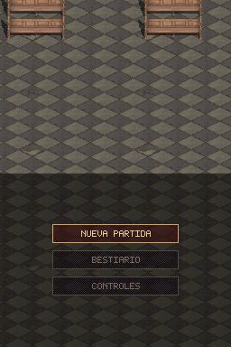
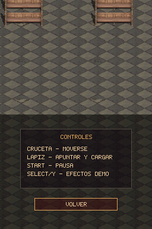
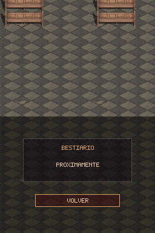
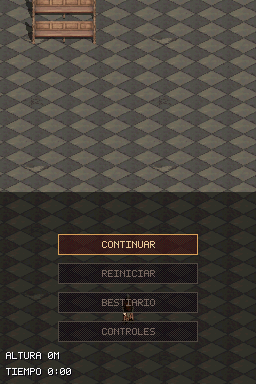
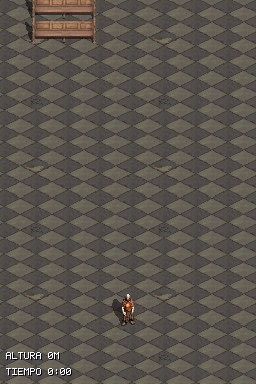

# Walkthrough — Menú inicial y menú de pausa (`feat/menu-inicial`)

## Decisiones de diseño (`DESIGN.md` §6.3)

- **Reparto entre pantallas:** la pantalla superior muestra únicamente la catedral de fondo (sin título ni adornos); la pantalla inferior (táctil) muestra la catedral oscurecida por detrás con un tinte oscuro y el menú encima.
- **Estilo minimalista:** cajas semitransparentes oscuras con texto plano usando la paleta `FX_SH_*` (marfil, oro antiguo, carmesí apagado y ceniza), sin marcos ni títulos postizos.
- **Navegación (ambos):** táctil con lápiz sobre cualquier botón y cruceta (`Arriba`/`Abajo`) + `A` (confirmar) / `B` (volver o reanudar en pausa). `START` abre y cierra la pausa durante la partida (cuando el jugador sigue vivo; tras morir conserva el reinicio).
- **Opciones:**
  - **Menú inicial:** `NUEVA PARTIDA`, `BESTIARIO` y `CONTROLES`.
  - **Menú de pausa (`START`):** `CONTINUAR`, `REINICIAR`, `BESTIARIO` y `CONTROLES`. Congela horda, marea, temporizador, combate, godrays y música (`sfx_set_bgm_paused`), sin coste por frame en partida. `SELECT` e `Y` siguen funcionando en partida.
  - **Submenús:** `BESTIARIO` (placeholder `PROXIMAMENTE` + `VOLVER`) y `CONTROLES` (`CRUCETA - MOVERSE`, `LAPIZ - APUNTAR Y CARGAR`, `START - PAUSA`, `SELECT/Y - EFECTOS DEMO` + `VOLVER`).

## Cambios principales

- [`include/menu.h`](../../include/menu.h) y [`source/menu.c`](../../source/menu.c): máquina de estados (`MENU_TITLE`, `MENU_PAUSE`, `MENU_BESTIARY`, `MENU_CONTROLS`), navegación dual (stylus + cruceta/A/B/START), render minimalista en cajas semitransparentes sobre `BG2` con fuente propia 5×7 y registro de regiones sucias (`dirty_rect`).
- [`include/sfx.h`](../../include/sfx.h) y [`source/sfx.c`](../../source/sfx.c): `sfx_set_bgm_paused()` guarda la posición del stream en NitroFS al pausar y la reanuda exactamente donde estaba al continuar.
- [`source/main.c`](../../source/main.c): arranque en `MENU_TITLE` en la ROM normal (`SANDBOX`/`STRESS_TEST` mantienen arranque directo), congelación de simulación y godrays cuando el menú está abierto, tinte oscurecido por hardware sobre `BG1` en pantalla inferior, y bloqueo del toque mantenido al cerrar un menú para no disparar al pulsar `NUEVA PARTIDA` o `CONTINUAR`.
- [`tests/test_menu_contract.py`](../../tests/test_menu_contract.py) y [`scenarios/menu_inicial_pausa.json`](../../scenarios/menu_inicial_pausa.json): contratos de código y escenario headless de flujo completo.

## Evidencia en la ROM real (DeSmuME)

| Menú inicial | Controles | Bestiario |
| :---: | :---: | :---: |
|  |  |  |

| En partida | Pausa (`START`) | Reanudado (`CONTINUAR`) |
| :---: | :---: | :---: |
|  |  |  |

## Verificación

- **Compilación (`build-project.ps1`):** `DS_BUILD=PASS`, `warnings=0`, `new_warnings=0`.
- **Tests de host:** 17/17 suites en `.ds-game-dev/project.json` PASS (incluidos `test_menu_contract.py`, `test_fps_hud_contract.py`, `test_upper_screen_contract.py`, `test_gameplay_contract.py`, `test_encounters_contract.py`).
- **Escenario headless (`scenarios/menu_inicial_pausa.json`):** `DSM_SCENARIO_RESULT=PASS` (`frames=158`).
- **Rendimiento en Nintendo DS física (`PERF_PROFILE`):** validado en consola por el usuario (variante `perf`, sin log descargado).
