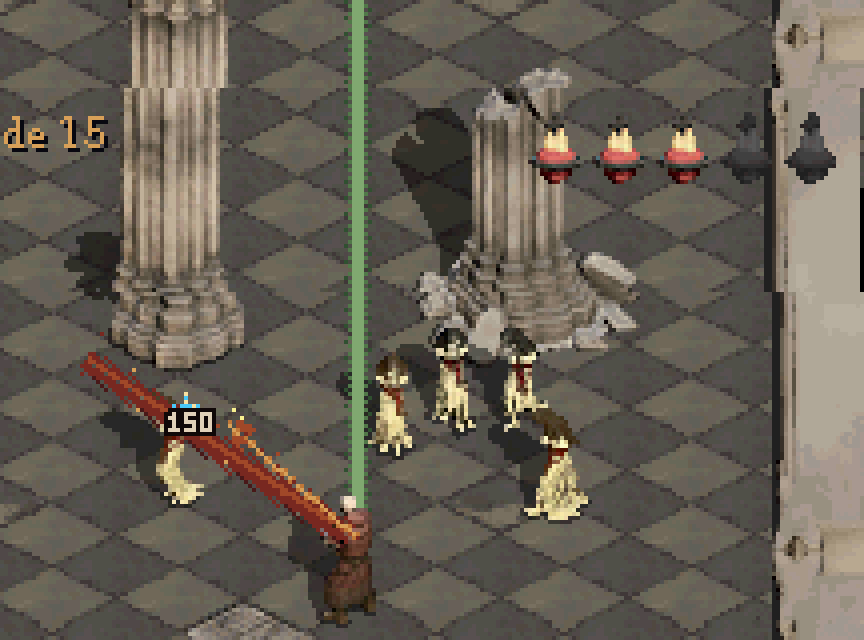
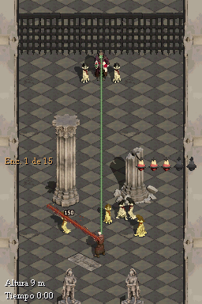
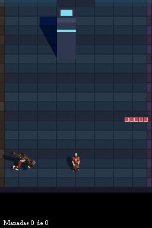

# Del ARPG al roguelike: números de daño y depósito de sala

Rama `feat/migra-arpg` (2026-11-23), integrada en `main`. Primera tanda de lo que se trae de `proto/arpg` al juego por encuentros.

## Qué cambia para el jugador
- **Números de daño** (`DESIGN.md` §6.11.3): sobre el enemigo golpeado sale la cifra del rayo (marfil, con salto) y la del quemado (violeta-ceniza, sube despacio). Sin cifra sobre el héroe: su vida ya la enseñan los corazones.
- **Depósito de sala** (`TECHNICAL.md` §3.3.1): los enemigos dejan la RAM fija; se cargan del cartucho al empezar el acto (los 5 tipos actuales, 1,37 MB). Sombras a 1 bpp en personajes y remates. El arranque del acto tarda unos 20 fotogramas más.

Pantalla completa con el depósito activo (cuerpos y sombras correctos):

## Cifras (variante `encuentros`)
| | Antes | Después |
|---|---|---|
| RAM fija | 3.486.592 B | 3.196.592 B |
| Heap libre | 183.424 B | 473.424 B |
| ROM | 9,57 MB | 9,11 MB |

## Verificación
- Builds por defecto, `encuentros`, `encuentros-bot`, `bestiary`, `remate-sandbox` y `sandbox` con 0 avisos.
- Tests `test_guardrails`, `test_blit_runs_contract`, `test_sprite_ground_anchor`, `test_character_muzzle` PASS.
- Escenarios PASS: guía de encuentros (`pool_misses` 0), `bestiary_tour`, remates del Exvoto, Cireneo y Ojo, `enemy_charger_lunge_hits_player`, `enemy_ojo_andar_mirar_sentenciar`; `dmg_numbers_main` (evidencia).
- Ajustes de escenarios por el arranque más largo: primer paso de `encuentros_smoke` y `enemy_ojo_andar_mirar_sentenciar`.

## Pendiente
- **Sin medir en la DS** (60 FPS y duración de la carga del acto): el usuario decidió mergear y probarlo jugando.
- **Carga por encuentro** (como en el ARPG) antes de traer Súper Monja, Párroco y Campanero: hoy el depósito tiene el tamaño justo del acto.
- Cifra del quemado no vista aún en pantalla; el Códice carga bajo demanda (pequeño tirón al abrir una ficha).
- Fallos sin relación ya conocidos: relicario de `encuentros_smoke`, `abanderado_jefe_ciclo`, tests del Códice; disparos del sandbox sin comprobar contra `main`.

MDs tocados: `DESIGN.md` (§6.11.3), `TECHNICAL.md` (§3.3, §3.3.1), `STATUS.md`, `STATUS-ARCHIVE.md`.
