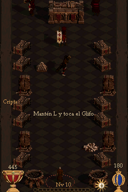
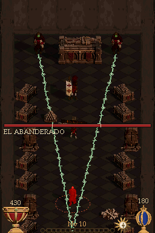
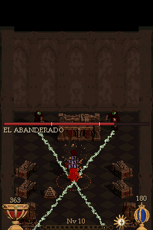
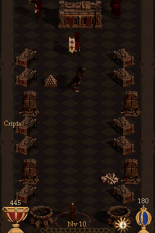
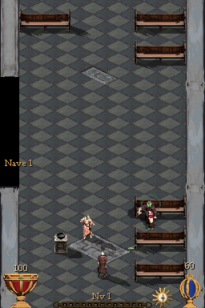
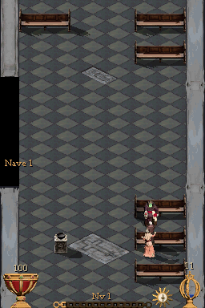

# Mini ROM genérica desde JSON

Se describe un encuentro en `minirom/<nombre>.json` y `python tools/minirom.py minirom/<nombre>.json` genera la cabecera (`include/minirom_gen/`), el escenario (`scenarios/minirom_<nombre>.json`) y el contrato grabado (`.ds-game-dev/partial/mini-<nombre>.txt`), compila la variante `mini-<nombre>`, la verifica y deja `dungeonds-mini-<nombre>.nds`. Detalle en `TECHNICAL.md` §3.6c, «Mini ROM».

## Qué se verificó
- Abanderado (`minirom/abanderado.json`, 6,8 MB): arranca en la sala sin título, el héroe llega al jefe, lo golpea y al morir reinicia la sala. Probado en la DS por el usuario: «está perfecto».
- Pruebas del Ojo (`minirom/pruebas-ojo.json`, 4,8 MB): enemigos colocados por `dx`/`dy`, inmortales y que reaparecen.
- Dos JSON de prueba adicionales (Osario y Capilla del párroco) durante la revisión; ya borrados.
- Sin cubrir: reinicio tras matar al jefe en la DS. Padre Tomás aún no existe como miniboss.
- Mini ROM del Abanderado frente a ~56 MB de la ROM completa.
- MDs: solo `TECHNICAL.md` §3.6c, `STATUS-ARPG.md` y `STATUS-ARCHIVE.md`; `AGENTS.md` y `ONBOARDING.md` sin cambios.

## Evidencia
 
 
 
