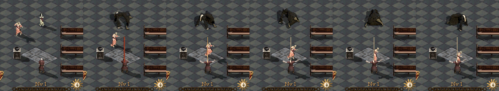
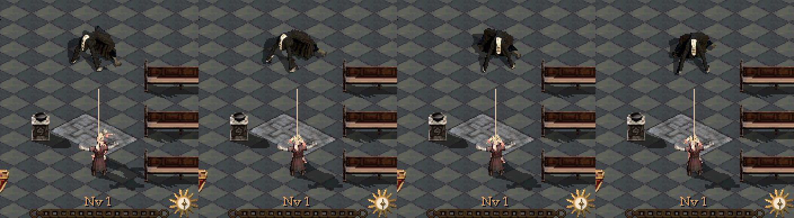
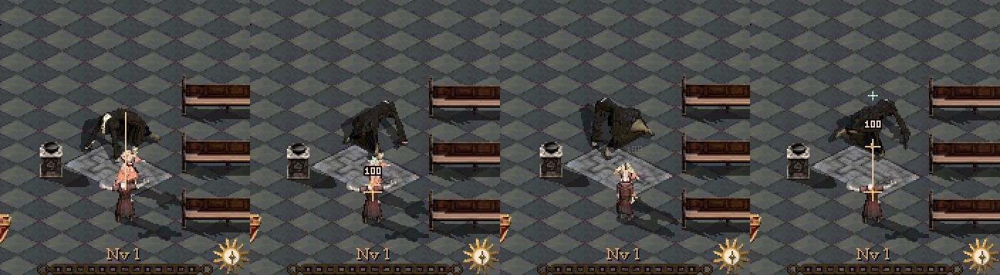
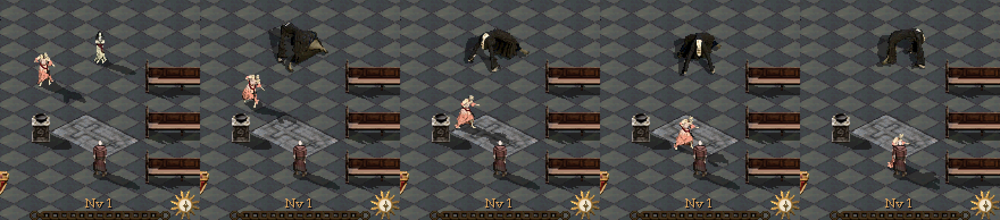
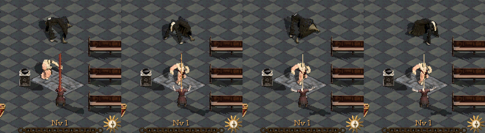

# Monaguillo guardaespaldas: avanza hacia el héroe

**Rama:** `feat/monaguillo-avanza` (base `arpg`), 2026-11-27.

## Qué cambia para el jugador
Mientras el héroe carga el Rayo, el Monaguillo guardaespaldas corre a la línea héroe-aliado y, ya en ella, avanza andando hacia el héroe a su paso normal (la mitad si tiene la quemadura de Llama Votiva). Al alcanzarlo avisa y muerde. El Párroco no cambia. Decisión en `DESIGN-ARPG.md` (2026-11-27).

Código: `source/enemy_ai.c` (`bodyguard_step`, estados ATTACK y CHASE), `include/arpg.h` (`ARPG_GUARD_LINE_TOL`), `source/encounters_act1.c` (hook de prueba).

## Evidencia (verificador aparte, ROM real, 6/6 PASS)
- C1/C2 corre a la línea y avanza andando (+-3 px, 0,51 px/f): 
- C3 aviso y mordisco: 
- C4 se come el Rayo y la Monja 0 daño (ROM default; en `arpg-todo` la Lanza de Longinos atraviesa): 
- C5 sin carga, igual que antes: 
- C6 Párroco quieto: 

Escenarios (todos `"suite": false`): `monaguillo_avanza`, `monaguillo_avanza_full`, `_parroco`, `_s2_avance_vivo`, `_s2_control`, `_sin_carga`. Compilación sin warnings nuevos.

## Pendiente
Probar sensación y FPS en la DS (no medido; el usuario pidió mergear directamente).

## MDs
`DESIGN-ARPG.md` y `STATUS-ARPG.md` actualizados (la entrega más vieja pasó a `STATUS-ARCHIVE.md`); sincronizados con `roguelike`.
