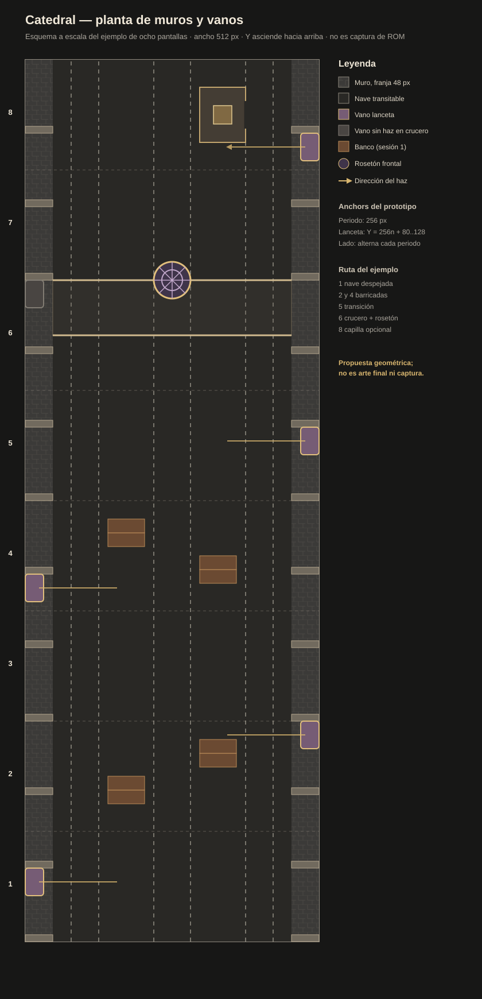

# Sesión de diseño: muros laterales, arcadas y vanos

**Fecha:** 2026-11-09
**Alcance:** resolver e integrar una primera pasada de muros, lancetas y crucero en la sesión 2.
**Estado:** primera ROM compilada; pendiente revisión visual del usuario y certificación en DS.
**Decisiones canónicas:** [`DESIGN.md` §6.9.1b](../../DESIGN.md).



## Lo que hay hoy

- Blender contiene un primer modelo de muro con lanceta geminada: [archivo `.blend`](../../assets/models/environment/cathedral/lancet_pair.blend) y [exportación GLB](../../assets/models/environment/cathedral/lancet_pair.glb). El Shader Lab ya muestra su silueta frontal, pero el render sale demasiado alto y el vidrio pierde su color; por eso el primer atlas de ROM traduce la misma forma a tiles de 8×8 desde `tools/bake_cathedral_kit.py`.
- [Vista del modelo prerenderizado con el Shader Lab](assets/lancet_pair_lab_preview.png): sirve para revisar la forma, no como evidencia de juego ni como prerender definitivo.
- La columna existente de 40×56 px sirve de acento, pero no como muro de altura completa: [prerender actual](../../assets/environment/cathedral/props/render/columna/color.png).
- El prototipo ya fija un ritmo: `GODRAY_PERIOD=256`, `GODRAY_ANCHOR=64`, con ventanas emisoras alternando de lado. El arte es de 256×128 px y el borde izquierdo activo de la lanceta ocupa las filas locales 16–64. Referencias: [`source/godrays.c`](../../source/godrays.c), [`assets/sprites/godrays/NOTES.md`](../../assets/sprites/godrays/NOTES.md).
- [La hoja del prototipo](../../assets/sprites/godrays/preview_sheet.png) enseña la lectura del haz sobre el suelo de piedra; **no** es referencia del modelo final de pared.

### Borde de colisión ya implementado

El motor ya define el carril de 512 px como 64 columnas de tiles: los seis tiles exteriores de cada lado son 48 px de muro, y las 52 columnas centrales son los 416 px transitables. [`source/strip.c`](../../source/strip.c) marca esas franjas de borde (12 celdas de colisión de 4 px) como sólidas para cuerpo y proyectiles y solo permite colocar estampas dentro del carril. Por tanto, esta sesión resuelve la **apariencia** de los muros; no necesita inventar una segunda colisión basada en las mallas altas. La prueba antigua de muros altos (`walkthroughs/wh40k-collision-arena-test/`) sigue siendo relevante para pilastras o piezas que se proyecten hacia el suelo.

`tools/bake_cathedral_kit.py` compone muros laterales con lancetas geminadas en `x=0–48` y `x=464–512`; la alternancia emisora se repite cada 512 px. Un inlay transversal con rosetón marca el crucero en Y=1056 y alarga a 1.024 px el ciclo completo de escena. La colisión de los bordes sigue siendo la existente; el inlay no bloquea el paso ni crea oclusión nueva.

- [Captura de ROM junto al muro](assets/rom-review-verified/01_left_wall.png).
- [Captura de la subida hacia el crucero](assets/rom-review-verified/02_climb_900.png).
- El ciclo de mapa ocupa 64×128 tiles (16 KiB de ROM), con colisión en su periodo independiente de 16 tiles/128 px. El baker informa 1.024 tiles en total y 224 para la ventana de 33×25.
- ROM: [`dungeonds-godrays.nds`](../../dungeonds-godrays.nds), variante `godrays`, 1.939.968 bytes; SHA-256 `5e6fede15ab9f5699c6e9eb1877a1741d26e0431b7bf6296931ee1cdec7827d9`.
- Build: PASS, 0 warnings nuevos. Escenario `strip_cathedral_look`: PASS, 4.783 frames, capturas del inicio, muro lateral, crucero y rebase en [`assets/rom-review-verified/`](assets/rom-review-verified/).

El primer bake ya integra el arte en el tilemap opaco de BG1. Falta sustituir la rasterización provisional por un prerender Blender bien encuadrado en el lab, pulir el rosetón y ligar su haz al crucero en la sesión 3.

### Tramo mínimo para validar en ROM

El primer corte de revisión contiene nave procedural, muros, vanos alternos y crucero. El escenario `strip_cathedral_look.json` permite revisar:

1. Que el paño no deja cortes en las bandas técnicas de 128 px ni en el rebase de la ventana de 512 px.
2. Que el vano coincide con el origen del haz y que la cara opuesta se lee como muro ciego.
3. Que las tres rutas y las barricadas de las pantallas 2 y 4 siguen legibles con los muros presentes.
4. Que el arco y el rosetón se leen como un hito frontal; en ese tramo el vano lateral sigue visible, pero su haz se apaga.
5. Que la escena compuesta conserva contraste suficiente junto al marine y no produce costuras al desplazarse.

El escenario headless comprueba el avance y los rebases; las capturas son evidencia de la ROM. La semilla de atrezo varía, así que no reproduce exactamente las barricadas del SVG. Cualquier cambio de render, mapa o actores aún requiere medición en DS real según `AGENTS.md`.

## Planta propuesta

El carril continúa con 512 px de ancho. Los muros ocupan solo las bandas laterales: `x=0–48` y `x=464–512`. La nave transitable sigue siendo `x=48–464`; ninguna pilastra ni contrafuerte invade ese suelo. La pared es continua aunque cambien sus paños, para que no haya salidas al exterior entre módulos.

```text
Vista en planta; Y crece hacia el crucero

X=0       48                                            464      512
 ┌─────────┬────────────────────────────────────────────┬─────────┐
 │ muro izq│             suelo útil: 416 px             │muro dcho│
 │ P  V    │  corredor L       central       corredor R │   V  P  │
 │ P      │                                            │      P  │
 │ P      │                                            │      P  │
 │ P      │                                            │      P  │
 └─────────┴────────────────────────────────────────────┴─────────┘
          0              128             256             384      Y

P = pilastra/contrafuerte dentro de la banda de muro.
V = vano de lanceta en un solo lado de cada periodo de 256 px.
```

### Ritmo de los muros y las ventanas

- **Pilastras menores:** cada 128 px de recorrido, alineadas con las bandas técnicas; su base y toda la huella permanecen dentro de los 48 px laterales. **Contrafuertes mayores:** cada 256 px, marcando el fin de una bahía de luz.
- **Arcadas laterales:** cada módulo de 128 px se lee como un arco apuntado poco profundo entre pilastras. La apertura con lancetas vive dentro de uno de esos arcos; el módulo alterno conserva la misma forma como arco ciego de piedra. La tracería se concentra en los vanos para no llenar la pared de detalle fino.
- **Una lanceta geminada por periodo de 256 px**, alternando el lado para conservar el anclaje actual del haz: izquierda, derecha, izquierda… El paño opuesto lleva un nicho apuntado ciego o piedra lisa, nunca otra ventana emisora en ese mismo periodo.
- **Alineación exacta del prototipo:** para el periodo `n`, la ventana izquierda se representa en el tramo de mapa `x=0–32`, `y=256n+80–128`; en el siguiente periodo, la ventana derecha se refleja en `x=480–512`, `y=256(n+1)+80–128`. El punto de origen del haz queda en `x=16` a la izquierda y `x=496` a la derecha. Esto sigue el anclaje y el recorte de las imágenes existentes; la sesión 3 puede corregirlo si el emisor final cambia.
- **Forma del vano:** dos lancetas apuntadas con parteluz central, tracería de plomo oscura y vidrio coloreado. El arco de piedra y el vidrio mantienen el mismo contorno y posición en estados 2 y 3; cambia solo el paño (entero agrietado → roto con huecos). Así el emisor no salta entre estados.
- **Piedra:** zócalo y paños de bajo contraste con una textura repetible; juntas, pilastras y marcos concentran el detalle. Espejar el módulo para el otro lado cuando el modelo lo permita. Las piezas singulares son insertos; no prerenderizar una imagen única para cada 256 px de pared.

```text
Secuencia longitudinal del anclaje actual (cada celda = 256 px de mundo)

Y:       0–256             256–512            512–768
Pilares: PIL——PIL——PIL    PIL——PIL——PIL     PIL——PIL——PIL
Izq.:    PIL—lanceta—PIL  PIL—ciego———PIL   PIL—lanceta—PIL
Dcha.:   PIL—ciego———PIL  PIL—lanceta—PIL   PIL—ciego———PIL
Haz:     ───────→ centro   centro ←───────    ───────→ centro
```

El ritmo de ventanas laterales es de iluminación ambiental, no sustituye los cruceros de la sesión 1. Las bahías pueden llevar más o menos suciedad y vidrios rotos, pero no cambian de hueco ni de huella.

### Encaje concreto con el recorrido de la sesión 1

En el ejemplo de ocho pantallas, cada pantalla lógica mide 192 px. La siguiente tabla convierte los anclajes absolutos del prototipo a pantallas del recorrido; `n=4` cae junto al arco frontal del crucero, así que el rosetón toma el protagonismo y el haz lateral de esa ventana queda apagado mientras el rosetón está activo.

| Periodo | Pantalla | Vano lateral | Tratamiento |
|---:|---:|---|---|
| 0 | 1 | Izquierdo, Y=80–128 | Lanceta geminada + haz lateral |
| 1 | 2 | Derecho, Y=336–384 | Lanceta geminada + haz lateral |
| 2 | 4 | Izquierdo, Y=592–640 | Lanceta geminada + haz lateral |
| 3 | 5 | Derecho, Y=848–896 | Lanceta geminada + haz lateral |
| 4 | 6 (crucero) | Izquierdo, Y=1104–1152 | Vano visible, haz lateral apagado mientras actúa el rosetón frontal |
| — | 6 (borde norte) | Arco en Y=1056–1152; rosetón centrado en X=256 | Haz de rosetón frontal; huella no bloqueante |
| 5 | 8 | Derecho, Y=1360–1408 | Lanceta geminada + haz lateral |

Comprobación puntual de las seis aperturas del recorrido: **PASS**; todas quedan dentro de su franja de muro, el punto de origen coincide con `x=16`/`x=496`, y ninguna toca los tres corredores. Es una comprobación de coordenadas de diseño; no sustituye la prueba de movimiento en la ROM.

Regla de integración: **no se dibujan simultáneamente el haz del rosetón y un haz lateral en la misma pantalla**. Evita competir por la mezcla global y solapar las dos fuentes de luz; la sesión 3 implementa esa prioridad.

## Crucero y rosetón

- El arco transversal existente mide **416×64–96 px** y cruza el suelo útil. Se coloca en el borde norte del crucero, perpendicular al avance. El actor pasa por debajo; la huella de suelo no es una pared de colisión.
- El rosetón mira hacia el jugador desde el frente del arco, centrado en `x=256`. Propuesta: hueco de 64×64 px, ocho tiles de diámetro, con doce sectores radiales (la tracería ya existe en `ray_rose_vitral.png`). El marco de piedra completa la altura del arco.
- Las lancetas pertenecen a las paredes laterales; el rosetón pertenece al arco frontal del crucero. **No** colocar el rosetón como una de las ventanas periódicas laterales.
- Hay una discrepancia conocida: el código actual recorre las tres variantes de haz en las posiciones laterales periódicas, incluida la variante de rosetón. En la sesión 3 se debe asociar la lanceta solo a las ventanas laterales y reservar el haz de rosetón para el emisor frontal del crucero.

```text
Vista frontal del arco al llegar al crucero

        muro lateral                      muro lateral
   ┌─────────────────────────────────────────────────┐
   │             arco transversal                    │
   │                    ◉                            │  ← rosetón Ø64
   └─────────────────────────────────────────────────┘
      ←────── ancho del arco: 416 px ──────→
                 ruta central libre
```

El tamaño y la forma finales del rosetón deben verse a escala junto al marine antes de congelar el asset. Los 64 px son la propuesta de partida para el concepto, no una aprobación visual.

## Contratos para render y motor

1. **Límite de paso:** la superficie caminable termina exactamente en `x=48` y `x=464`; la pared no deja huecos por juntas o cambios de tramo. No usar una malla alta como única colisión: una prueba anterior detectó que el bake dejaba atravesar ciertos muros altos (`walkthroughs/wh40k-collision-arena-test/`).
2. **Oclusión:** construir el color y la silueta desde `world.png` + `occlusion.png`, y los spans desde `occlusion_depth.png`, todo del mismo prerender/cámara (`TECHNICAL.md` §3.3). Los spans de profundidad de pared se repiten en `s_occlusion_runs`; la colisión sigue en los bordes sólidos y no se ensanchan máscaras para tapar costuras.
3. **Vanos:** la lanceta física debe estar visible en la pared en la misma coordenada del origen del sprite. El vidrio y el marco son arte prerenderizado; la luz y el polvo siguen siendo sprites separados de hardware.
4. **VRAM:** repetir el mismo atlas de paño y zócalo por las dos paredes; reservar únicos tiles para ventanas, marcos y pilastras. El presupuesto se medirá en sesión 4: <440 tiles distintos por ventana visible y ≤1024 en el kit.
5. **Calidad:** usar cámara ortográfica y luz neutra canónicas. La hoja de contacto debe mostrar el módulo unido al muro, un marine a 1× y ampliación 4× NEAREST. La captura de la ROM, no esta lámina, valida el resultado de juego.

## Briefs listos para producir arte

Usar el bloque común del catálogo de [`prompts.md`](../../assets/environment/cathedral/prompts.md), adjuntar la referencia de estilo aprobada y elegir el lote 4. Quedan cubiertos el paño ciego repetible, la lanceta geminada, el rosetón frontal y el contrafuerte. La altura del muro se mantiene abierta hasta revisar la hoja de contacto junto al marine; las dimensiones de vanos indicadas allí son objetivos del prerender.

## Revisión del primer pase

1. Corregir escala y contraste de muros, aspecto de plomo/vidrio y lectura del crucero.
2. Decidir si la silueta Blender debe acercarse a una referencia concreta de tracería gótica.
3. Confirmar si el inlay transversal funciona como primer hito o si hace falta un arco más reconocible.

## Estado de la sesión

- **Implementado:** primer modelo Blender de lanceta, muros alternos, crucero/inlay, ciclo visual 1.024 px y ROM `godrays`.
- **Validado:** build PASS, 0 warnings nuevos; escenario headless en revisión final tras añadir la captura lateral.
- **Pendiente:** feedback visual del usuario, prerender lab definitivo y medición de FPS en hardware.
- **Siguiente:** sesión 3, anclar el haz de lanceta y el rosetón con prioridad sobre la marea; después optimizar el uso de tiles y certificar el rendimiento.
