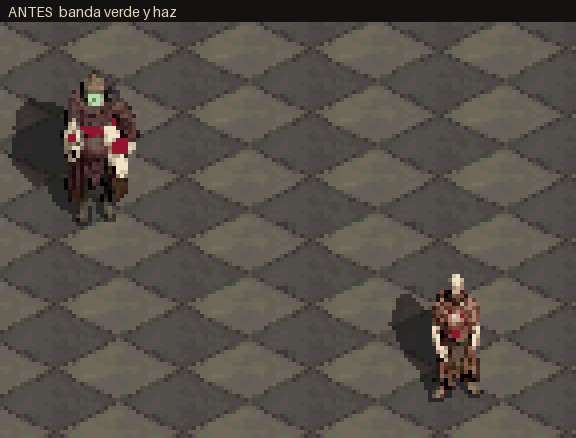
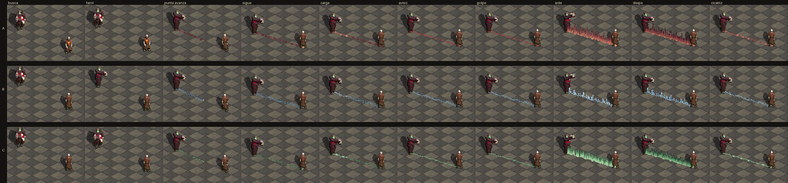
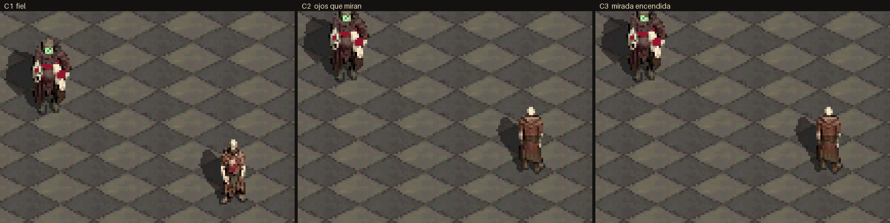
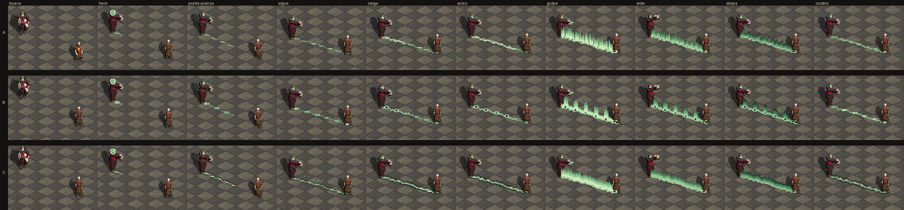
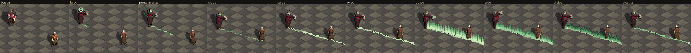
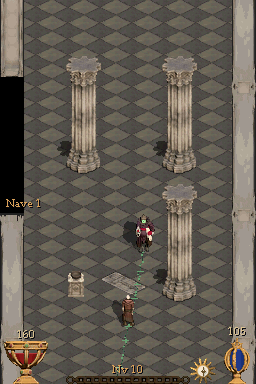

# El Ojo del Tribunal: sentencia escrita en el suelo (`feat/ojo-sentencia`, 2026-11-23)

## Qué cambia para el jugador

El Ojo ya no apunta con una banda verde ni dispara un haz de hielo por la boca. Escribe una **sentencia en el suelo** (variante «C1 Fiel»):

1. **Busca:** el farol titila tenue.
2. **Te ve (TRACK):** fogonazo con un anillo verde hueso alrededor del farol (~8 frames). Desde sus pies avanza una grieta verde hueso/fósforo con ojos de 7x3 (cerrados, como rendija) que llega a ti en ~14 frames y te sigue.
3. **Te fija (LOCK):** la grieta se congela y se prolonga hasta el primer muro o columna; el núcleo pasa a 2 px, una luz corre del Ojo a la punta abriendo cada ojo (la cuenta atrás) y en los últimos 10 frames pulsa.
4. **Sentencia:** toda la línea estalla a la vez en llamas espectrales verdes con motas (golpe 3 frames, arde ~20, disipa ~8). La cabeza de la mano abre la boca con un destello y no dispara nada. El daño es esa franja de suelo: de los pies del Ojo al muro, ancho de golpe 8; la cobertura baja se comprueba desde los pies.
5. Queda una cicatriz que se apaga en ~1 s.

Columnas y estatuas siguen cortando la línea de visión. Tiempos y estados sin cambios (TRACK 40, LOCK 20, SENTENCE 31, COOLDOWN 90).

Código: `source/enemy_laser.c` (reescrito), `source/enemy_ai.c` (origen y línea de daño desde los pies), `include/enemy_laser.h`. Sala de prueba solo ARPG: variante `arpg-ojo` (`source/ojo_test.c`, `scenarios/arpg_ojo_comprobacion.json`).

## Las dos rondas A/B/C

- **Ronda 1:** Lacre / Escarcha / Fósforo. Ronda completa (HTML publicado, 10 MB, no versionado): <https://claude.ai/artifact/CvKdor48Etqs82AeqxHXq7>
- **Ronda 2:** C1 Fiel / C2 Ojos que miran / C3 Mirada encendida. **Elegida C1.**

Antes (comportamiento anterior):

Ronda 1:

Ronda 2 (C):

Hoja final de C1 capturada de la ROM:

Sala de prueba `arpg-ojo`:

## Verificación

- Builds por defecto y `perf`: 0 avisos.
- `test_guardrails`: PASS.
- Hoja de C1 capturada de la ROM real (arriba).

## Pendiente

- **Medición `perf` en la DS: sin hacer.** El rendimiento de la sentencia no está certificado (regla 6 de `AGENTS.md`); se aprobó mergear sin ella.
- Probar la sala `arpg-ojo` en la DS.
- Los escenarios con tag `ojo-tribunal` ya fallaban antes de este cambio por aserciones desfasadas (vida en escala 100, estados); no se han reparado.

## MDs tocados

`DESIGN.md` §6.10 y menciones sueltas (la historia retirada, en `DESIGN-ARCHIVE.md`), `TECHNICAL.md` (render y variante `arpg-ojo`), `STATUS.md`, `STATUS-ARPG.md`, `STATUS-ARCHIVE.md`.
