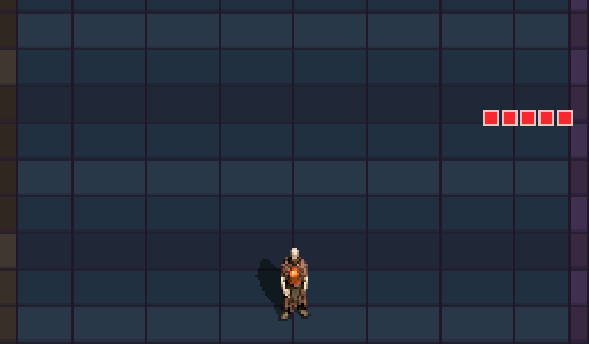
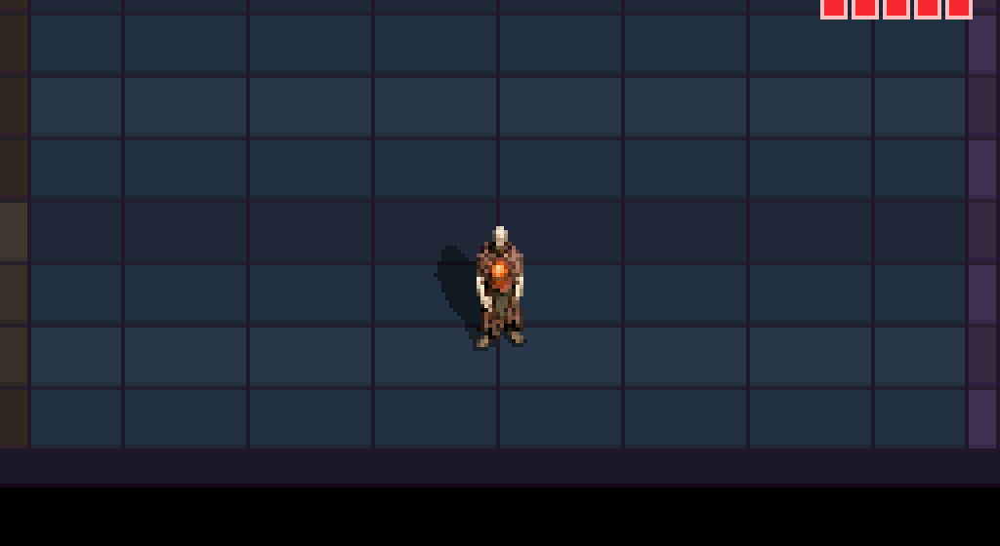
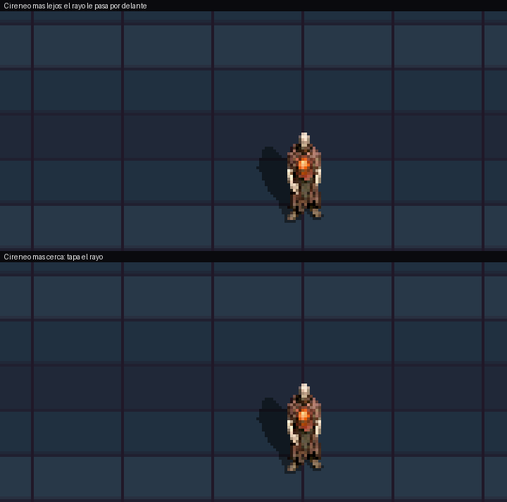

# Ojo del Tribunal: mirada colimada y llamarada espectral

**Rama:** `feat/ojo-tribunal`  
**Fecha:** 2026-11-14  
**Diseño:** [`DESIGN.md` §6.10](../../DESIGN.md) («Mirada colimada», «Efectos desaturados en todos los personajes»)

## Cambios

- **Modelo y escala:** cuerpo bajo y gordo al 140 % (sprite 56×56), cabeza abierta en la mano al 150 % de la anterior. Re-renderizado con el pre-render **C2** desde el manifiesto único `assets/sprites/characters/characters.json` (entradas `ojo`, `ojo_look`, `ojo_sentence`).
- **Mecánica:** se descarta el cono de suelo con cuenta compartida (poco legible) y se recupera el ritmo del francotirador anterior.
  - Buscar: sin efectos, el farol no emite luz.
  - Seguir, 40 frames: mirada tramada y verde apagada desde el farol, que se estrecha mientras sigue al héroe.
  - Fijar, 20 frames: la línea queda quieta y parpadea al final.
  - Sentencia: disparo desde la boca.
- **Disparo «llamarada espectral»:** dura 31 frames.
  - Fases: golpe (3), llamarada (20) y disipación (8).
  - Forma: núcleo recto sobre la línea de daño, bordes de llama irregulares y volutas.
  - Color: hielo espectral desaturado. **Verde = te apuntan, hielo = te disparan** (mockup de elección: `assets/mockup_color_disparo.png`).
  - Daño: durante golpe y llamarada, como mucho 1 golpe gracias a los i-frames.
  - Muros y columnas cortan la mirada y el disparo.
- **Oclusión real con personajes:** mirada y disparo se pintan por tramos según la profundidad del suelo, intercalados con los personajes. Un personaje más cercano tapa el rayo y uno más lejano queda detrás.
- **Regla de saturación** reforzada en `AGENTS.md` (flujo de VFX) para todos los efectos.

## Evidencia (ROM real, DeSmuME, 4× vecino más próximo, velocidad real)

Ciclo completo (busca, ficha, se colima, fija y dispara) y esquiva saliendo de la línea durante el fijado:

Oclusión con un Cireneo quieto. Arriba está más lejos y el rayo le pasa por delante; abajo está más cerca y tapa el rayo:

Descartados en esta sesión: cono de luz en el suelo con cuenta compartida (`assets/ojo_final_4x.gif`, `assets/ab_*`), disparo fino verde (`assets/gif_mirada_colimada_*_antes.gif`) y disparo ámbar o violeta (mockup).

## Verificación

- Compilación `default`, `sandbox`, `playground-perf` y `perf`: 0 warnings.
- Tests de host: 16/16 PASS (`test_shooter_contract` con 26 contratos: fases, ventana de daño, paleta desaturada, sin `float`, bucles acotados, orden de pintado).
- Escenarios: 9/9 `enemy_ojo_*` PASS. Cubren alcance al héroe quieto, ciclo completo, esquiva, columna que corta la mirada, columna que salva del disparo, Ojo muerto antes de disparar, héroe que entra en la llamarada y rayo por delante y por detrás de otro personaje.
- DS: ROM `perf` subida y jugada por el usuario, que la dio por buena. **No se descargó el registro de rendimiento** (FTP cerrado al terminar), así que no hay cifras medidas.
