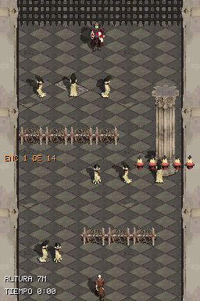
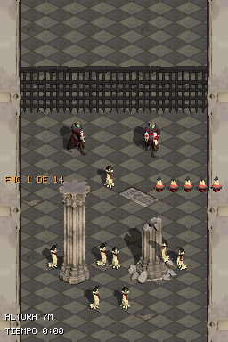
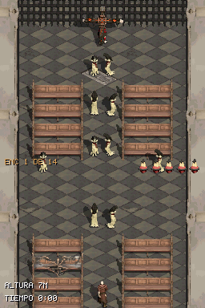
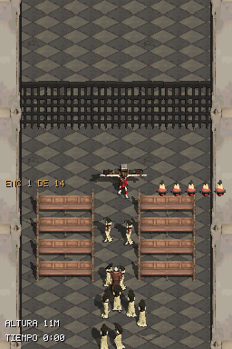

# Walkthrough — Piezas 3D de las salas, rastrillo OBJ y lápidas (`feat/props-catedral-v2`)

**Fecha:** 2026-11-17  
**Rama:** `feat/props-catedral-v2`  
**Diseño:** `DESIGN.md` §6.13.6 («Piezas 3D de las salas»)

## Qué se ha hecho

1. **Piezas 3D integradas en las salas y pasillos:**
   - **Sacos** (`sacos`, `sacos_b`, `sacos_remate`, `sacos_remate_der`) con tono oscurecido en `tools/props/prerender_props.py`.
   - **Alambre de espino** (`alambre`) re-renderizado a mitad de tamaño (**32×24 px**) con el doble de tramos (4 por línea) y colisión exacta de **128 px**.
   - **Columna rota** (`columna`) y **banco roto** (`banco_grupo4_roto`, 1 de cada 4 grupos en fila 0).
   - **Relicario nuevo** y **estatuas orientadas al centro** (`santo` a la izquierda y `santo_der` a la derecha, ambas mirando hacia el eje de la nave con sombra hacia la izquierda).
2. **Rastrillo en sprites hardware (OBJ):**
   - `tools/props/bake_verja_obj.py` genera `include/verja_gfx.h` y `source/verja_gfx.c` (paleta de 15 colores + transparente, 104×56 px).
   - `source/hwshadow.c` reserva 128 tiles al inicio del pool OBJ (`hwshadow_add_verja`) para dibujar ambos rastrillos (delantero y trasero) sin ocupar tiles del kit de fondo.
   - Al limpiar cada sala, la reja delantera sube despacio (56 frames a 1 px/frame, recortada por el borde superior) y abre el paso al terminar. Al despertar la sala, la reja trasera baja rápido detrás del héroe (prioridad delante de los actores para ocluirlo correctamente) sustituyendo a la franja roja.
3. **Recuperación de lápidas y simetría izquierda/derecha:**
   - Al sacar `verja` del kit, reducir `alambre` y añadir fusión de tiles casi idénticos (umbral 2,5, corrigiendo el empaquetado interno de flips >1024), el kit vuelve a incluir las 4 variantes de lápidas en **948 / 1024 tiles** (peor ventana **279 / <440**).
   - Parejas simétricas (`procesion`, `pinza`, `balcon`, `claro`, `alambrada`) colocadas por el cuerpo del arte (`x_der = 208 - x_izq - ancho_cuerpo`).

## Verificación

- **Build:** `default` y `encuentros` PASS sin avisos nuevos.
- **Tests de host:** `test_cathedral_kit.py`, `test_strip_layout_parity.py`, `test_guardrails.py`, `test_navfield.py` PASS.
- **Escenarios (`props_*`):** `props_alambrada`, `props_balcon`, `props_procesion`, `props_barrera`, `props_embudo` PASS.
- **Validado en Nintendo DS física** por el usuario (visual y jugabilidad).

## Evidencia

| Alambrada (32×24) | Balcón (columna rota y simetría) |
| :---: | :---: |
|  |  |

| Procesión (bancos y banco roto) | Rastrillo en sprites OBJ |
| :---: | :---: |
|  |  |
