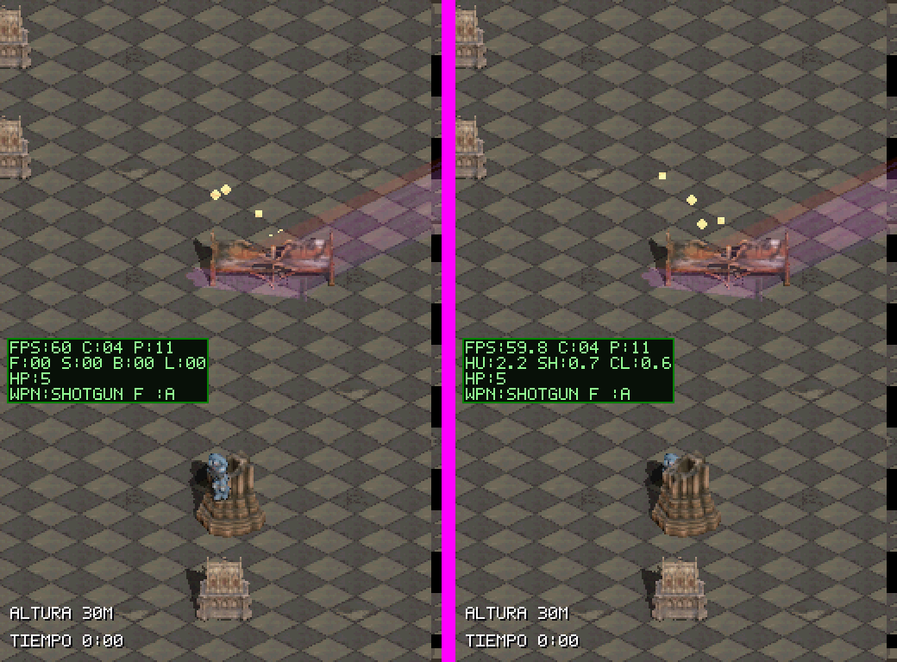
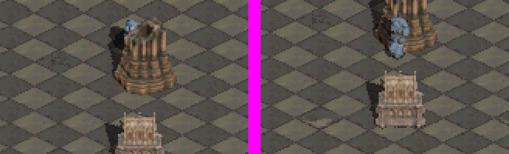
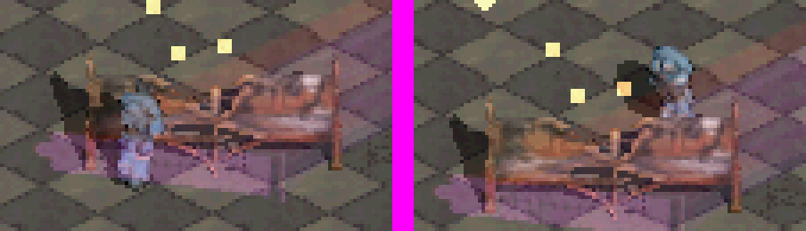

# Oclusión de props y huella de los bancos

**Fecha:** 2026-11-10
**Rama:** `feat/muros-catedral`
**Estado:** cerrado. Validado en DeSmuME, dado por bueno por el usuario en la DS y medido con `PERF_PROFILE`.

## Causa

El escenario monolítico funcionaba porque `occlusion_depth.png` salía del lab a escala 1:1 con el mapa: cada valor ya era la Y de mundo del suelo bajo la superficie (`TECHNICAL.md` §3.3).

Los props reutilizan ese mismo canal, pero `tools/props/prerender_props.py` recorta el render del lab y lo reduce (×0,04–0,14) con `NEAREST`. Eso escala la **imagen**, no los **valores**, que seguían en píxeles del render fuente, entre 7 y 23 veces más grandes según la pieza. El baker restaba una línea base y usaba esos números como píxeles de mundo. En la columna, el capitel quedaba con unos −150 px en vez de −16 px (no tapaba al actor de detrás) y parte de la base con valores positivos de más (podía tapar al de delante).

Comprobación con los renders crudos del lab en caché (idénticos byte a byte a los assets): una vez convertidos a píxeles del sprite, los valores caen sobre la huella de cada pieza (columna 40–56 frente a la huella 36–55; santo 58–72 frente a 56–71).

## Cambio

- `prerender_props.py` convierte la profundidad a la Y local del sprite (`(v − y0) · escala + oy`), anota `"depth_units": "sprite_px"` en `meta.json` y conserva las claves que añade `prop_shadows.py`.
- Regenerados con `--skip-lab` los seis props físicos (columna, santo, relicario, vela, banco_roto, banco_volcado): solo cambian `depth.png` y `meta.json`.
- `bake_cathedral_kit.py` usa la profundidad tal cual, relativa a `foot_anchor_y_px`, sin heurística de línea base. Rechaza un `depth.png` cuyos valores se salgan del sprite.
- `source/strip_kit.c` rehorneado: solo cambian las runs de profundidad. Los deltas quedan en −21…+1 px y las runs de la peor ventana bajan de 14.838 a 4.117, lo que también abarata el recorte.
- `tests/test_cathedral_kit_contract.py` exige que la profundidad de cada prop caiga dentro del sprite y sobre su huella.
- `scenarios/cathedral_props_depth_collision.json` añade la aproximación por el sur. El primer intento colocaba al marine en Y=584, por debajo del umbral de rebase (768), y caía en otro tramo del mapa. Ahora arranca en Y=1100, en el mismo marco que la columna.

## Evidencia de la ROM

Antes (izquierda) y después (derecha), con el marine detrás de la columna:

Detrás y delante de la misma columna, 4× NEAREST:

## Verificación

- `build-project.ps1 -Variant cathedral-playground-perf`: PASS, 0 warnings.
- Tests de host declarados: 9 PASS. `test_cathedral_kit.py` y `test_strip.py` (no declarados): OK. `test_strip_kit.py` (no declarado) ya fallaba antes de este cambio: espera el periodo de mapa antiguo (1.024 entradas frente a 8.192).
- `cathedral_props_depth_collision`: PASS. Bloqueado por el norte en Y=1056 y por el sur en Y=1083.
- `cathedral_playground_respawn`: PASS.

## Huella de los bancos

El `collision.png` del lab solo marca la geometría entre 0,30 y 1,20 m. En los bancos casi todo el asiento queda por debajo: `banco_roto` bloqueaba una tira de 28×4 px y `banco_volcado` salía vacío, así que el baker lo convertía en un rectángulo completo, aire incluido.

Lo implementó un subagente (Sonnet) y yo lo verifiqué:

- `prerender_props.py` admite `"footprint_from": "depth"` en `tools/props/props.json`, activo en los dos bancos. La planta se construye a resolución cruda, a partir de dos fuentes:
  - superficies oclusoras: su X con la Y de suelo que guarda la profundidad;
  - píxeles bajos de la silueta: se proyectan hacia abajo.

  Después se cierra con un filtro morfológico, se rellena la envolvente convexa (la planta de un banco es convexa y el borde delantero va de pata a pata) y se reduce por área.
- La primera versión, sin envolvente, dejaba un hueco bajo el asiento: el marine entraba entre las patas delanteras y quedaba dibujado dentro del banco. La envolvente lo cierra.
- `bake_cathedral_kit.py` falla si un prop físico llega sin huella; ya no la rellena con un rectángulo.
- El test de contrato exige que cada banco tenga una huella de al menos tres filas, el 40 % del ancho del sprite y una fila delantera continua.
- `scenarios/cathedral_bench_collision.json` choca contra un `banco_roto` real (esquina superior izquierda en (320, 896) tras el rebase). Entra por x=350, que la tira antigua dejaba libre:
  - por el sur se detiene en Y=939, delante del banco y dibujado delante;
  - por el norte se detiene en Y=912, con el respaldo tapándole las piernas.

  Este escenario no se ha ejecutado contra la ROM anterior; que la tira antigua dejaba pasar por x=350 se deduce de la geometría.

En la captura del sur, el tinte morado es el haz de luz, que se pinta encima de todo. La profundidad del banco (Y 916–925) no puede ocultar unos pies en Y=939.

Verificación final: build `cathedral-playground-perf` PASS con 0 warnings, 9 tests de host PASS. Escenarios PASS: `cathedral_bench_collision`, `cathedral_props_depth_collision` y `cathedral_playground_respawn`.

## Pendiente

- `banco_volcado` no tiene escenario propio: su huella nueva puede quedar algo generosa por el sur.
- Las lápidas planas conservan su `depth.png` antiguo; no lo usan, porque no ocluyen.
- Lo ideal sería que el lab exportara la profundidad también por debajo de 0,25 m. Requiere los `.glb` de los props, que no están en el repo.

## Medición en la DS (regla 6)

Log `/dungeonds_perf.log`, última sesión de arranque de `cathedral-playground-perf`: 40.440 frames (≈11 min).

- **CPU:** media de 116.277 ticks y máximo de 396.970, frente a un presupuesto de 560.190.
- **Frames de más de un vblank:** 363, como máximo uno por ventana de 60 frames. Coinciden con la escritura del propio log en la SD: `sdw_ticks` 1,0–1,6 M, unos 30–47 ms por escritura. Sin el registrador no hay caídas.
- **Contador `occ`:** marca 0 porque esta build no lo alimenta. El coste de la oclusión está dentro de `blit` y `sh`, con máximos de 70.434 y 198.451 ticks.
