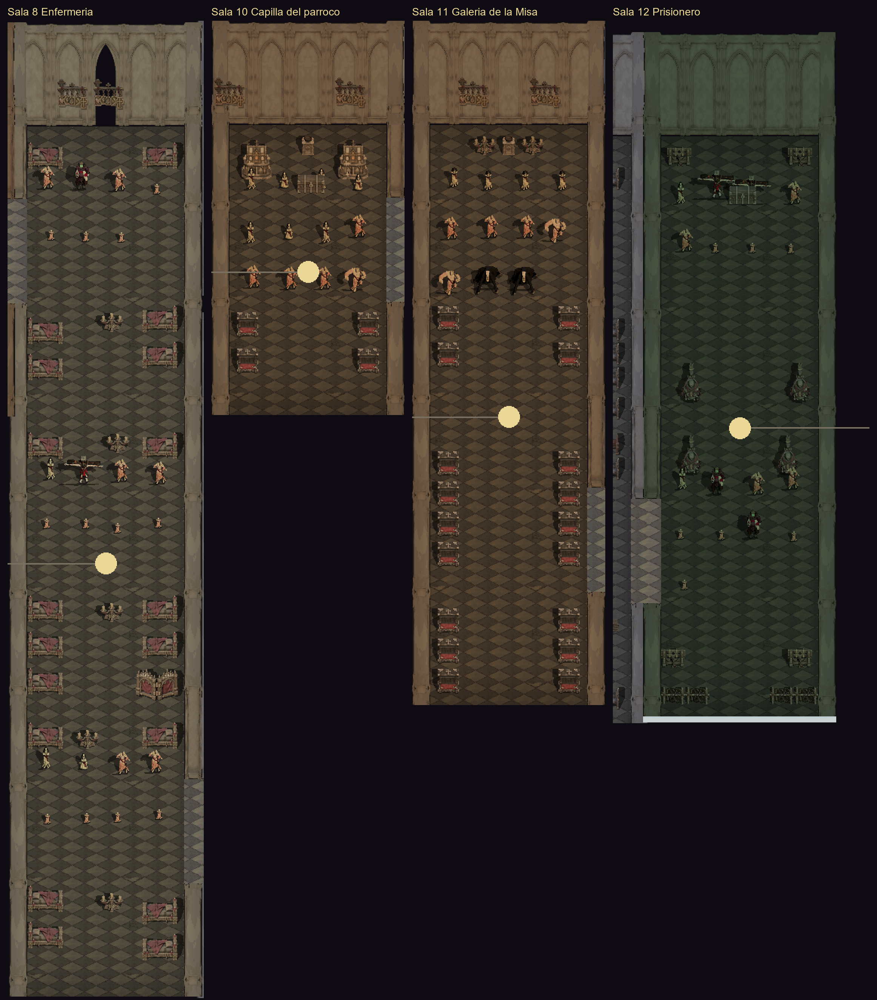
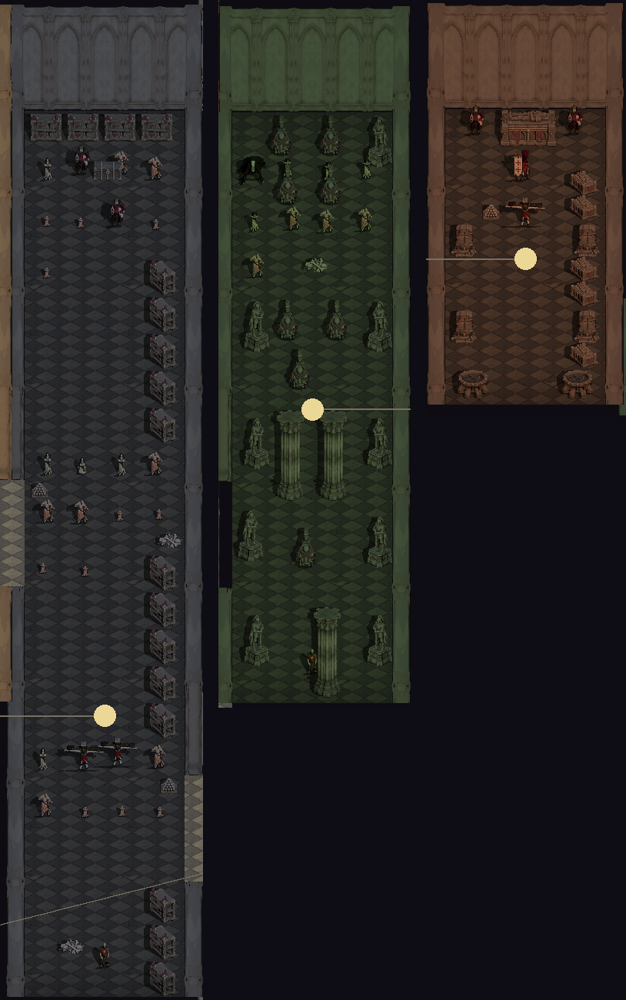

# Escala de props del mapa ARPG

Los props que usan los enemigos pasan a una escala creíble (héroe 31 px = 2 m); los exvotos se cuelgan de la pared.

- Reclinatorio 28 px (recoloreado: madera oscura, cruz plateada, cojín carmesí), catre 48, palangana 24, cepo 32.
- Exvotos a 40 px colgados en la pared del fondo (mecanismo `COLGADOS` en `tools/poster/poster_arpg_v3.py`, sombra de 2 px).
- Osario (salas 9, 14, 15): calaveras 21, huesos 34, estante 40; sala 9 con 4 estantes cada 48 px.
- Paleta compartida: +4 rojos apagados (171 → 175 de 256).

## Evidencia

Rondas A/B/C descartadas o elegidas durante la sesión: [`assets/abc/`](assets/abc/).

## Verificación

test_guardrails, test_strip_kit y test_cathedral_kit_contract PASS; la ROM compila sin avisos nuevos.

## Pendiente

- El altar sigue a 16 px (a 28 px el horneado del kit falla: «color.png does not fit in shadow canvas»).
- `osario_lado` (33 px, misma malla que el estante) sin revisar.
- `place()` de `tools/poster/poster_acto1.py` descarta en silencio las piezas solapadas.
- `test_cathedral_kit` falla en 2 casos (IDs de puerta y de pieza del baker), anteriores a esta entrega.
- `walkthroughs/poster-mapa/assets/salas/15_cripta.png` sin actualizar.

## MDs

`DESIGN-ARPG.md` (escala de props), `TECHNICAL.md` §5 (paleta, altar, colocador), `assets/MANIFEST.md` (recolor), `STATUS-ARPG.md`.
