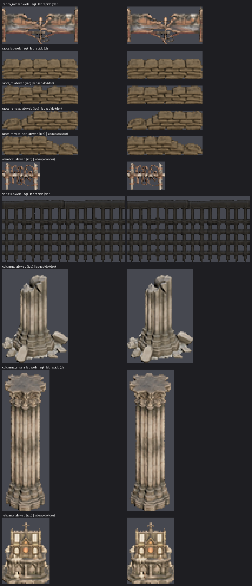
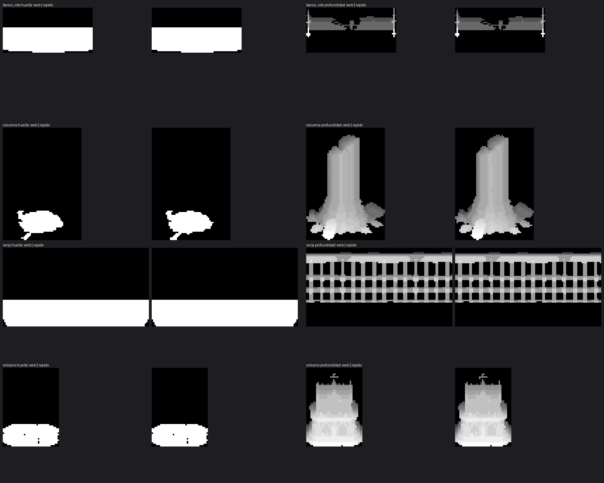
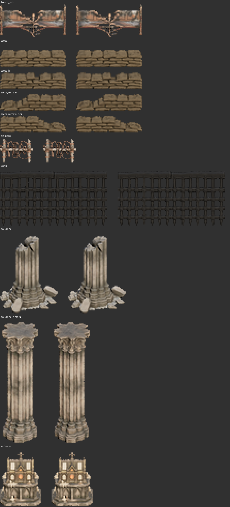
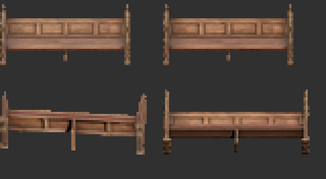
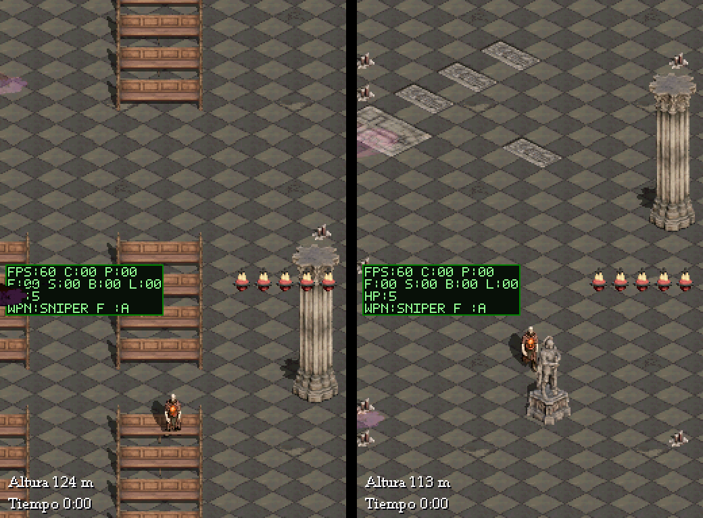

# Props por el lab rápido

Los props de la catedral (GLB) se renderizan ahora con `tools/lab/fast/export_prop_fast.cjs`, sin navegador y unas 14 veces más rápido que el lab web. `prerender_props.py` lo usa por defecto (`DS_FAST_RENDER=0` vuelve al lento).

## Qué cambia
- 15 piezas con GLB regeneradas: las 10 antiguas más santo, santo_der (geometría espejada, luz correcta), vela, banco_entero y banco_volcado.
- `banco_volcado` sale de `banco_entero.fbx` (pitch -50, yaw 135); pose nueva aceptada por el usuario.
- Paleta (`palette.json`, `swatches.png`) y `source/strip_kit.c` rehechos.
- Las 8 lápidas `_h/_v` siguen sin GLB (no están en el juego).

## Evidencia

## Verificación
Build sin avisos nuevos; host tests `*cathedral_kit*`, `*guardrails*`, `*strip_kit*`, `*strip_layout*` PASS; escenario de captura `scenarios/props_lab_rapido_captura.json` (evidencia). Sin medición en la DS por decisión del usuario (cambio de herramienta).

## MDs
`TECHNICAL.md` §3, `AGENTS.md` regla 12, `assets/MANIFEST.md`, `STATUS.md`, `STATUS-ARCHIVE.md`.
