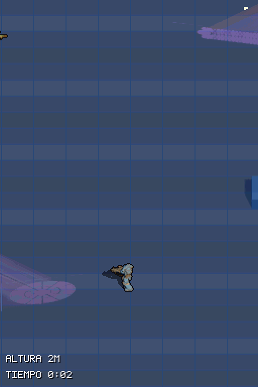
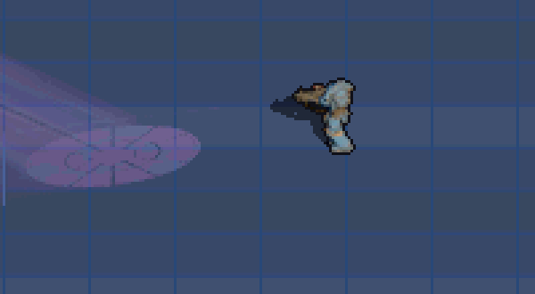
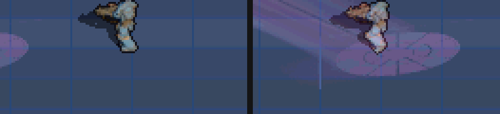
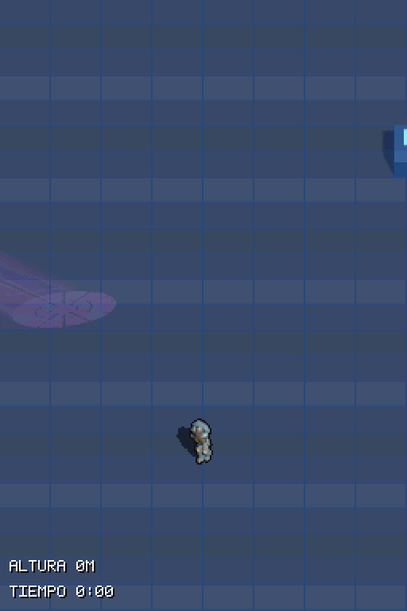
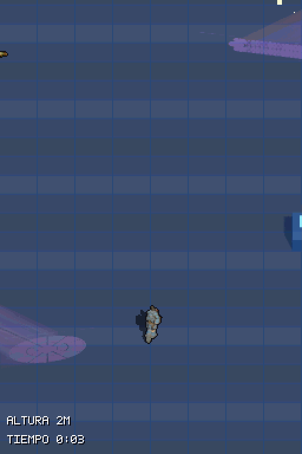
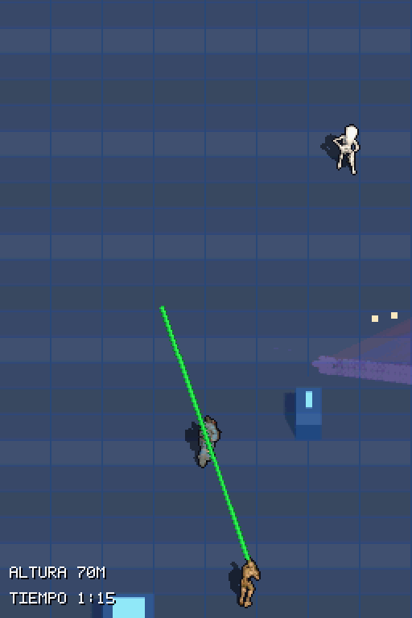
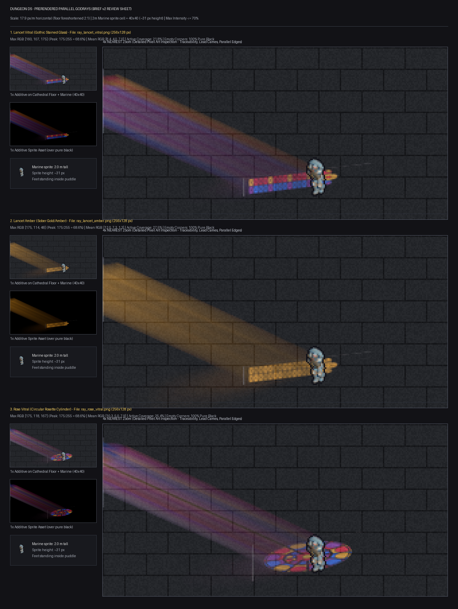
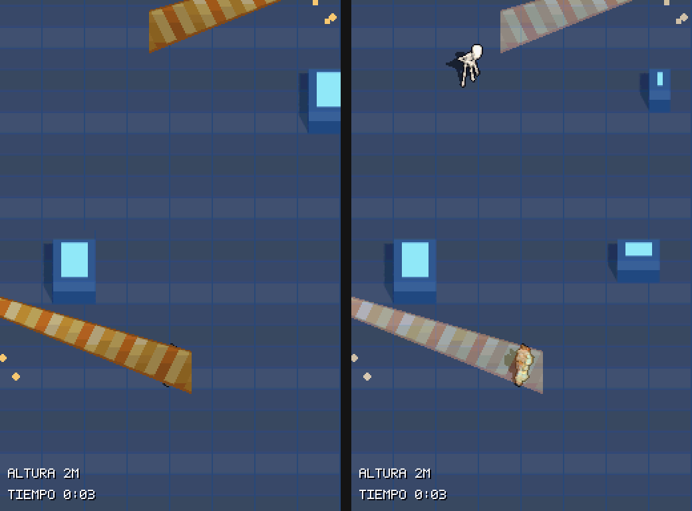

# Prototipo: haces de luz de vidriera (god rays) en la DS

- Fecha: 2026-11-08. Rama `proto/godrays` (worktree `.worktrees/proto-godrays`). **Prototipo: no se fusiona a `main`.** Nada commiteado.
- Para qué: comprobar si la DS puede mostrar haces de luz prerenderizados, translúcidos y que tiñan a los personajes, como pieza central de la catedral (`DESIGN.md` §6.9.1b en `feat/v032-escenario`; biblia en `walkthroughs/v032-escenario/BIBLIA.md` de esa rama).
- Evidencia: **todo son capturas de la ROM real en el emulador DeSmuME**. Todavía no se ha visto en la consola ni se ha medido el rendimiento en ella (regla 6).

## Qué mirar

1. **El marine se tiñe al entrar en el haz** y recupera su color al salir, sin coste de CPU por píxel.
2. **Los rayos son paralelos**: el haz no se ensancha. En el suelo se proyecta una copia del rosetón con su tracería.
3. Si el nivel de intensidad, el tamaño y la dirección de los haces sirven para la catedral.

## Resultado en la ROM

**Cruce del haz** (ambas pantallas, 2x): el marine camina hacia la izquierda, entra en el haz del rosetón, se para dentro y sale.



**El mismo cruce a 3x**, centrado en el marine:



**Fuera frente a dentro** (4x): a la izquierda, el marine con sus colores; a la derecha, dentro del haz, teñido de violeta y rosa, de pie sobre la proyección del rosetón.



**Haces fijos al mundo:** se repiten cada 256 px de altura, alternando el muro izquierdo y el derecho (el derecho es el mismo gráfico espejado por hardware). Siguen en su sitio tras subir 70 m con varios rebases de la franja:

| Inicio | Cruce | Tras 70 m |
|---|---|---|
|  |  |  |

## El arte: Blender con rayos paralelos

Flash (Gemini 3.8, esfuerzo alto) lo renderizó en Blender (Cycles):
- Luz *Sun* con ángulo 0, que da rayos paralelos.
- Vidriera como vidrio transparente coloreado.
- Volumen de niebla.
- Luz aislada restando dos renders (sol encendido menos sol apagado).

Variantes: lanceta de colores, lanceta ámbar y rosetón. En la ROM van el **rosetón** y la **lanceta de colores**.



Scripts: `tools/godrays_art/` (`python tools/godrays_art/build_all.py`). Diario: `assets/sprites/godrays/NOTES.md`.

## Cómo funciona en la DS

- Cada haz es un PNG de luz aditiva sobre negro (máximo 256×128). `tools/godrays/convert_rays.py` lo cuantiza a 15 colores en 4 bpp, lo corta en sprites de hardware de 16×16, descarta los vacíos y escribe `source/godrays_gfx.c`.
- Memoria: rosetón, 48 piezas (6 KiB); lanceta, 40 piezas (5 KiB). Total con el polvo: 11,1 KiB de los 16 KiB del banco de sprites de la pantalla superior (banco I). La de abajo usa el banco E (64 KiB).
- `source/godrays.c` usa sprites semitransparentes. El chip de vídeo suma la luz al suelo y al bitmap de los actores con `BLDALPHA` (EVA 12-16 y EVB 16, es decir, suma). La intensidad respira en un ciclo de unos 2 s cambiando un solo registro. Las motas de polvo son sprites de 8×8 con deriva.
- Variante de compilación `godrays` (define `GODRAYS_PROTO`). En ella la marea está desactivada, porque usa el mismo bloque de registros de fusión. Si la marea fuera visible, los haces de esa pantalla se ocultan para que nunca se vean opacos.

## Incidencias y lo que se aprendió

1. **Haz opaco en la primera versión.** El código desplazaba dos veces los bits de "segunda diana" de `REG_BLDCNT` y quedaban fuera del registro (`0x50` leído en el emulador con una sonda de memoria). Sin segunda diana, el hardware dibuja el sprite opaco. Corregido: izquierda antes, derecha después.

   

2. **Muy tenue** con EVA 6-10: el haz se perdía sobre el suelo. Se subió a 12-16.
3. **El primer arte eran conos** (un foco). Tras tu comentario se rehízo con luz paralela: un prisma con la sección de la ventana y una copia proyectada en el suelo.
4. **No cabían tres haces** en el banco de sprites de arriba con piezas de 64×64 (12 KiB cada uno). Con piezas de 16×16 caben dos; con tres harían falta unos 17,7 KiB.
5. Comportamiento de los agentes:
   - Luna (motor, sin poder compilar en su sandbox) entregó un código casi correcto, salvo el bug del registro.
   - Flash, en su primer intento, pasó 25 min con focos cónicos sin nada usable y se paró. Con un brief con receta física concreta acertó en unos 40 min.

## Defectos conocidos

- **Línea vertical espuria** de luz bajo cada haz (fuga en el render de Blender).
- La mancha de la lanceta sale muy achatada (parece una barra) y la tracería se pierde a 15 colores.
- El polvo apenas se ve: son puntos sueltos.
- El haz se corta en el borde izquierdo de la pantalla porque la ventana queda fuera de cámara. En la catedral, con muros de 48 px, el arranque del haz quedaría junto al muro.
- Suelo neón azul provisional: sobre losas oscuras el efecto debería lucir más, pero eso no se ha probado.
- Sin medición en la DS. El coste esperado de CPU es mínimo (recorrer como mucho 128 entradas de OAM por pantalla y frame), pero no está medido.
- La convivencia con la marea queda sin resolver (en esta variante, la marea está apagada).

## Verificación

- Build `godrays`: PASS, 0 warnings nuevos. Build normal: PASS, 0 warnings.
- Escenarios: `godrays_demo` PASS, `godrays_gif` PASS (geometría comprobada en las capturas: el marine pisa la mancha del rosetón en los fotogramas 20-69), `strip_climb_smoke` PASS, `strip_horde_tide` PASS.
- Pendiente: probarlo en la consola (variante `godrays`, `dungeonds-godrays.nds`) y medir con `PERF_PROFILE`.

## Para reproducir

```powershell
python tools/godrays/convert_rays.py assets/sprites/godrays/ray_rose_vitral.png assets/sprites/godrays/ray_lancet_vitral.png -o source/godrays_gfx.c
C:\codexlocal\skills\agentic-ds-dev\scripts\build-project.ps1 -ProjectPath <worktree> -Variant godrays
C:\codexlocal\skills\agentic-ds-dev\scripts\run-scenario.ps1 -ScenarioPath scenarios/godrays_gif.json -ProjectPath <worktree> -RomPath <worktree>\dungeonds-godrays.nds
```
