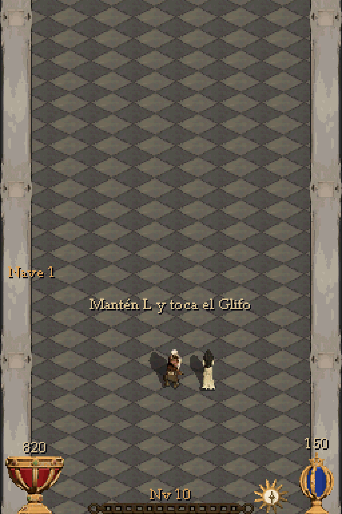
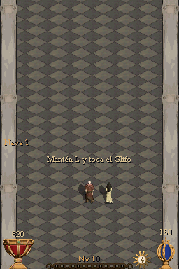
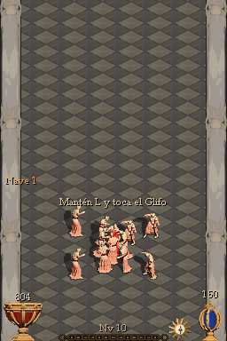

# Puñetazo: objetivo igual andando que parado

**Rama:** `fix/punch-target` -> `proto/arpg` (2026-11-25).

## Qué cambia para el jugador
El puñetazo elige siempre al enemigo más cercano dentro de su alcance, en cualquier dirección, tanto parado como andando. Se quitó el cono frontal de ±45° al andar, que hacía fallar golpes con enemigos en diagonal. Probado en la DS: «se siente perfecto».

La invulnerabilidad del remate no cambia a propósito: se encadenan ejecuciones y los enemigos fáciles se compensan con la composición de oleadas.

## Herramienta de prueba
Variante `arpg-boxeo-mele`: 12 monaguillos que persiguen al héroe y reaparecen, para probar el cuerpo a cuerpo (documentada en `TECHNICAL.md` §5.3).

## Evidencia

## Verificación
Compilación sin avisos (`arpg-boxeo`, por defecto, `arpg-boxeo-mele`). Escenarios `punch_diagonal` (suite), `arpg_boxeo` y `punch_andando` PASS; `arpg_boxeo_mele` es evidencia (`suite: false`). Host tests no necesarios. Sin `perf`.

## MDs
`DESIGN-ARPG.md` (regla del puñetazo y del remate), `TECHNICAL.md` §5.3, `STATUS-ARPG.md` (la entrega más vieja pasa a `STATUS-ARCHIVE.md`), `walkthroughs/README.md`.
