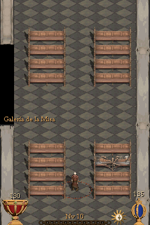
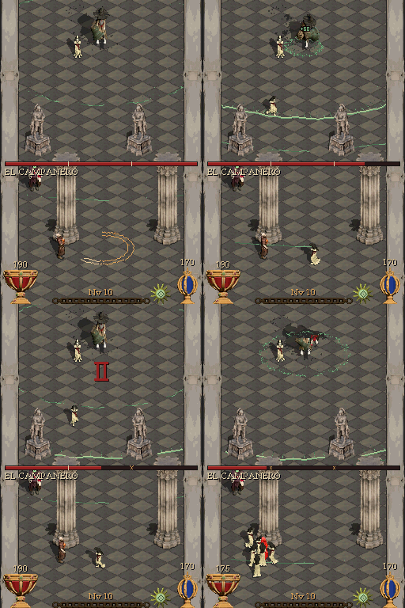
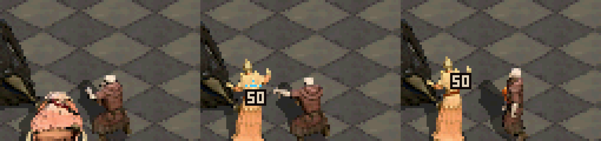
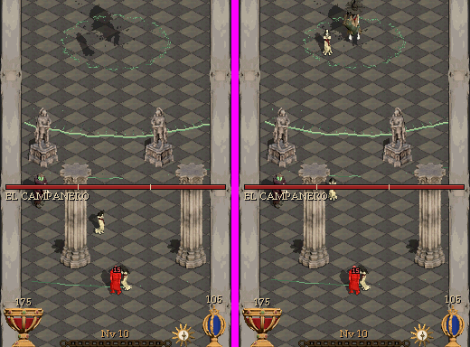

# Depósito de sala: reparto RAM / cartucho (ARPG)

Rama `perf/ram-por-sala` (2026-11-23), integrada en `proto/arpg`. Regla permanente en `TECHNICAL.md` §3.3.1 y `AGENTS.md` regla 3a.

## Qué cambia
- **Antes:** todos los enemigos (≈1,9 MB) vivían en RAM siempre, usara la sala o no; por falta de sitio, el jefe Campanero, el Párroco y la Súper Monja se leían del cartucho fotograma a fotograma en pleno combate.
- **Ahora:** en RAM fija solo el héroe y la interfaz. Cada enemigo va en su paquete del cartucho (`nitrofiles/chars/`) y en la pantalla de carga se cargan a un depósito de 1,70 MB solo los que la sala puede sacar.
- **Sombras a 2 tonos (1 bpp):** todas las sombras eran «sombra o nada» guardadas con 16 tonos; ahora ocupan la cuarta parte con resultado idéntico (comparado píxel a píxel).
- **Campanero:** 1,57 MB → 1,12 MB. Entero en el depósito si cabe con su escolta; si no, lee del cartucho guardando los 8 fotogramas de su ciclo.
- **Compresión del cuerpo por animación:** programada y apagada (para animaciones raras cuando una sala no quepa; se activa solo tras medir en la DS).

## Cifras (`arpg-todo`)
| | Bytes |
|---|---|
| Salas de la zona 1 | 0,24 – 1,16 MB |
| Sala del Campanero (jefe + escolta) | 1,63 MB de 1,70 (margen 70 KB) |
| Todos los enemigos juntos | 2,41 MB (no caben a la vez; ya no hace falta) |
| Heap libre | igual o mayor que antes |

## Evidencia (ROM en el emulador)
Sala de la Súper Monja, cargada por sala:

Combate contra el Campanero con escolta (cuerpos y sombras):

Sombras de remate a 1 bpp en pantalla:

Fallo previo (ya estaba en la rama del Campanero): en algunas partidas, leyendo del cartucho, el jefe y la Monja salían sin cuerpo (izquierda); con el jefe en RAM, bien (derecha). Con los 8 huecos por ciclo, 0 de 30 capturas fallan; causa exacta sin identificar.

## Verificación
- Builds `arpg-todo`, `arpg-campanero` y `arpg-remates` con 0 avisos nuevos.
- Barrido de las 12 salas con `g_pool_misses` = 0; `arpg_campanero_escolta` y `remates_sala` con cuerpos y sombras.
- `test_guardrails` ampliado (clips de enemigo fuera del programa, máscaras 1 bpp), `test_blit_runs_contract`, `test_sprite_ground_anchor`, `test_sniper_hit_volume` PASS.

## Pendiente
- **Medir en la DS** (`perf`): 60 FPS en la sala de la Súper Monja y en la del Campanero, tiempo de carga entre salas y si el fallo del jefe sin cuerpo reaparece en la consola.
- Puñetazos del héroe aún se leen del cartucho; búferes dobles de `strip.c` (~370 KB) recuperables para el depósito.
- `main` sigue con los sprites residentes: portar cuando se toque.
