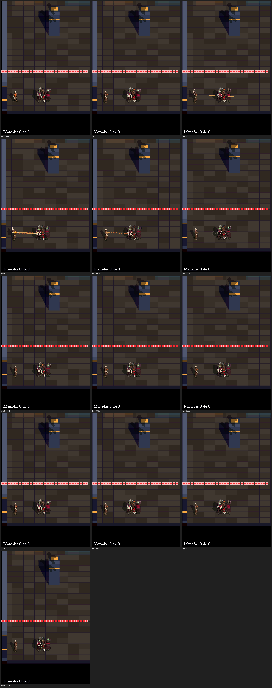
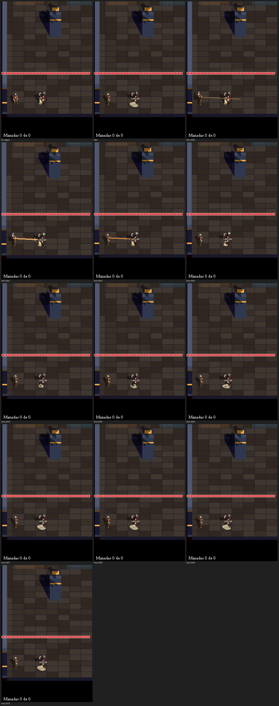

# El Rayo ya no daña en área (`fix/rayo-perfora`)

## Causa
Con enemigos pegados, sus zonas de impacto se solapaban y el Rayo dañaba a varios en el mismo paso, aunque el primero sobreviviera. Parecía daño en área. El diseño (`DESIGN.md` 6.12.2) dice que matar atraviesa y un superviviente lo para.

## Arreglo (`source/weapons.c`, `fire_sniper` + `sniper_touches()`)
- Sin la Lanza de Longinos, en cada paso del Rayo solo se daña al enemigo tocado más cercano al héroe.
- Matar sigue atravesando. La Lanza no cambia (atraviesa todo).
- El relicario del pasillo no se golpea si el rayo ya se paró en ese paso.

## Verificación
- Compila la variante por defecto, `encuentros` y sandbox sin warnings nuevos.
- `sniper_packed_row_stops_at_first` PASS: dos enemigos pegados, solo daña al primero.
  
- `sniper_packed_kill_pierces` PASS: el esqueleto muere y el rayo sigue hasta el Ojo pegado detrás.
  
- `enemy_sniper_row_skeleton_dies_in_one_shot` estaba roto de antes (offsets de `Enemy` a 112 bytes en vez de 124, carga 40 frames en vez de 70, daño del Rayo en sandbox 100 y no 150). Arreglado y PASS: esqueleto muerto, Ojo a 200, cargador detrás a 300.

Pendiente: no medido en la DS.

MDs: solo `STATUS-ARPG.md` (entrega); `DESIGN*.md` ya describía el Rayo así.
